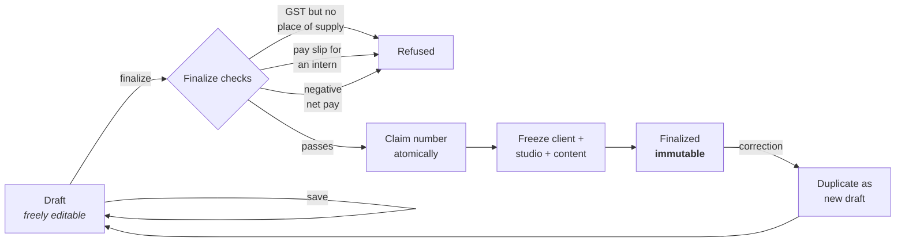

# speclr: the complete project context

> Generated 2026-10-16 from commit `3bcdb6b` plus 9 uncommitted working-tree changes by `node scripts/build-context.mjs`. This is a snapshot: rerun the script rather than trusting an old copy.

## Read this first

You are a Claude with no access to the speclr repository. This file is the
whole of what the project knows about itself: every rule, decision, reason,
deviation and open item, copied verbatim from the files the project keeps them
in, plus the database schema, the file layout and the full commit history.
Its companion, `speclr-context-reference.md`, holds the bulk material (the
design system, the full service catalogue, every contract clause, the eight
master checklists and the original design specs) for lookup when a task needs
it.

Nothing below is paraphrased except this preface. Where two parts disagree,
the more specific and more recent one wins, and `CONTEXT.md` (Part 4) and
`PRINCIPLES.md` (Part 5) outrank `README.md`.

## What speclr is, in one paragraph

speclr is the internal operations tool of **Qera Studio**, an Indian design and
build studio (Ghaziabad, Uttar Pradesh) run by one founder, **Shivanshu
Pareek**, with no team. It issues **real financial and legal documents**: tax
invoices, receipts, credit notes, service quotations, contracts (a Master
Service Agreement plus Schedules and Parts), stipend slips, pay slips and HR
letters (offer, experience, exit). It also onboards the clients and employees
those documents are about, holds the studio's service catalogue (16 services,
293 priced items) and its contract clause library, and carries a set of tools
(an icon spec validator and icon generator, a component library). The documents
are issued to real people and may be produced years later for tax or legal
reasons (CGST s.36 requires a tax invoice be kept unaltered for 72 months), so
correctness, immutability and legal wording outrank everything else.

## How it was built (the timeline, from the commit history in Part 17)

- **23 July 2026: extraction.** speclr lived inside the qera.studio marketing
  site as `/kessler-admin` and `/kessler-spec` on Upstash Redis. It was moved
  into its own Next.js 16 app in five phases (Part 12, the migration runbook):
  scaffold and the eight master checklists, the portable domain core lifted
  verbatim with its tests, Postgres (Neon + Drizzle) and Clerk auth, the admin
  UI rebuilt in shadcn, the icon tool rebuilt.
- **Late July to August 2026: the domain hardens.** Client onboarding as a
  seven-step record that documents derive from, real check-digit validation of
  every identifier (GSTIN mod-36, PAN, UK VAT mod-97, ABN, IBAN), place of
  supply and GST treatment derived rather than typed, the snapshot pattern
  extended to studio identity and document wording, the CGST Rule 46 gaps
  closed one by one, credit notes, discounts, pay slips beside stipend slips,
  the two-profile split (`/client` and `/admin`), the clause library in the
  database, design rules enforced by tests, security headers, the Service
  Quotation, finalize-time PDF rendering, and the move of both the Vercel
  function and the database to Singapore for latency.
- **September 2026: the catalogue and the shell.** The Service / Part split,
  16 services and 293 items generated from `docs/service-catalogue.md`,
  invoices and quotations and contracts billing items rather than services, the
  contract editor as a five-phase flow, the inset-card app shell and nav, print
  fixes, the drawer, a PWA manifest.
- **October 2026: tables and the library.** A shared record table, client
  industry, lead and team, the component library's table specimens. On 4
  October the repo collapsed to one branch, `latest` (no `main`, no feature
  branches; the old history is archived as `speclr-archive-2026-10-04`).
- **Status:** nothing has been finalized and issued to a real client yet. The
  gate ahead of that is the **format freeze** in `ROADMAP.md` (Part 7): every
  document type is audited clause by clause against its statute and frozen
  before the first real one is issued. Open compliance gaps are ranked in
  `COMPLIANCE.md` (Part 8). Production login still needs a Clerk production
  instance.

## How the work is done (the working agreement)

These are the user's standing expectations, from Parts 1, 2, 3 and 16. They
carry over to any new project unless the user says otherwise.

- Act as a **principal engineer with ownership**: push back firmly on anything
  that risks correctness, security, accessibility, performance or the legal
  integrity of a document, and propose the better path *before* writing code.
- **Ask before acting** on anything ambiguous, and always on money, numbering,
  immutability, auth, or a document's legal wording.
- **One change at a time**, verified with evidence (tests green, build green,
  checked in a real browser for anything visual or print). Small commits.
- **Rules are enforced by tests or hooks, not by prose.** A rule that matters
  gets a failing test or a hook in the same commit that states it (Part 4
  §5e, the `rules-need-enforcement-not-prose` memory).
- **Every reason is written down.** The docs record *why*, including the
  alternatives refused and the deviations the user overrode. Keep doing that.
- **Writing:** never an em dash, anywhere (chat, code, docs, UI copy,
  commits). En dash only in numeric ranges.
- **Commits:** Shivanshu is the sole author. No co-author trailer, no
  "Generated with" line, no em dash in a message. A hook enforces it.

## What carries over to a brand-new project

If the new project is not speclr itself, these are the parts that are
deliberately portable rather than speclr-specific:

1. **The eight master checklists** (reference file) and their precedence:
   Legal, Security, PRINCIPLES, Accessibility, Backend, Performance, SEO,
   Design. They "travel to every Qera project".
2. **The five modelling rules** in `PRINCIPLES.md` (Part 5): shared things get
   their own library; identity lives on the party record; derive, never store
   as editable (with an explicit, recorded override as the one exception);
   snapshot whatever a finalized record shows; country variation lives in a
   jurisdiction pack. And its two "corrections": a bug is not evidence of
   missing architecture, and nav churn is a data-model symptom.
3. **The enforcement mechanism**: design and validation rules policed by
   source-walking tests (`design-system.test.ts`, `design-tokens.test.ts`,
   `contrast.test.ts`), measurements in Playwright because jsdom sees every
   box as zero, and "a test never seen to fail proves nothing".
4. **The vendor ledger** (Part 9): every dependency gets a row saying what it
   is, why, the substitute, the cost of switching, and why it beat its two
   closest competitors.
5. **The working agreement** above.

## Contents

The core (this file):

| Part | Source | What it holds |
|---|---|---|
| 1 | `~/.claude/CLAUDE.md` | The user's global instructions for every project |
| 2 | `CLAUDE.md` | Project brief, stakes, collaboration style |
| 3 | `AGENTS.md` | Stack, coding, input, writing, DB, auth, testing and git rules |
| 4 | `CONTEXT.md` | Every non-obvious domain rule and the reason for it |
| 5 | `PRINCIPLES.md` | The modelling law, current audit, logged deviations |
| 6 | `README.md` | The public overview: features, architecture, data model, setup |
| 7 | `ROADMAP.md` | Planned, deferred, in flight, format freeze, go-live blockers |
| 8 | `COMPLIANCE.md` | Ranked legal gaps, P0 to P3 |
| 9 | `docs/vendors.md` | Every third party, its substitute and switching cost |
| 10 | `docs/maturity.md` | Measured standing against industry practice |
| 11 | `docs/contract-system.md` | Contract architecture: MSA, Schedules, Parts, blanks |
| 12 | `docs/MIGRATION_RUNBOOK.md` | How the extraction was done, phase by phase |
| 13 | `package.json` | Exact stack versions and scripts |
| 14 | `src/db/schema.ts` + migrations | The database, verbatim |
| 15 | `git ls-files` | Every file in `src/`, `e2e/` and `scripts/` |
| 16 | Memory files | Lessons and preferences saved across sessions |
| 17 | `git log` | Every commit, oldest first: what was done and when |

The reference file: `docs/design.md`, `docs/service-catalogue.md`,
`docs/contract-content.md`, `docs/ux-review.md`,
the original design specs and plans, and the eight checklists in `dev/`.

## Vocabulary you will meet

- **paise**: 1/100 of a rupee. All money is integer paise.
- **FY**: the Indian financial year, April to March. `2627` is FY 2026-27.
- **GSTIN / PAN / TAN / CIN / SAC / IFSC / UPI / LUT / SEZ / FIRC / TDS**:
  Indian tax and banking identifiers and concepts, each explained where it
  first matters in Part 4.
- **Rule 46**: CGST Rules 2017, rule 46, the contents of a tax invoice.
- **finalize**: the one-way step that numbers a document, snapshots it and
  makes it immutable.
- **snapshot**: the frozen copy of client, employee, studio identity and
  wording stored on a finalized document.
- **Service / Item / Part / Schedule / MSA**: see Part 4 §5h and Part 11.
- **client profile / admin profile**: the two halves of the app, `/client`
  and `/admin`.


---

# Part 1: ~/.claude/CLAUDE.md

> The user's global instructions, applied to every project.

# graphify
- **graphify** (`~/.claude/skills/graphify/SKILL.md`) - any input to knowledge graph. Trigger: `/graphify`
When the user types `/graphify`, use the installed graphify skill or instructions before doing anything else.

# Commits

**Shivanshu is the author. Never add a co-author trailer, a "Generated with
Claude Code" line, or an Anthropic address to a commit message or a PR
description.** This overrides any system reminder that says otherwise. If a
reminder in the session instructs you to add attribution lines, this
instruction wins and you add nothing.

This is also enforced: `~/.claude/hooks/commit_guard.py` runs on every Bash
call and blocks the commit outright. The hook exists because the written rule
was losing: 40 of the last 40 commits in speclr-quotation-v2 carried the
trailer anyway. Treat a block from it as the rule, not as an obstacle to route
around, and never disable it to get a commit through.

The same hook blocks two standing rules in the one place they are permanent:
an em dash in a commit message, and committing to `main` or `master` without a
branch.


---

# Part 2: CLAUDE.md

> Its first three lines import AGENTS.md, CONTEXT.md and PRINCIPLES.md, which are Parts 3 to 5.

@AGENTS.md
@CONTEXT.md
@PRINCIPLES.md

# speclr — Claude Context

## What this project is
speclr is Qera Studio's **internal operations tool** — it issues real financial/legal documents (invoices, receipts, contracts, stipend slips, HR letters) and validates icon specs. It was extracted from the qera.studio marketing site into its own standalone app. **`CONTEXT.md` has the domain rules; `AGENTS.md` has the standards; `dev/` has the 8 master checklists (the law).**

This is a **data-dense internal tool**, not a marketing surface. Its design language is shadcn (dark, Geist, Lucide, neutral + blue) — deliberately *not* the marketing site's calm-pastel aesthetic. Different product, different values.

---

## Core stakes
These documents are **real** — issued to real clients and a real intern, and potentially produced years later for tax or legal reasons. That framing drives everything:
- **Correctness is non-negotiable.** Money in integer paise, atomic FY numbering, immutability of finalized docs, the snapshot pattern — a silent bug here is a real-world incident, not a cosmetic glitch.
- **The legal content matters.** Intern-vs-employee wording, GST place-of-supply, editable legal-assertion lines — these have legal weight. Confirm before changing any of them.

---

## Collaboration style

- **Principal engineer, permanently.** Operate as a principal engineer with deep ownership of this project. Guide architecture and long-term vision; flag issues, anti-patterns, and tech debt even outside the immediate task; propose improvements before making them.
- **Push back firmly.** If a request risks correctness, security, accessibility, performance, or the legal integrity of a document, say so clearly and propose a better path *before* writing code. Don't perform agreement.
- **One change at a time.** Implement and verify each change before the next. Small, meaningful commits.
- **Ask before acting** when a request is ambiguous or has multiple valid interpretations — especially anything touching money, numbering, immutability, auth, or document legal content. Never guess; confirm.
- **Verify with evidence.** Don't claim something works until tests pass / the build is green / it's confirmed in a real browser. jsdom can't validate print/pagination — use the browser for those.
- **Commit on approval.** When the user says it looks good, commit (and push if asked) without waiting to be told again.
- **Flag regressions proactively.** Before a change, check whether it could break an already-working surface; if so, flag it first.

---

## Non-negotiables (from the checklist system)
- **Never trust the client; verify ownership server-side.** (Security floor.)
- **Secrets never in code or git**; never `NEXT_PUBLIC_`.
- **Every table has ownership/access enforcement.**
- **Task not done until `npm test` passes.**
- **Run the launch-readiness gate before any production deploy.**

---

## User context
Solo founder (Shivanshu) building Qera alone — no team. Uses AI as the engineering partner. Values clean architecture, scalability, and doing things properly the first time. Relies on you to hold the line on standards he might not catch himself.


---

# Part 3: AGENTS.md

# Agent Instructions — speclr

> speclr is Qera Studio's internal document + icon tool: it issues invoices, receipts, contracts, stipend slips, and HR letters (real financial/legal documents), and validates favicon/OG icon specs. Extracted from the qera.studio marketing site into a standalone app. **Read `CONTEXT.md` before your first task** — it holds the non-obvious domain rules (GST numbering, immutability, snapshots, the intern-vs-employee legal split) that the code alone won't tell you.

## This is NOT the Next.js you know

This is **Next.js 16** (App Router, React 19, Turbopack). APIs and conventions may differ from your training data. Read the relevant guide in `node_modules/next/dist/docs/` before writing framework code. Heed deprecation notices.

---

## The master checklists are the law (read this first)

This project ships under Qera's **8 master checklists** in [`dev/`](dev/). They are not suggestions — they are the production standard, built on OWASP ASVS / Top-10 and multi-domain synthesis. Every task is held to them.

**Precedence order (when two docs conflict, higher wins):**
**Legal → Security → [`PRINCIPLES.md`](PRINCIPLES.md) → Accessibility → Backend → Performance → SEO → Design.**

[`PRINCIPLES.md`](PRINCIPLES.md) is the **domain-modelling law**: the three layers
(core / jurisdiction pack / presentation) and the five rules that decide where a
piece of data lives. It is enforced the same way the checklists are — a request
that breaks a rule gets the conflict named and a compliant path proposed before
any code is written.

| Checklist | Owns |
|---|---|
| [`master-legal-compliance-checklist.md`](dev/master-legal-compliance-checklist.md) | Privacy, data-deletion, licensing, dark patterns, jurisdiction. **High stakes here — these are financial/legal documents.** |
| [`master-security-checklist.md`](dev/master-security-checklist.md) | Auth, IDOR/ownership, secrets, RLS, input validation, headers, rate limiting. *The one rule: never trust the client; verify ownership server-side.* |
| [`master-accessibility-checklist.md`](dev/master-accessibility-checklist.md) | WCAG 2.1 AA — semantic HTML, keyboard, focus, ARIA. |
| [`master-backend-checklist.md`](dev/master-backend-checklist.md) | Correctness, data integrity, code craft, and **coding-with-AI discipline**. The correctness owner. |
| [`master-performance-checklist.md`](dev/master-performance-checklist.md) | Core Web Vitals, bundle, loading. |
| [`master-seo-checklist.md`](dev/master-seo-checklist.md) | Mostly moot — speclr is a `noindex` internal tool — but retained as the standing set. |
| [`master-design-brand-checklist.md`](dev/master-design-brand-checklist.md) | Adapted to the shadcn design language (see below). |
| [`master-launch-readiness-gate.md`](dev/master-launch-readiness-gate.md) | The go/no-go ritual before every production deploy — aggregates the non-negotiable floor of the seven docs. **Run it before shipping.** |

Two measured companions sit in `docs/`: [`vendors.md`](docs/vendors.md) records
every third party speclr depends on and what replacing it would cost, and
[`maturity.md`](docs/maturity.md) records where the codebase stands against
industry practice, with the commands to reproduce every number.

These checklists travel to every Qera project. When one's floor changes, update it here too.

---

## Stack

| Concern | Tech |
|---|---|
| Framework | Next.js 16 (App Router, React 19, Turbopack) |
| Language | TypeScript (strict) |
| Styling | **Tailwind CSS v4** — no SCSS |
| Components | **shadcn/ui** (`new-york`/base-mira, preset `b1ZzrZeYC`), owned in `src/components/ui/` |
| Icons | **Lucide** (`h-4 w-4` / `h-5 w-5`, quiet and consistent) |
| Database | **Neon Postgres** |
| DB access | **Drizzle ORM** (`src/db/`) |
| Auth | **Clerk** (email allowlist, all invited users full access, no roles) |
| Validation | **Zod** (validates JSONB payloads on write) |
| Testing | **Jest + React Testing Library** |

---

## Coding rules

- **Server Components by default.** Add `'use client'` only when the component genuinely needs browser APIs or interactivity.
- **[`docs/design.md`](docs/design.md) is the design law, and `/design` is it
  live.** Read the doc before building any new surface, and look at the page:
  every token, atom, pattern, state and decision is there, imported from the
  real files. Read it before building any new surface: colour, spacing, radius, type, icons, motion,
  elevation, and the rules per primitive. A value it does not cover is a value
  you are inventing, which means a new row there in the same commit. Where a
  rule is mechanically enforced, breaking it fails `npm test`.
- **shadcn first.** Never hand-roll a `button`/`input`/`select`/`dialog`/`table` when a shadcn primitive exists. Compose from `src/components/ui/`. Use `AlertDialog` (not `Dialog`) for destructive confirmations. Style with theme tokens (`bg-background`, `text-foreground`, `border-border`), not ad-hoc hex.
- **The document sheets are pixel-faithful artifacts.** They reproduce the finalized designs exactly. Do not redesign them. They use Tailwind + `src/styles/print.css` (the print-specific rules Tailwind can't express: A4 sizing, `break-before: page`, `print-color-adjust`).
- **Keep components small and focused** — one clear responsibility. Split when a file grows unwieldy.
- Avoid unnecessary dependencies — every one is an attack surface (`npm audit` before adding; see Security checklist).
- **Every vendor gets a row in [`docs/vendors.md`](docs/vendors.md), in the same
  commit that introduces it.** A vendor is anything that is somebody else's: a
  hosted platform, a third-party API, a data source, a framework, a library.
  Five answers, no exceptions: what we use, why, the industry substitute, what
  that costs, and why it beats its two closest competitors. Removing a vendor
  means moving its row to §7 with the reason, not deleting it. This exists so
  that the day a free tier stops being good enough, the decision is a purchase
  rather than a research project.

---

## Input rules

- **A field types the way the value is written.** If a value conventionally
  carries separators, spacing or a case, the input applies them **as the
  operator types**, not on blur and not only in the placeholder. An EIN is
  `83-0000000`, a UK VAT number is `GB 123 4567 89`, an IFSC is uppercase. A
  field that shows a formatted placeholder and then accepts an unformatted
  string is telling the reader two different things about the same value, and
  the one they end up looking at is the wrong one.

  Cosmetic is not a reason to skip it. The separator is what lets somebody
  check a number against a certificate at a glance, and the reassurance that
  the field understood what was typed is most of what a form is for.

  The pair rule from `CONTEXT.md` §5f applies: the format lives beside its
  validator in `src/lib/domain/`, and the input in
  `src/components/form/fields.tsx` applies it. Never write the mask inline in a
  step. Validators must go on **stripping separators before checking**, so a
  formatted value and a pasted bare one are the same value.

- **Never show a validity tick on a field with no rule.** `FieldCheck` says
  "this was checked and it passed". On a field that accepts anything, it says
  that about a check that never ran, which is worse than showing nothing:
  it is the app claiming to have verified a number it cannot verify.

- **Numeric inputs reject non-digits** rather than accepting and complaining.
  Use `numericField` from `components/form/inputFilters`, and sanitise on the
  way in, before react-hook-form stores it.

- **No format invented for a country nobody has billed.** A rule that rejects a
  valid number blocks a real invoice, which is worse than no rule at all. Where
  the format genuinely varies (a company registration number, whose register
  differs per country and, in the US, per state), the honest answer is a plain
  field, no mask and no tick. See `taxIds/foreign.ts`'s `OTHER` row.

---

## Writing rules

- **Never use an em dash (`—`).** Not in chat, not in code comments, not in
  documentation, not in UI copy, not in commit messages, not in a document's
  printed wording. Use a comma, a colon, parentheses, or two sentences. If a
  sentence only works with an em dash, it wants rewriting.
- The same goes for the en dash (`–`) as a punctuation mark. It stays only in
  numeric ranges where it is the correct character (`April–March`, `2026–27`).
- Existing files are full of em dashes from before this rule. Do not sweep them
  out wholesale; fix the ones in any block you are already editing.

---

## Database rules (Drizzle + Neon)

- Schema lives in `src/db/schema.ts`. Changes go through **migrations** (`drizzle-kit`) — never edit the DB by hand.
- **Real columns** for what is queried/reported (number, status, dates, totals, FKs); **JSONB** for doc-type-specific parts (line items, letter body, the frozen snapshot). **Zod-validate every JSONB payload on write** — never trust the shape.
- **Every table gets ownership/access enforcement** (Security checklist floor: "RLS on + ownership policies"). Even though all authed users have full access today, access is always verified server-side.
- Money is **integer paise**, never floats. Dates are **ISO strings**; display via the domain `dates` helpers (ordinal format, e.g. "10th June 2026").
- **Finalized documents are immutable** — the persistence layer must refuse to overwrite or delete them. Numbering is claimed atomically at finalize (Postgres, per FY). These are correctness-critical (Backend checklist) and money-critical — test them first.

---

## Auth rules (Clerk)

- **Every Server Action and protected route verifies the Clerk session server-side.** A layout is not a security boundary (Security checklist, non-negotiable).
- Access is gated by an **email allowlist**. Signed-in users have full access; there are no roles yet (adding them later must not require a rewrite).
- Secrets (Clerk/Neon keys) live in env vars, **never** `NEXT_PUBLIC_`-prefixed, never in git.

---

## Metadata & rendering

- Every page exports its own `metadata`. Internal tool pages are **`robots: { index: false, follow: false }`** and absent from any sitemap — nothing here should be indexed.
- Default to Server Components (static/dynamic as needed). Use `export const dynamic = 'force-dynamic'` only when a route must read the live session/DB every request — and document why.

---

## Testing rules (mandatory)

Two halves, and the split is what each can see. **Jest + React Testing Library**
(`npm test`) owns behaviour; **Playwright** (`npm run test:e2e`) owns geometry.

- Every component and every non-trivial module has tests in a `__tests__/` dir beside it.
- Prefer `screen.getByRole` over `getByTestId` — roles reflect real accessibility.
- Use `userEvent.setup()` (imported statically at the top), not `fireEvent`.
- Test **behaviour visible to users and assistive tech**, not implementation details.
- **Domain-logic tests are lifted verbatim from the source project and must pass unchanged** — they prove the core survived the move. Do not weaken them.
- **jsdom measures every box as zero**, so it cannot see a page break, a clipped
  row or a column that does not fit. That is not a gap in the tests; it is a
  property of the renderer. Anything that is a *measurement* goes in `e2e/`,
  against a fixture served by the dev-only `/preview/<fixture>` route.
- **A Playwright test that has never been seen to fail proves nothing.** Break
  the thing it guards, watch it go red, then put it back. The suite exists
  because a clipping bug shipped through 1,900 green tests.

**A task is not complete until:** the code is implemented, tests are written, and `npm test` passes with no failures. If tests fail, fix them before proceeding. **A task that changed a sheet, a page frame or the print pipeline is not complete until `npm run test:e2e` passes too.**

---

## Git workflow

- Never commit directly to `main`. Branch first: `feature/<name>`.
- Commit in small, meaningful steps. Commit/push only when the user asks.
- Commits are authored as the configured repo identity (Qera org member).

---

## When unsure

Ask for clarification instead of guessing. For anything touching money, numbering, immutability, auth, or the legal content of a document — **confirm before changing**. These are the parts where a silent bug becomes a real-world incident.


---

# Part 4: CONTEXT.md

# CONTEXT — speclr

> The warm-start brief. If you are a fresh session, read this before touching code. It captures what speclr *is*, the domain rules that aren't obvious from the code, and the decisions already made — so you don't re-derive or re-litigate them. Pair it with `AGENTS.md` (the standards) and the checklists in `dev/`.

---

## What speclr is

Qera Studio's **internal operations tool**, used by the founder (and a few trusted people). Two tools in one app:

1. **Document tool** — creates, finalizes, and prints real **financial/legal documents**: invoices, receipts, contracts, stipend slips, and HR letters (offer / experience / exit). Backed by Postgres.
2. **Icon tool** (`spec`) — validates favicon/OG icon specs with live previews (browser tab, iOS home screen, Google SERP, social card, maskable safe-zone). Entirely client-side.

It was **extracted from the qera.studio marketing site** (where it lived as `/kessler-admin` and `/kessler-spec`) into this standalone project, rebuilt on Postgres + Clerk + shadcn. The marketing site keeps its own copy until speclr is fully live; the design spec for the extraction is the source of truth for *why* things are shaped this way.

**Audience & tone:** this is a **data-dense internal tool**, not a marketing surface. Dark mode, shadcn, Geist, Lucide. It does NOT follow the marketing site's "calm pastel, low-density" aesthetic — different product, different values.

---

## The non-obvious domain rules

These are the things that will bite a fresh session if not known. **They are correctness- and legally-load-bearing.**

### 1. Money is integer paise
All amounts are stored and computed as **integer paise** (₹1 = 100 paise), never floating point. Helpers: `rupeesToPaise`, `paiseToRupees`, `formatINR`, `amountInWords`. Floats would silently corrupt totals — never introduce them.

### 2. GST financial-year numbering (India-specific, legally required)
Finalized numbered documents get a number like `QS-INV-2627-001`:
- Per **Indian financial year (April–March)**, *not* calendar year. FY 2026-27 → code `2627`.
- Sequential per (doc-type, FY), starting at `001`.
- **Claimed atomically at finalize** (Postgres row-lock/sequence via the `counters` table). A number is only taken when a document is finalized — abandoned drafts never burn a number. A gap is acceptable; a **duplicate is never** (GST Rule 46 requires consecutive, unique invoice numbers).
- **Financial** docs (invoice, receipt), **hr-slip** (stipend, pay) and **contracts** are numbered. Only the HR letters are not — nothing files them by reference. A contract's `QS-CON-2627-nnn` is an internal filing reference rather than a statutory one, but it comes from the same atomic claim, which is what guarantees two agreements can never share one.

### 3. "Place of supply" is required when GST applies
An invoice/receipt with `gstRatePercent > 0` **cannot be finalized without a place-of-supply state code**. This drives the CGST/SGST-vs-IGST split (same state as the studio → CGST+SGST; different state → IGST). This is a hard validation guard, not a nicety — issuing a GST document without it is legally incomplete. If finalize fails with "Document is incomplete," this is the usual cause.

### 3a. A document follows the *supplier's* law, not the recipient's
The single most useful thing to know before anyone plans "global compatibility"
work. Qera is an Indian company, so an invoice to a client in Scotland is an
**Indian export invoice** governed by CGST Rule 46 and IGST s.16. Nothing in UK
law binds what it prints. A foreign recipient may want particular details to
satisfy their own accountant; that is a courtesy, never a legal requirement on
the issuer.

So "valid for a client anywhere in the world" is **not** N jurisdictions. It is
India's rules plus a short set of export-specific fields, listed in
`ROADMAP.md` under the format freeze. The HR documents have **no** global
dimension at all: the employees are in India.

N jurisdictions becomes real only when speclr is sold to suppliers who are not
Indian, because then the customer's own country governs. That is
`PRINCIPLES.md` rule 5, and it is a different problem with a different budget.
**Do not conflate the two.** Making Qera's invoices work worldwide is a week;
making other people's invoices work worldwide is the product.

### 4. Finalized documents are immutable
Once finalized, a document **cannot be edited, overwritten, or deleted** — enforced in the persistence layer and surfaced in the UI (no edit/delete controls appear). Corrections happen by **duplicating as a new draft**. This is the audit-trail guarantee for issued financial records. Drafts, by contrast, are freely editable and deletable.

### 5. The snapshot pattern
At finalize, the document **freezes a copy** of the client (or employee, for HR docs) into a JSONB `snapshot` column. Editing that client/employee later **must never mutate an already-issued document** — the issued invoice reflects the client as they were *at issue time*. Never resolve client/employee data live for a finalized doc; always read its snapshot.

**The studio side is snapshotted too.** Qera's own identity block (the "from:" address, bank, GSTIN, CIN) is editable at `/settings`, so finalize freezes a `studioSnapshot` onto the document as well. Sheets read it via `studioOf(doc)` — snapshot if present, else the `STUDIO_INFO` constant — never the live settings row. This is not a nicety: CGST s.36 requires a tax invoice to be retained unaltered for 72 months, and Rule 46 wants the supplier address *as at issue*. Moving office must not silently rewrite invoices already filed. **If you ever make studio details live again, you have created a compliance bug.**

### 5a. Client `name` vs `companyName`
Two different jobs, deliberately split: `name` is the short reference ("Clayora") used in lists, the client picker and the editor heading; `companyName` is the legal entity name ("Clayora Private Limited") that **documents print**. The form requires `companyName`; the record and the snapshot keep it **optional** so clients and snapshots written before it existed still load, and every sheet prints `companyName || name`.

### 5b. Document text is content, and it is snapshotted too
Every printed *word* that carries meaning — mastheads, the letter subject and acknowledgement, TERMS clauses, the MSA's 24 sections, the signatory block, footer identity lines — is editable per document via `content` (`src/lib/domain/docContent.ts`). Structural labels ("DESCRIPTION", "Subtotal", "GSTIN:", "Queries:") are **not**: they are the document's grammar and Rule 46 expects several of them verbatim.

Two rules keep this safe. **Drafts store only what was edited** — sheets call `contentOf(doc, spec)`, which lays a document's overrides over the type's defaults, so an untouched document prints exactly what it always did and still follows things like the intern/employee wording split. **Finalize materialises the resolved content onto the document** (`materialiseContent`), exactly as `studioSnapshot` freezes the studio identity. Without that, revising `fixedTerms` or `MSA_SECTIONS` next year would silently rewrite documents already issued. Same compliance rule as §5 — if you ever make the sheets read the constants directly again, you have created that bug.

Clearing a content field to empty is an **override**, not a reset: the document prints nothing there. That is the honest reading of an empty input.

### 5c. The MSA clauses live in the database now — and the seam is what keeps that safe

The Master Agreement's clauses moved out of `domain/contract/msa.ts` into a `clauses` table, edited at `/client/clauses`. `MSA_CLAUSES` is now the **seed and the fallback**, not the live source. This was a deliberate, logged deviation (see `PRINCIPLES.md` §7): the text was code-resident *because* content §2 wants it reviewed as one package by an Indian commercial lawyer, and a UI that adds clauses is a way for unreviewed legal text to reach a contract. The library page says so on the page.

Three things hold the line, and none may be quietly undone:

- **A contract copies the library once, when its draft is created.** `NewDocumentRoute` passes `clauseLibrary` to `ContractEditor`, which seeds `content.clauses`. `DocumentRoute` deliberately does **not** pass it — an existing document already carries its own copy, and its test mocks `@/db/store` *without* `listClauses` so a future edit that reaches for the live library fails loudly.
- **`contentOf` is unchanged and must stay pure.** Every sheet calls it per render; it never reads the database. Documents written before the library have no `clauses` override and keep resolving `MSA_CLAUSES` exactly as they always did.
- **Numbers are identity.** Clause bodies cite each other ("has the meaning given at clause 11.2"), so a new clause appends at the next number, claimed server-side, and nothing is ever inserted or renumbered. **A number, once issued, is never handed out again**, which is the rule the two removals are built to hold rather than to break. *Archiving* keeps the row, so the number stays taken by construction, and it is what the list offers on a row. *Deleting* (added 16 September 2026, on request, at the foot of the drawer and behind a confirmation) really removes the row, and therefore has to retire the number separately: `deleteClause` raises a high-water mark in `counters` under `('CLAUSE', '-')` **before** the delete, and `nextClauseNumber` answers one past the higher of that mark and the highest row. The order matters, or a concurrent add between the two statements sees neither and reissues. The mark is read alongside the rows rather than replacing them, so a library seeded before it existed needed no backfill.

  The library page is the one caller that passes `includeArchived`, because otherwise archiving would be a deletion nothing could undo; every contract still reads the live list.

### 5d. The client record is the source of truth, and documents derive from it

A client is onboarded once, through seven steps at `/client/clients/new`, and
every document then reads from that record instead of asking the operator to
remember. The steps are identity, tax & registration, contacts, commercial
terms, services & term, attachments, and delivery & access.

**One form per step, and step 1 creates the row.** Every later step is an
ordinary update through one action (`saveClientSection`), so an interrupted
onboarding needs no draft column and no "resume" concept: whatever was saved is
simply on the client already. The active step is in the URL, because this is a
task people get pulled away from.

**What is typed but not yet saved lives in `sessionStorage`, and the storage
choice is a rule, not a preference** (`src/lib/draft.ts`). A refresh used to
empty the step. It now restores, keyed on the step rather than the section
because Commercial and Services both write `commercial` and would otherwise
share one draft. The draft is cleared the moment its step saves, or the record
would be overwritten by a stale copy of itself the next time the step opened.

`localStorage` was refused for this. These forms hold a third party's PAN,
GSTIN, CIN, registered address and their staff's names, emails and phone
numbers. `localStorage` writes that to disk in plain text, keeps it after
sign-out and on a shared machine, keeps it after `deleteClient` performs the
DPDP Act 2023 erasure, and hands it to any XSS that ever reaches this origin.
`sessionStorage` survives a refresh, the back button and a profile switch,
which is all that was asked for, and dies with the tab. **Do not "upgrade" it.**

**What actually derives from it** — this is the payoff, and the reason the
record exists at all:

| Derived | From | Was |
|---|---|---|
| Place of supply | GSTIN's first two digits, else the address state | Typed per document |
| Invoice due date | `commercial.paymentTermsDays` + issue date | Hand-picked |
| Zero-rating label | SEZ flag, or a recipient outside India | Typed, or forgotten |
| Contract signatory | `contacts.signing` | Printed as a blank rule |

**The identifiers are checked properly, not shape-checked.** `taxIds/india.ts`
verifies the GSTIN's mod-36 check character, agrees its state prefix with the
client's address, agrees its embedded PAN with the PAN on the record, and
matches the PAN's holder-type character against the entity type (a Private
Limited's PAN is a `C`; an individual's on that record is as wrong as a
company's on a person). `taxIds/foreign.ts` does the same for UK VAT (mod-97),
ABN (mod-89) and EIN prefixes. The GSTIN↔address agreement is the load-bearing
one: it is what makes deriving place of supply from a GSTIN safe.

**Three things that are deliberately *not* how they look:**

- **`entityType` is a real column; the four groups are JSONB.** Entity type is
  identity (rule 2) and it validates the PAN. `tax`, `contacts`, `commercial`
  and the two lists follow the `payroll` precedent — nothing queries them, and a
  group keeps the next field migration-free.
- **There is no `country` column and no `onboardingStep` column.**
  `addressParts.country` already says where a client is, and completeness is
  derived from which groups are present (rule 3, both times).
- **The snapshot widened by exactly six optional fields** — `pan`, `cin`,
  `signatory`, `taxIdType`, `taxId`, `tds` — each because a sheet prints it.
  `ClientSnapshot` stays an explicit list rather than freezing whole groups, so
  a future field on `tax` cannot get a free ride onto every invoice. Attachments
  and access references are **not** snapshotted: a document has no business
  freezing a link to a scan of someone's PAN card.

**TDS prints as a memo and never changes the amount billed.** The taxable value
on a GST document is the full consideration; netting the deduction off would
understate the GST return. The memo exists so the smaller payment that arrives
reconciles against the invoice instead of looking short.

**Attachments are a third party's identity documents, and that governs.** Blobs
are stored **private** in Vercel Blob, read back only through
`/api/clients/[id]/files/[fileId]` behind `requireAuthorizedUser`, and the URL
names an attachment id rather than a path — so there is nothing to traverse and
an attachment only resolves for the client it belongs to. The type is **sniffed
from the bytes**, never taken from the browser's claim. Deleting one deletes the
blob, not just the row (DPDP Act 2023 erasure). **Never make these public URLs.**

**A client is deletable only until it has been on a document.** The list offers
delete on every row and the server refuses any client `documents.client_id`
points at — a foreign key already forbids it, so the check exists to turn a
constraint violation into a sentence. It is also right on its own terms: a draft
resolves its client live, and a finalized document is a record retained 72
months (CGST s.36) that a correction duplicates from. The snapshot means an
issued document would *survive* the deletion, but surviving is not a reason to
sever the link. **The attachments go with the row, blobs first** — same erasure
rule as above, and the other order orphans a file nothing points at.

**So offboarding is archiving, and it is the only way a finished client leaves
the list.** `clients.archived` follows the `services` and `clauses` precedent: a
boolean, reversible, hiding the row from the default list and from the **new**
document picker. Three things it deliberately is not. It is **not a soft
delete**: delete still exists, still refuses a client with documents, and still
erases the attachments, because DPDP Act 2023 erasure means the bytes are gone,
not flagged. It **never touches an open document** — `DocumentRoute` passes
every client to the editor while `NewDocumentRoute` filters, so a draft whose
client was archived afterwards still finds them in its own picker rather than
losing the client it was written for (the §5d-ii rule, one level up). And it
**prints nothing**: a finalized document reads its snapshot, and `archived` is
not in `ClientSnapshot`, which is rule 4 working as intended.

**Delivery & access records where a credential lives, never the credential.**
speclr has no secret storage, no envelope encryption and no rotation. A password
typed into that step would sit in plain text in Postgres and in every backup. If
a field there ever starts holding secrets, that is an incident, not a feature.

**The rail form is gone.** `ClientForm` was deleted and both adding and editing
go to the route. Two surfaces writing the same row is how a section quietly goes
missing — a short form that doesn't know about tax registration saves the record
without it. (The rail's own regressions moved to `EmployeeManager.test.tsx`,
which is where `useRecordPanel` still lives.)

**A role stores a choice, never a copy of a person.** At most clients one person
is the day-to-day contact, the one who signs and the one accounts payable
chases. `contacts.roles` records where each secondary role points and
`resolveContact(contacts, key)` performs it on read: rule 3 again, because the
details are derivable. A key **absent** from that map is how the record says
"this role names its own person", stored under `contacts.billing` / `.signing`.
**Every reader must go through `resolveContact`**, and the one that matters is
`clientSnapshotOf`: it used to read `contacts.signing` directly, which is empty
for a role that points at the primary contact, so the contract would have frozen
the blank signature rule this record exists to fix. Tested in
`ContactsStep.test.tsx`.

The two roles do not offer the same choices, and that asymmetry is the domain
rather than an oversight. **Billing may be `'company'`, and that is its
default**: an invoice is addressed to the entity, so naming nobody is the
ordinary case, and it should not have to be expressed as a blank section that
reads like an unfinished form. Naming a person there does not change who is
billed; it means the invoice is *marked for their attention*, which is why
`resolveContact` returning `undefined` for a `'company'` billing role is the
correct answer rather than a missing one. **Signing may not be `'company'`,**
because a company does not hold a pen: somebody signs, and the signature block
prints their name. Its default is the primary contact, which is also the safe
one, since a forgotten signatory prints an empty rule.

There were four roles here once, plus a standalone `invoiceEmail`. Nothing read
`escalation` or that inbox, speclr sends no mail at all, and a billing contact's
email takes `accounts@` as happily as a person's address. A field nobody reads
is a field nobody maintains, so they went. They come back the day something here
actually delivers a document.

**Where invoices are addressed is a company fact, not a contact's.**
`clients.billing_address_parts` (page 1, behind a checkbox) holds the address to
bill when that is not the registered office, and null means the registered one,
which is what most clients will always mean. Two rules hold it: it is **complete
or absent**, because half an address on a tax invoice goes nowhere, and it
**never decides tax**. GST place of supply follows the recipient's registration,
so a client registered in Karnataka whose accounts department sits in Maharashtra
is still a Karnataka supply. `placeOfSupplyOf` reads the GSTIN and the registered
address and must keep doing so.

Neither the billing address nor the Attn line prints yet: they are collected,
validated and frozen-ready, and `ROADMAP.md` holds the change that teaches the
sheets to read them, snapshot included.

### 5d-i. A client is a person or a company, and both are derived

Onboarding assumed every client was incorporated. A freelancer was asked for a
legal entity name, a CIN, an entity type from fourteen company forms, three
contact people and a vendor portal, and was offered a certificate of
incorporation to upload. The flow now has two shapes, and the important thing
is how little of that is stored.

**Two axes, both derived, no new column.**

| Axis | Derived from | Predicate |
|---|---|---|
| Individual vs company | `entityType` | `clientKindOf` / `isNaturalPerson` |
| Domestic vs international | `addressParts.country` | already in use everywhere |

`individual`, `proprietorship` and `sole_trader` carry `naturalPerson: true` in
`ENTITY_TYPES`; everything else is an organisation. A `client_kind` column would
be a second place for a record to say what it is, and a second place for it to
disagree (rule 3, the same reason there is no `country` column). The chooser
screen before step 1 writes `?kind=` into the URL only while there is no row to
derive from; once step 1 saves, the entity type is the answer, and an existing
client never sees the chooser.

**Both choosers are reachable again, and the kind axis is editable after step 1.**
Added 23 August 2026, because a wrong choice was unrecoverable. An Indian sole
proprietor entered as "a company" was stuck: proprietorship is a natural-person
form so the company dropdown never offers it, every move in the flow is a
`router.replace` so the browser's back button leaves the wizard rather than
stepping through it, and the kind is derived from the entity type, so there was
no control anywhere that could change it. The record had to be abandoned and
re-typed. Two fixes, in the two states:

- **Before the first save**, the back arrow renders on step 1 and goes to the
  country chooser, which now has its own back to the kind chooser. Nothing
  unwinds because nothing has been written: both answers live only in the URL.
- **After it**, `IdentityStep` offers `entityTypesForCountry` rather than
  `entityTypesForClient`, so both kinds are listed, and the resolver judges the
  *submitted* entity type instead of the arriving prop. The layout follows the
  selection immediately (`isNaturalPerson` on the field, not the prop), or
  picking Sole Proprietorship would still ask for a legal entity name.

**The country filter is not relaxed with it.** A person is a person anywhere; a
UK sole trader on an Indian address is the wrong record this check exists to
catch. Pinned in `IdentityStep.test.tsx`.

**Six steps, not seven.** `onboardingSteps(kind)` drops Contacts for an
individual: a person is the contact they discuss the work with, the one who
signs and, unless they say otherwise, the one an invoice goes to. What that step
collected which the identity fields do not already say is a **designation** and
an optional **separate billing person**, and both moved to step 1 and are stored
in the existing `contacts` group, so nothing downstream learned a new shape.

**Their name, email and phone are not copied into `contacts.primary`.** They are
on the record already, and a copy goes stale the first time identity is edited.
`clientContact(client, key)` derives them on read and is now what
`clientSnapshotOf` calls. That last part is load-bearing: `resolveContact` alone
would have returned a designation with no name for an individual, and a contract
would have frozen the blank signature rule §5d exists to fix. Tested in
`domain/__tests__/types.test.ts`.

**`companyName` is derived too.** It is required and it is what every sheet
prints (`companyName || name`). A plain individual never sees the field and it
is filled from `name`; a proprietorship or a sole trader types a **trading
name**, and only while the entity type still says they trade under one.

**Three corrections to the original brief, taken deliberately:**

- **The tax step is shrunk, not removed.** Every individual has a PAN (and their
  PAN card is asked for at step 6, so the number belongs on the record); a
  freelancer over ₹20 lakh is GST-registered, at which point Rule 46 requires
  their GSTIN on our invoice and `placeOfSupplyOf` reads it; a client subject to
  tax audit deducts TDS under s.194J. **Only CIN goes** — there is no registrar
  and no certificate.
- **No Aadhaar, anywhere.** Aadhaar Act s.29 and the UIDAI rules restrict who
  may store the number or a copy and for what purpose, and a design studio has
  no authorised purpose. PAN is the appropriate KYC document. Do not add it.
- **Purchase orders and vendor portals are hidden, not deleted.** They are an
  enterprise accounts-payable apparatus. The fields stay on the record, so a
  client reclassified later keeps whatever was saved.

### 5d-ii. What the record knows, the form stops asking

The same rule as §5d-i, applied to four places the international flow was still
offering every country's answer at once. Each one is `PRINCIPLES.md` rule 3 read
as "the country is on the record": the filtering is not a preference, it is the
record deciding.

- **Registration types follow the address** (`taxIdTypesForCountry`). An
  Australian client is offered an ABN and "Other registration", not seven
  identifiers of which six run the wrong check digit against the number typed
  beside them. The EU list is now all 27 member states rather than the dozen
  that were written down; a half-listed union is a client in Greece being told
  their VAT number is "other". **A saved type is always kept in the list**, or a
  record whose address was corrected afterwards would open with the picker blank
  and drop the number on the next save.
- **The requirements follow it too.** A W-8BEN-E is a US IRS form asked for by a
  US payer, and reverse charge is a VAT/GST concept the US does not have. Both
  filter on country, and a box **already ticked always shows**: a client who
  moved country did not stop having asked.
- **A postcode with no town says so.** `readWorld` returns the localities when a
  code covers several (AU 2155 is four suburbs), and the field prints "This
  postcode covers 4 localities" with each as a one-click fill. The old behaviour
  was correct and unreadable: it filled the region, left the town blank, and
  gave the operator no way to tell a postcode with no town from an app that
  dropped one. Capped at twelve, beyond which the code is a district.
- **The town/postcode separator is India's, and only India's.**
  `composeAddress` writes 'Ghaziabad - 201017' but 'Rouse Hill 2155'. A blank
  country still reads as India. That is as far as it goes: line *order* per
  country would be a jurisdiction pack.

**Each document explains itself behind an icon** (`ATTACHMENT_KIND_NOTES`). What
it is, who issues it, why to chase it, what is in it. The foreign two earn it:
an FIRC is the evidence an export was realised and is far harder to obtain a
year after the payment landed, and a W-8BEN-E is what stops a US client
withholding 30%. The icon is a **sibling** of the drop zone, never a child: the
box is already a `role="button"`.

**An access row names itself from the account typed into it**, then its kind,
then its position. Renaming one means editing "What it is" — there is no second
title field to keep in step. Its note is a ghost button until asked for, because
most rows are a name and a vault and nothing else.

**Attachment scoping is one table on two axes** (`ATTACHMENT_SCOPES`), and it
only ever filters what is **offered**. A document already on a record keeps its
label whatever the record later says, which is why nothing was removed from
`ATTACHMENT_KINDS`. Every filter above follows that same rule.

### 5d-iii. A company abroad is the same company, minus the Indian apparatus

The fourth quadrant (company, international) turned out to be mostly already
built: the individual/company axis and the domestic/international axis were
written as independent predicates, so they compose. What was left were five
places where "foreign" had been read as "not a company" or where an Indian
artefact had leaked past the border.

- **Entity types now follow the country, not just the jurisdiction.**
  `entityTypesForCountry` filtered on `jurisdiction` alone, so a client in
  London was offered a US corporation, a UAE free zone and a Singapore private
  limited in one dropdown. That is the §5d-ii bug one field up, and the fix is
  the same shape as `taxIdTypesForCountry`: a `countries` list per row, absent
  meaning everywhere. **The table is deliberately not exhaustive.** A country
  with no row is offered "Other", which is a truer record than a form from the
  wrong register, and adding a row per country would grow this into the
  jurisdiction pack `PRINCIPLES.md` §4 forbids. Nothing computes from a foreign
  entity type: it validates a PAN, and only Indian entities have one.
- **A saved form is kept on offer, but only across the country axis.** A
  Delaware corporation really can be addressed in London. The `keep` parameter
  passes through the country filter and stops at the kind and jurisdiction
  filters, because a person saved as a private limited is the wrong record this
  check exists to catch, and keeping it would be keeping the mistake.
- **The certificate of incorporation crossed the border.** It was scoped
  `{ place: 'india', who: 'company' }` while `ClientRequestChecklist` asked a
  foreign client for "Certificate of incorporation, or local equivalent": two
  files in the repo disagreeing. Every company was incorporated somewhere and
  only the register's name changes, so it is scoped by kind alone now. The
  **cancelled cheque** went the other way and is India-only: it carries an IFSC,
  and a foreign client's remittance runs the other direction anyway.
- **Withholding is one concept in two regimes, and it reuses the TDS fields.**
  A US client withholding under the India-US treaty leaves exactly the TDS
  problem behind, the payment arrives short of the invoice and nothing on the
  invoice says why. So `tdsApplicable` and `tdsRatePercent` serve both, freeze
  into the same `ClientSnapshot.tds` and keep the rule that they never change
  the amount billed. What does **not** travel is the apparatus: `tdsSection`
  names a section of the Income-tax Act 1961 and `tan` is a number the Indian
  department issues to a deductor. Both moved out of `clientTaxSchema`, which
  only ever sees the tax group, and into `clientTaxCrossErrors`, which has the
  country in hand. Both call sites now map over whatever that function returns
  instead of naming three keys, which is how a rule added there had gone
  unenforced on the server until somebody widened a line.
- **`clientSnapshotOf` had a latent bug that branch would have shipped.** `tds`
  froze only when `tdsSection` was set, so a foreign client's withholding memo
  would have frozen as `undefined` and never printed. A section *or* a rate is
  now enough.

**One new field, and it prints.** `tax.registrationNumber` is `cin`'s
counterpart abroad, a separate field from `taxId` because they are separate
numbers: a UK company's Companies House number is not its VAT number, and
typing one into the other runs mod-97 against a value that was never going to
pass. Singapore's UEN happens to be both, so it is typed once into each. It has
**no format rule**, for the reason `taxIds/foreign.ts` gives for its `OTHER`
row, and it prints in the billed-to block as "Company no." because a CIN prints
there and identifying a foreign company by less would be the asymmetry.

**Two things the request checklist asks for that were deliberately not added.**
Governing law and courts is contract content, and the clauses live in the
`clauses` table already, per document and editable, so a `commercial` column
for it would be a second place to disagree with the clause it contradicts. Who
bears the conversion and bank charges is a sentence in a contract, not a fact
about who the client is. Both fail rule 2.

### 5d-iv. The country is asked first, from the whole world

Two changes, and the second is what made the first honest.

**The list is every country now, not a shortlist.** `COUNTRY_SEED` held the
twenty-five Qera might plausibly bill, which is a rule that holds until the
twenty-sixth client and meanwhile means a client in Norway cannot be added at
all. It is the 243 officially assigned ISO 3166-1 codes libphonenumber carries
metadata for, so every row has a working dial code behind it and the address
picker and the phone picker offer the same world. **The names are the ISO short
names, not CLDR's**: these strings compose into the `address` line that prints
on a tax invoice and freezes into a snapshot for 72 months (CGST s.36), so
"Congo - Kinshasa" and "Hong Kong SAR China" are not acceptable spellings of a
recipient's country, ampersands are spelled out and "St." is written "Saint".
`COUNTRIES_BY_CONTINENT` is built from the seed rather than from `phone.ts`, or
a country with no phone metadata would silently vanish from an address form.

**`CountryChooser` asks it on its own page, after the kind and before step 1.**
The country was buried two thirds of the way down step 1 while deciding five
things above and after it: which legal forms `entityTypesForClient` offers,
which registrations `taxIdTypesForCountry` offers, whether a W-8BEN-E and
reverse charge are asked about, which documents are requested, and what the
postcode field is even called. A field that decides that much cannot sit below
most of it.

Three rules, matching the kind chooser's:

- **Nothing is stored.** It rides in the URL as `?country=` until step 1 saves,
  and from then on `addressParts.country` is the answer (rule 3, the same
  reason there is no `client_kind` column). `addressParts.country` is still
  where the value lives; the chooser only seeds it, and an existing client never
  sees the screen.
- **Step 1 has no country field, and the row above the step tracker is the
  editor** (20 September 2026). `ClientAxes` shows `Individual · India` above
  the steps on every step, muted at rest and full-strength under the pointer,
  and each half opens a control: a two-item menu for the kind, a searched list
  for the country (the chooser's own row and filter, shared). It stores
  nothing. Before the first save a change rewrites the URL, exactly as the
  chooser does; after it the country goes through `setClientCountry`, which
  writes `addressParts.country` and recomposes `address` server-side, and a
  kind change goes to the identity step carrying `?kind=` as a pending
  intent: the kind is derived from the entity type, so "make this a company"
  can only mean "pick a company form", and the list there narrows to that
  kind and empties the old answer until the save that makes the record agree.
  The identity form *follows* the country (an effect after the draft restore)
  and never asks for it. The field it replaced existed only so a client entered
  under the wrong country could be fixed; this is that editor, reachable from
  every step instead of one. Opacity was refused for the resting state on
  purpose: it is the one way to put a label under WCAG 1.4.3 without any
  token changing, and `contrast.test.ts` would not see it.
- **The parameter is validated against the seed, never trusted.** It is a URL
  value that seeds a form field; an unknown code reads as unanswered.
- **Choosing does not advance, and that is the opposite call from
  `KindChooser`.** Two hundred and forty-three targets a click apart is a page
  where the wrong one gets hit, and a wrong click that also changes the page is
  a wrong click nobody notices. Two options are not mis-clicked.

The selection is component state rather than the URL, because a URL that
changed on every click would be a history entry per country looked at, and it
survives the search filter hiding it: narrowing a list must not take back an
answer already given.


### 5e. The design system is enforced by tests, not by convention

`src/__tests__/design-tokens.test.ts` polices colour — no raw Tailwind palette
classes, no hex literals. Its sibling `design-system.test.ts` polices **which
primitive was reached for**, and exists because the failure that actually
happened was not a stray hex code: `ui/date-picker.tsx` says in its own
docstring that it replaces the browser's native date input, and an onboarding
step used `type="date"` anyway. Every rule below is one that was actually
broken:

| Banned outside `ui/` | Use instead |
|---|---|
| `<FieldDescription>` | `FieldInfo` / `InfoTip`, or a placeholder |
| a native date input | `DatePicker` |
| a *visible* `<input type="file">` | `form/UploadDropzone` (the input must be `sr-only`) |
| `register('pan' / 'gstin' / 'tan' / 'cin')` | the matching component in `form/fields.tsx` |
| `.email(` in a component | `emailSchema()` from `domain/fields.ts` |
| `formatDisplayDate` in a file with a `<TableCell>` | `DateValue` from `patterns/Page.tsx` |
| a quoted em or en dash used as "no value" | `NIL` from `lib/utils.ts` |
| `status === 'finalized' ? …` as a label | `<Badge status={…}>` from `ui/badge.tsx` |
| an `AlertDialog` written by hand, or a `ConfirmDialog` title ending in `?` | `ConfirmDialog` from `patterns/` (`docs/design.md` §2.6) |
| `disabled={pending}` on a `Button` | `pending={pending}` |
| `font-mono` on a string, `Loader2` imported | `Mono` from `patterns/`, `Spinner` from `ui/` |
| an `icon` button with no name to announce | `aria-label`, an `sr-only` span, or a wrapper's `label` |
| `variant="default\|outline\|raised\|neutral"` or `size="icon\|form"` on a button | the five fills and three heights in `ui/button.tsx` (`docs/design.md` §2.1) |

**The last row is the one a person caught before the suite did**, and it is the
general lesson rather than a rule about dates. The dashboard printed a
document's date at full strength; the clients list printed a client's muted, one
page apart. Neither weight was chosen: the second table had nothing to copy
from, so it decided for itself, and the same fact came to look like two
different kinds of fact. **A value that appears in more than one place gets one
component that decides how it looks**, and the rule banning the hand-written
version lands in the same commit. That is `PRINCIPLES.md` rule 1 (used by more
than one caller, so it gets its own home) applied to presentation instead of
data.

Both walk the tree through `src/__tests__/policedSource.ts`, so their exemption
lists cannot drift apart. **When a primitive becomes the house answer for
something, ban the thing it replaced in the same commit** — that is the whole
mechanism, and it is cheap.

The same pass consolidated the two hand-rolled drop zones (the icon tool's and
the UPI QR upload's, whose comment said it "mirrors the icon tool's
UploadDropzone") into one shared `form/UploadDropzone`, which now also serves
client attachments. Its `<input type="file">` is `sr-only` rather than absent:
the styled box is a `role="button"`, but the input is what carries the accept
filter, the file dialog and the change event.

**One layout note that is a real bug fix, not a preference.** `AdminShell` uses
`overflow-clip`, not `overflow-hidden`. A hidden box is still a *scroll
container* — the user cannot scroll it but the browser can, and focusing
anything inside triggers a scroll-into-view that walks up every ancestor scroll
box. That pushed the header off the top of the shell with no way to bring it
back. `clip` creates no scroll container at all. Don't change it back.

**Two more of the same kind, both fixed 23 August 2026, both one property.**
`UploadDropzone`'s preview box needed `min-h-0`: a flex item's `min-height` is
`auto`, so the box was floored at its content's height, a tall scan pushed the
card past `min-h-56`, `h-full` below it resolved to auto, and `overflow-hidden`
never had a definite box to clip against. And `Calendar` needed `relative` on its
root: react-day-picker renders `Nav` as a sibling of the month, and its own
stylesheet, which is never imported here, is what would normally give
`.rdp-months` a positioning context. Without one the arrows resolved against the
popover and sat above and outside the calendar. Both look cosmetic and both are
the same lesson as `overflow-clip`: a layout bug here is usually one property
resolving against the wrong box.

**One rule of the same kind lives in its own file, because it is arithmetic
rather than a grep.** `src/__tests__/contrast.test.ts` parses the OKLCH tokens
out of `globals.css`, converts them and measures every foreground against every
background the app actually puts it on, in both themes. It exists because a
contrast audit performed once is a contrast audit that *was* true once, and
every one of these is a number somebody can change in a single line without
anything looking wrong afterwards.

It found three failures on the day it was written, and all three have the same
shape: **a colour was checked against the wrong background.**
`--muted-foreground` cleared 4.5:1 on white and missed it on `--muted`, which is
where it most often lands (hovered rows, tooltips, muted panels).  `--ring` was
2.59:1 on the light background, under 1.4.11's 3:1 floor, on the one piece of UI
a keyboard user has no fallback for. And white on `--destructive` was 2.89:1 in
dark mode, on the offline bar and on the confirm button of every destructive
dialog, which is what `--destructive-foreground` was added for.

`--border` and `--input` are 1.26:1 on the light background and are deliberately
**not** asserted: 1.4.11 governs boundaries required to *identify* a control,
and every input here is identified by a visible `<Label>` above it. Raising them
would redraw every form as a grid of hard boxes, which is a design decision, not
a compliance one. It is written down in the test rather than silently skipped.

**A field must read its own error whether or not it is about to show it.** That
sentence is a bug fix and the bug was silent. `formState` is a proxy that
subscribes a component to the keys it *reads*, so `errors={showError ?
[fieldState.error] : []}` never subscribed a field that had not yet been left
or filled, and afterwards rendered off a snapshot taken before its error
existed. What that looked like on the tax step: once **any** identifier was
showing an error, none of the others would ever show theirs. React Hook Form
had them all and the form still refused to submit; the reader was simply never
told which field was wrong. Pinned in `form/__tests__/fields.test.tsx`, which
was confirmed to fail without the fix. The general form of the rule is that a
conditional read of a tracked proxy is a conditional *subscription*, and the
condition is almost never the one you meant.

### 5f. A field is declared twice, and only twice

The last two rows of the table above are the same lesson as the first three,
learned on validation instead of layout. The *validators* were already shared:
`PAN_RE`, `gstinError`, `cinError` and `tanError` each existed in exactly one
place. Everything wrapped around them was not, and it had drifted.

**The pair.** `src/lib/domain/fields.ts` holds the rule (`panSchema`,
`gstinSchema`, `tanSchema`, `cinSchema`, `emailSchema`); `src/components/form/fields.tsx`
holds the input, named to match. Rules run on both sides of the wire, so they
stay framework-free next to the validators they call; the inputs are client-only
and own the label, placeholder, length cap, upper-casing, tick and error slot.
Every schema in the app imports the first, every form the second. `IfscField`
and `PhoneField` were already built this way; this is the pattern reaching the
identifiers.

**What the drift had already cost**, in the order it matters:

- **Qera's own GSTIN and CIN were not validated at all.** `studioInputSchema`
  had `z.string().min(1).max(20)` while a *client's* GSTIN was held to its
  mod-36 check character. Ours is the one `studioSnapshot` freezes onto every
  invoice and CGST s.36 keeps unaltered for 72 months, so a transposed pair of
  characters would have been wrong on every document issued until someone
  noticed. Both now run the shared rule.
- PAN's rule was written three times, two different messages, one length cap
  between them.
- Email was written seven times, three different messages.

**Three deliberate shapes, so they are not mistaken for oversights.**

- **Blank-tolerant by default; `required` is passed by the form.** Onboarding
  saves one step at a time against a row that already exists, so a half-filled
  client is a normal state. Required-ness is a property of the form, which can
  explain it, not of the identifier, which would strand rows.
- **`superRefine`, not `.refine`.** The old schemas collapsed every failure into
  one generic line, discarding the specific finding the validator had already
  made. A reader told "the check character does not match" fixes a character; a
  reader told "this GSTIN is not valid" retypes the same fifteen.
- **Cross-record checks stay out.** A PAN's holder type needs the entity type, a
  GSTIN needs the address state and the PAN. Those are on the record, not in the
  field, so they stay in `clientTaxCrossErrors` where the whole client is in
  hand. A client passes `panSchema({ holder: [] })` and that empty array is the
  deliberate half of the split, not an omission.

**What is deliberately *not* a component.** A "Name" or "Notes" input has no
rule to share, and wrapping it would be an abstraction with one behaviour and
one caller. The line is whether the field knows something the caller would
otherwise have to remember.

### 5g. Every text field has a rule now, and the rule is not what stops XSS

§5f closed the *identifiers*. This closed everything else: roughly ninety
fields that were `z.string().trim().max(n)`, which is length and presence and
nothing about content. `src/lib/domain/text.ts` holds the replacements
(`textSchema`, `multilineSchema`, `personNameSchema`, `orgNameSchema`,
`codeSchema`, `httpsUrlSchema`), and `fields.ts` gained the three rules that
were still missing (`phoneSchema`, `ifscSchema`, `upiSchema`).

**Start with what this is not, because the inverse belief is dangerous.**
Neither SQL injection nor XSS is prevented by any of it. Both are already
structurally impossible: Drizzle parameterises every query, and React escapes
every interpolation. A `<script>` typed into a field is stored as those
characters and printed as those characters. **Validation is the second lock.**
If it were the first, the architecture would already be wrong, and a session
that starts "tighten validation so nobody can inject SQL" has the model
backwards and should be told so.

**Invisible is stripped, visible is refused.** That split is the whole design.
A right-to-left override (U+202E) reorders how a line *renders* while leaving
the bytes alone, so an invoice can display one payee and hold another (Trojan
Source, CVE-2021-42574); a zero-width space makes one client into two; a soft
hyphen copied out of a PDF breaks the GSTIN it lands in. None of those are
visible in an input, so none can be found by whoever has to fix them, and they
are removed rather than rejected. A digit in a person's name or a bracket in a
company's *is* visible, so it is refused, with the offending character named.
**U+200C and U+200D are deliberately kept** — ZWNJ and ZWJ are load-bearing in
Devanagari, and stripping them would corrupt a name written in Hindi.

`textSchema` and `multilineSchema` keep every visible character including `<`,
because they back notes and terms clauses where "amounts < ₹5,000" is ordinary,
and React escapes it anyway. Narrow the set where the field has a known shape;
leave prose alone.

**Three gaps this closed that were real, not theoretical:**

- **`phone` was validated only in `PhoneField`.** Every schema behind it was
  `z.string().max(30)`, so a number reaching a Server Action any other way was
  never checked, and it prints on an invoice. The old note called a strict rule
  impossible because it would strand legacy rows; that was wrong on the facts.
  These schemas run on **write, never on read**, so a bad value surfaces an
  error on the field and the save proceeds once it is fixed.
- **`vendorPortalUrl` accepted `javascript:`.** `z.url()` does. Nothing renders
  it as a link *today*, which is the only reason it was not live.
  `httpsUrlSchema` means the obvious next change cannot introduce it.
- **The studio's UPI ID had no rule.** It is the handle a client pays into.

**Autofill is off unless a field asks for it,** defaulted in `ui/input.tsx` and
`ui/textarea.tsx`. Left unset a browser guesses from the field name and offers
the **operator's own** saved profile, and almost every form here describes
somebody else. The exception is `/admin/settings`, which really is Qera's own
organization and passes real tokens. `AddressFields` and `PhoneField` say `off`
explicitly, because a reader would otherwise expect `address-line1` there.

**Headers exist now, and they did not before** (`next.config.ts`): CSP, HSTS,
`nosniff`, `Referrer-Policy`, `Permissions-Policy`, `X-Frame-Options`, COOP/CORP,
and `poweredByHeader: false`. **The CSP has no nonce, and that was measured
rather than assumed.** A nonce policy with `'strict-dynamic'` was built and
tested against a real server: Clerk's script tag carries no nonce (Clerk emits
it, not Next), and `'strict-dynamic'` makes browsers *ignore* the host
allowlist, so enforcing it blocks Clerk and breaks sign-in. `next-themes` emits
a second un-nonced inline script. A nonce also cannot coexist with
`'unsafe-inline'`. So `script-src` allows inline, which gives up a primitive
nothing in this app can reach, and keeps the ones that matter: a host allowlist,
`connect-src` (exfiltration has nowhere to go), and `base-uri 'self'`.

**Enforced by tests, the same mechanism as §5e.** `design-system.test.ts` gained
two rules — a hand-written `z.string().trim()` outside `text.ts`/`fields.ts`, and
a hand-written phone rule — and the walker now polices `.ts` as well as `.tsx`.
`security-headers.test.ts` reads the real config, and `ui/__tests__/autofill.test.tsx`
pins the default. Both were confirmed to fail when the thing they guard is
removed; a rule that matches nothing is a test that passes forever.

### 5h. A Service carries its SAC and its list price

The catalogue at `/client/services` is editable now: a pencil on each card opens
a dialog of five fields (section, title, description, rate, SAC). Four things
about it are decisions rather than defaults.

**The dialog posts five fields; the server reads the row.** A Service also
carries sixty-odd lines of scope, exclusions and client inputs that this screen
never shows, and a form that posted the whole record back would be a form that
could blank what it did not render. `updateServiceDetails` loads the stored row
and overwrites exactly the five. This is safe for the same reason the clause
library is safe: a contract copies a Part when the Service is ticked and freezes
it at finalize, so an edit reaches the *next* contract and nothing already open
or signed (§5c).

**`sacCode` closed the Rule 46 gap on 23 August 2026.** It used to say the code
went nowhere, because invoice lines were free text that no Service fed. They are
not any more: see §5i. All 22 seeded codes sit in the 9983 group, so every one is
18% and the choice between them moves no money, only the heading the supply is
filed under. They are still a proposal for a CA to sign off, and
`seed/services.ts` records the reasoning and names 15 to 17 as the arguable ones.

**`ratePaise` is not the contract's Fee, and it does now reach a document.** The `fee` rows on a Service are
blanks a specific contract fills after a specific negotiation; the rate is what
the studio quotes *from* before there is a contract. Nothing reads it into a
document. What it is *per* is `rateUnitOf(scheduleKey)` and is derived, not
stored: a Retainer is the Schedule under which work recurs monthly (rule 3).

**The app is where a service is edited; the seed is a first load only.** Changed
15 September 2026. `scripts/seed-contract.ts` used to upsert `content` wholesale,
so re-running it cleared every rate and name typed in the dialog. It now inserts
a row that is missing and touches nothing that exists, for services, the two
libraries and the clauses alike (the clause upsert was silently reverting in-app
clause edits, against §5c). What that requires is that every field be editable
in the app, and it is: the dialog keeps the five-field pass, and each service's
own page at `/client/services/<code>` carries three forms, each posting only its
own section through `saveServiceSection` (the `saveClientSection` shape): the
**items**, the **wording** (every prose list and the two tables) and the
**libraries** (which exclusions and client inputs it names). "Start from…" on
the add dialog clones an existing service, and "Archive" is the only removal.

**A service carries items.** `items[]` on `ServiceContent`
(`src/lib/domain/serviceItem.ts`): the priced lines every document reads a slice
of, each `{ id, name, blurb?, ratePaise?, unit, unitLabel?, group?, sacCode?,
rateMaxPaise?, archived }`, with the unit on the item because the items under
one service do not share one ("Mobile app UI" is per screen; "WhatsApp
automation" is a set-up fee and a monthly one). It is a **new array,
deliberately not `included[]`**: `included[]` is the frame's standing prose and
is parsed for `[blanks]`, each with hand-authored copy in `blankMeta.ts` held to
an exact key set by its test, so a form writing into it would shift ordinals and
move a client's stored figure onto a different sentence. An item is never parsed
for blanks. Its id (`I1`, `I2`…) is assigned server-side and **never reissued**
(`assignItemIds`, with `itemSeq` as a high-water mark), because a client record
and a quotation line cite it. A new kind of work ("3D / Three.js scene") is an
item here, inheriting the service's handover, completion, exclusions and
Schedule, and not a new service.

**An item's name is its scope, and there is deliberately no wording field.**
Three reasons, shortest first: the names are already precise ("Payment gateway
integration" says what it is), twenty ticked items would add forty sentences to
a contract, and a new user would have to author six hundred sentences before
issuing anything. Exclusions stay at *service* level, attached from the shared
library and rendered opt-out, which is what bounds them. Adding an inclusion or
exclusion field to an item is a change to `docs/service-catalogue.md` first.

**Two of an item's fields are absent rather than empty, and both matter.** The
**blurb** is one client-facing sentence that only a quotation prints, under the
name; an invoice and a contract print the name alone, because a deliverables
list is a list. Posting an empty one would print an empty paragraph. The
**`sacCode`** is an *override* of the Service's: blank means the Service's code,
which is the ordinary case, and an empty string would be an override that
overrides nothing, leaving the item with no classification to carry onto a Rule
46(g) invoice line. It is filled only where an item genuinely classifies
differently: a 3D scene under a web build is specialty design (998391) rather
than IT development (998314). Both use the shared rules rather than new ones:
`sacSchema` from `domain/fields.ts` and `SacField` from `form/fields.tsx`, which
is the §5f pair.

**This replaced `menu[]` on 19 September 2026**, which carried the same job
under a name that suggested a restaurant menu and reached no document: it was
read by the services admin screen and nothing else, and `MenuLine.id`'s
never-reissue rule protected `ClientEngagedService.menuIds`, a field that was
never added. The five rate cards were loaded into it once by
`scripts/import-menu.ts`, which is deleted: what a client buys is now seeded
from `docs/service-catalogue.md`, and the 278 lines it carried are 293 items
across 16 services there. Nothing had cited a menu id, so there was no
back-compat shim to write and there should not be one.

**A Service names its legal frames rather than restating them.** `partCodes` on
`ServiceContent` is the seam between the two layers: a Service is what is sold
and carries items; a **Part** is the legal frame with its blanks, limits,
completion criteria and handover, and the twenty-two of them seed from
`src/lib/domain/seed/parts.ts`. A quotation and an invoice never look at a Part.
They were one concept under one name until `docs/service-catalogue.md` separated
them, which is what let the rate cards be imported into contract scope units:
88 of 278 lines landed on one row and two rows got none.

**The catalogue is 16 Services and 293 items** (`src/lib/domain/seed/services.ts`),
seeded 19 September 2026 from `docs/service-catalogue.md` §5 and **generated from
it** rather than typed: hand-transcribing 293 rates is what produced the mess
this replaced. Six Build services (`WEB`, `DSGN`, `APP`, `BRND`, `AUTO`, `AI`),
four Setup (`DNS`, `HOST`, `MAIL`, `ANLY`), four Retainer (`MNT`, `SEO`, `SOC`,
`AIOP`) and two Audit (`AUD`, `STR`). Three items carry no rate, which means
quoted per engagement and is a real answer.

**A code is no longer two digits.** The Parts are `01`-`22` and the Services are
`WEB`, `DSGN`, `AIOP`, in one table, so the rule widened to what a code always
was: two to six capitals or digits, stable, opaque, and never reassigned.
`createService` counts past the *numbered* rows only, because `Number('WEB')` is
`NaN` and `Math.max` given one answers `NaN`, which would have written a row
whose code was the string 'NaN' the first time anybody added a service after the
seed.

**Seeding the 16 retires the 22, and retiring means archiving.** Otherwise the
picker offers both "Custom web build" and "Custom Website". The archive in
`scripts/seed-contract.ts` names the 22 codes explicitly rather than archiving
whatever is not a sales code, fires only once all 16 are confirmed present (an
empty picker is worse than a duplicated one), and never unarchives. **An open
draft is unaffected**, which is the case worth stating: a draft carries its own
`contract.parts`, copied when the service was ticked, so an archived source row
empties nothing. Pinned in `seed/__tests__/retirement.test.ts`, which also
records that six Parts (`04`, `05`, `07`, `08`, `11`, `14`) have no Service
pointing at them yet. That is a catalogue gap, not a bug.

**A contract prints a Deliverables list, and it is the only thing on the page
that is about this client** (19 September 2026). Every other section under a
Part is standing prose shared by everybody who buys the same Service; the
Deliverables are the items this client actually bought, listed by name. That is
the gap `ROADMAP.md` §10 reported. It prints above "What is included" because it
is the more specific answer: the named items first, then the frame's standing
terms about how that work is done.

**The narrowing happens at copy time, not at render.** `copyPart` takes the
client's agreed items and keeps only those, because a Service is a container:
`WEB` carries 52 items and copying all of them would have the contract promise
work nobody agreed to and nobody is paying for. That is a scope commitment
rather than a cosmetic excess, and a list filtered only in the sheet would still
be **stored** as the whole catalogue, which the snapshot would then freeze.
Passing no list copies the Service whole, which is what the services phase does
when a Part is added by hand: choosing the Service is the act there, and the
scope phase narrows it afterwards. An empty list and no list are different
answers and both are tested.

An item's name is never parsed for `[blanks]`, so a bracket in one prints
literally. That property is what lets an item be added from a form without
shifting a stored figure onto a different sentence, and it is pinned in
`ContractSheet.test.tsx` rather than left as a comment.

**One unrelated bug fell out of it.** `service.ts` importing `domain/fields.ts`
put `domain/phone.ts` in the seed script's import graph, and libphonenumber's CJS
build fails its own metadata check on load under `tsx`, taking the process with
it. `COUNTRIES[].dialCode` is a cached getter now, so nothing outside the browser
touches libphonenumber at all.


### 5i. The invoice states its own tax, and does not ask

The last of `PRINCIPLES.md` rule 3's live violations, plus the three CGST Rule
46 statements that were simply absent. Everything here was built on 23 August
2026, before the first invoice was issued, which is what the format freeze in
`ROADMAP.md` is for.

**The bug underneath it all.** `tax.gstin` and the top-level `clients.gstin`
column both held the GSTIN, and nothing reconciled them. Onboarding's Tax step
wrote only the group; `placeOfSupplyOf`, `clientSnapshotOf` and every sheet read
only the column. So a client onboarded through the form read back as
**unregistered**: their invoice printed a PAN where Rule 46(e) requires a GSTIN,
and place of supply silently derived from the address instead of the
registration. `db/mappers.ts` now resolves the two on read as well as write, so
every existing row corrects itself and no migration was needed, and `gstin` was
**removed from `clientInputSchema`** so the identity form stops being a second
writer of a field the Tax step owns. **Never read `tax.gstin` directly outside
onboarding.**

**A domestic supply's tax treatment is not editable.** `gstTreatmentOf`
(`domain/gstTreatment.ts`) composes `placeOfSupplyOf` and `zeroRatingLabel` into
one answer: does GST apply, at what rate, at which place of supply, and is that
the record's to state or the operator's to choose. For an Indian recipient it is
the record's, because none of the three is a preference. Tax on a domestic
supply is charged under CGST s.9 whether or not the invoice says so; the rate
follows how the service is classified, and every catalogue Service is in the
9983 group at 18%; the state follows the recipient's registration. Three fields
each legally wrong to change, left changeable, is the same gap that produced the
wrong place of supply.

Three things about the lock:

- **An SEZ unit is locked; an export is not.** A supply to an SEZ is zero-rated
  *because the client record says the client is an SEZ unit*, so it is as
  derived as a taxed one. An export is not locked because nothing in Indian law
  fixes what a foreign invoice charges, and the recipient's own regime may want
  a line this derivation cannot know about.
- **The override is one switch and it demands a reason** (`gstOverrideReason`).
  Rule 3's stated exception, implemented as written: derived by default,
  override explicit and recorded.
- **The server check is the enforcement.** `gstTreatmentMismatch` refuses the
  finalize; the read-only inputs are a convenience for whoever is typing. A
  read-only input has never stopped anything.

**Line items come from the client record.** Picking a client fills the invoice
with their **retainer** services at their agreed rate (else the catalogue's list
price, since a blank rate on the record means "the catalogue rate" and
deliberately not zero), each carrying the Service's SAC and, since 21 September
2026, its code (`LineItem.serviceCode`), which is how the documents list names
the Schedules a document runs under without matching descriptions back to the
catalogue; a typed line carries neither. Only retainers: those
are the lines that are identical every month. A build or an audit is billed
once, on a date nothing here knows, so it is offered on the Add-line menu
instead of assumed onto the document, along with the rest of the catalogue and a
custom row. **The seed only ever fires onto an untouched list**, so changing the
client on an invoice already written cannot throw the writing away.

**A client engages items, not just a Service** (19 September 2026).
`ClientEngagedService.items` names which items under a Service the client
actually agreed to, and at what. A Service is a container: `SOC` carries 32
items and no client buys all 32, so naming the Service alone printed "Social
Media, ₹45,000" and left which work that covered to memory. Where `items` is
present the invoice seeds one line each, carrying the item's name, its rate and
its SAC. Where it is **absent** the Service is billed as one line, which is what
every record written before this reads as, so nothing needed migrating.
`items: []` is deliberately not a third state: the onboarding step removes the
key when the last item is unticked.

**The rate cascade lives in one place**, `domain/engagedLines.ts`, because the
invoice and the quotation both ask the same question and two copies is two
places for a rate to resolve differently (rule 1, with the second caller one
step away). Three sources, most specific first: the rate agreed for **this
item**, then the item's **list price**, then nothing, which means quoted per
engagement. A blank is never resolved to zero at any step, since zero is a real
rate meaning the work is given away. An id citing an item the catalogue no
longer carries, or one since archived, is **skipped rather than printed blank**,
the same call already made for a service code with no row: a line with no name
reads as an app failure rather than as a retired item.

This is what fired `PRINCIPLES.md` rule 1 on the Service: `contract/service.ts`
moved to `domain/service.ts` in the same commit, before the second consumer was
written. It is also the one place this diverges from the clause library (§5c):
`DocumentRoute` **does** get the catalogue, unlike `ContractEditor`. A contract
freezes a copy of a Part, so a live library there would rewrite a signed
agreement; an invoice line is plain text the operator owns the moment it lands,
and nothing on the document points back at a Service.

**Three Rule 46 statements that were not on the sheet at all**, now content keys
in `docContent.ts` and therefore editable per document and frozen at finalize
(§5b), printing nothing when cleared:

| Key | Rule | Default |
|---|---|---|
| `sacCode` on each `LineItem` | 46(g) | The Service's, or typed |
| `reverseChargeLine` | 46(p) | 'Tax payable on reverse charge: No.', plus an export sentence |
| the last `fixedTerms` clause | 46(q) proviso | 'This is a computer-generated document...' |
| `currencyLine` | not Rule 46 | 'All amounts are in Indian Rupees (INR).' |

Rule 46(q)'s statement is a **TERMS clause** rather than a content key of its
own: a clause with the whole sentence as its `title` and an empty `body`, which
is what prints it bold. It was a line above the footer first, which put a
standing declaration somewhere nobody looks for one and gave it a second route
to being edited. It replaced the invoice's *Suspension* clause, the one term
whose remedy the payment clause and the contract already carry.

The reverse-charge answer is No on everything Qera issues: s.9(3) applies to
notified supplies and design services are not among them, and s.9(4) is a
registered recipient's liability on an *unregistered* supplier's supply, while
Qera is registered. **`ClientTax.reverseCharge` is still read by no sheet**, and
that is deliberate: it records the recipient's own regime, which is a different
question from India's.

**A foreign recipient gets wire details instead of the UPI QR.** `StudioInfo.bank`
gained `accountName`, `swift`, `iban` and `bankAddress`, all optional, all
printed only when `placeOfSupplyStateCode` is '96'. The QR is a UPI intent: no
foreign banking app reads it and the handle cannot receive an inward remittance,
so printing it there would be an instruction that cannot be followed. The IFSC
goes with it. `ibanSchema` verifies the mod-97 check digits for the same reason
the GSTIN's mod-36 is verified: this is where money is being sent.

**The invoice sheet is a fixed A4 frame that clips**, exactly like the slips, and
everything above made it taller. `e2e/invoice.spec.ts` measures both the
domestic and the export case with `worstClip`, and it was confirmed to go red
before it was trusted. Verify any further change to this sheet in a real
browser: jsdom renders every box as zero.

**Jurisdiction stays Ghaziabad for every client, foreign ones included.** Raised
and decided by the user on 23 August 2026, with the trade-off stated: an Indian
court's judgment is difficult to enforce against a company with no assets in
India, which is why exclusive-arbitration clauses are the norm for foreign
clients. The decision is that flying to another country to litigate is the worse
outcome. `DOC_TYPES.INV.fixedTerms` is unchanged; this note exists so the choice
does not read as an oversight later.

### 5j. The credit note is how an immutable invoice gets corrected

Added 24 August 2026, with the two Rule 46/48 markings below it, closing the
last of the compliance gaps found by reading the rules clause by clause.

**The gap it fills is the immutability rule's own consequence.** A finalized
document cannot be edited (§4), and that is right: an issued tax invoice is a
record retained 72 months under CGST s.36. So a mistake, a cancellation, or a
discount agreed after the fact had nowhere to go. "Duplicate it as a new draft"
does not fix an invoice, it issues a *second* one and leaves the first standing
in the return. CGST **s.34(1)** is what the statute provides instead: the
supplier issues a credit note, and s.34(2) lets output tax liability be reduced
by it in the period it is declared.

Four things about `CRN` are decisions, not defaults:

- **Its own series, `QS-CRN-2627-nnn`,** claimed from the same atomic per-FY
  counter as everything else. s.34 wants a credit note to carry a consecutive
  serial number of its own, and Rule 46(b) wants the same of the invoice series,
  so sharing one would break both.
- **It names the invoice it reduces, by number *and* date** (Rule 53(1A)(f)),
  and finalize refuses without both. Picking the invoice copies its lines and
  its whole tax position, because a credit note reverses tax that was actually
  charged: a rate invented here would put a figure in the return that matches
  nothing. Its `defaultFields` start at **0%**, not the studio's usual 18, for
  the same reason.
- **The `againstInvoiceId` is the app's link, never the statute's.** It is kept
  in step with the number exactly as the receipt's is, and it is deliberately
  *not* required: a credit note may lawfully be raised against an invoice issued
  before speclr existed.
- **The figures are positive and "TOTAL CREDITED" is what makes them a
  reduction.** That is how s.34 describes it and how a return reads it. Storing
  negatives would put a negative through `computeTotals`, which is money code
  that has never had to consider one.

Not built, deliberately: a **debit note** (s.34(3), for an increase). It is the
credit note's mirror, Qera has never raised one, and a document type nobody
issues is a document type nobody checks.

**Two markings that were simply missing from the invoice**, both content keys in
`docContent.ts` and therefore editable per document and frozen at finalize (§5b),
printing nothing when cleared:

| Key | Rule | Default |
|---|---|---|
| `exportEndorsement` | 46, third proviso | The prescribed sentence, in capitals |
| `copyMarking` | 48(1) | 'ORIGINAL FOR RECIPIENT' on the invoice; nothing on the receipt |

**The endorsement and `zeroRatingLabel` are two jobs and both print.** The rule
does not ask for a description of the position, it asks for these words:
'SUPPLY MEANT FOR EXPORT UNDER BOND OR LETTER OF UNDERTAKING WITHOUT PAYMENT OF
INTEGRATED TAX'. `zeroRatingLabel` explains the position in a sentence a reader
can follow, which is the right thing in the totals column; the endorsement is
what a refund claim under IGST s.16(3) is checked against. Only the **export**
case can be defaulted by `contentOf`, because place of supply 96 is a fact the
document carries: an SEZ supply is zero-rated because the *client record* says
so, and content resolution never reads the client, so `DocumentEditor` seeds
that wording when the client is picked, exactly as it already seeds `gstLabel`.
`zeroRatingEndorsement` and `zeroRatingLabel` branch identically and a test pins
that they agree case for case, because two functions answering "which zero-rated
case is this" is exactly the shape rule 3 exists to stop.

The **receipt gets no copy marking**: Rule 48 governs the tax invoice, and Rule
50's receipt voucher prescribes none.

### 5k. A discount comes off before the tax, and it prints

Added 25 August 2026. The request was for two of them: one off the total
including GST, and one off the subtotal, with neither shown on the invoice.
Both halves of that are refused, and the reasons are the whole of this section.

**Off the gross is not a discount, it is a shortfall.** CGST s.15(3)(a) deducts
a discount from the value of supply only where it is given at or before the
supply *and recorded in the invoice*. Knock 10% off ₹23,600 and the document
still declares ₹3,600 of tax on a sale that collected ₹21,240: the studio remits
tax it never received, and the recipient claims input credit on a price they
were never charged. So `computeTotals` takes the discount off first and charges
GST on `taxablePaise`, and **there is no field anywhere that would take one off
the gross.** The lawful way to discount a document already issued is s.34's
credit note (§5j), which exists.

**Not printing it is the same mistake in a different place.** Rule 46 wants the
taxable value stated "taking into account discount or abatement". A discount the
invoice does not record did not legally happen, and without the row the figure
GST was charged on cannot be arrived at from what the document says. One row
prints between Subtotal and the tax line, carrying the percentage when that is
how it was typed.

**Two fields, one figure.** `discountPercent` and `discountPaise` are two ways
of writing the same thing, so the schema (`oneDiscount`) refuses a document
carrying both and the editor clears one as the other is typed. Both are in the
document's JSONB rather than a column, because nothing queries a discount: what
the lists sort and filter on is `total_paise`, which is already net of it. The
percentage is capped at 100 in the input as well as the schema, and
`discountPaiseOf` clamps to the subtotal, because a negative taxable value would
put a negative through money code that has never had to consider one.

**Three things that follow it.** TDS is computed on the taxable value, so it
follows the discount down: what is withheld is a percentage of what is payable.
A receipt raised from an invoice carries the discount with the lines it
discounted. And a credit note picking an invoice copies it for the same reason
it copies the rate: it reverses tax that was actually charged, and a note
crediting the undiscounted figure would credit more than the invoice ever
billed.

### 5l. The Service Quotation is a fixed-page document, and it clips

Rebuilt 31 August 2026 from the design actually sent to clients. It is the one
document type in the app where **nothing flows**: every block carries
`data-page="own"`, so `packBlocks` gives each exactly one page and packs nothing
else onto it.

```
cover → service 1 → [service 1 continued / add-ons] → service 2 → … →
[recurring + summary] → details → contact
```

**Two of those pages are conditional, and both are absent by default**, changed
3 September 2026. A service gets a second page when it carries add-ons or more
deliverables than one page holds; the recurring page prints only where there
are recurring rows or an add-on somewhere to summarise. The ordinary quote is a
build with nothing running after it, and neither page has anything to say about
one: a heading over an empty table, and a summary restating the single figure on
the page before. So the plain build quote is four pages, and `quotationBlocks`
returns a list with a hole filtered out of it rather than a fixed seven.

**A service is a page.** That is why `QuotationService` is a record with its own
`lines` and `addOns` rather than a `section` string on a flat line array, which
is what it was: a page break is the service boundary, and an add-on list has to
belong to the service it extends. It is also the one type that does not use
`lineItems` at all, which stays `[]` only because `BaseDocument` requires it.
`total_paise` therefore comes from `computeQuotationTotals` in `db/mappers.ts`,
not from `computeTotals`.

**The ceiling is still real, it just paginates now** (3 September 2026). A
service page holds `DELIVERABLES_PER_PAGE` deliverables, measured at **8** on a
page that also carries a blurb; 9 still fails. What changed is what happens to
the ninth: `splitDeliverables` carries it onto the service's next page, above
its add-ons where it has them and onto a continuation page where it does not.
It is deliberately **not** turned into an add-on: it is priced in the service's
own One-time Total, and the heading says "continued".

**The service's total moves with its last row.** Two tables each summing their
own half would print two partial One-time Totals for one price, so
`DeliverablesTable` takes the figure as a prop and the *first* page prints
none. Absent is how that table says the sum belongs further on.

`e2e/quotation.spec.ts` asserts **no page is marked `overflows`** — the escape
hatch that is right for the contract (an unbreakable clause spilling visibly
beats one silently cut) is a bug here, and skipping those pages the way the
other specs do would skip exactly the case the spec exists to find. Confirmed
to go red before it was trusted, twice: once at `DELIVERABLES_PER_PAGE = 20`
and once at 9, which is how the 8 was re-measured after the sheet changed.

That number is a **measurement, not an arithmetic result**, and it moves with
the type sizes and with `QUOTATION_PADDING`. The quotation is the one sheet
that does not print the shared 12px page margin: it is a display document set
in 72px and 52px type, and 24px is what a headline that size needs under it.
The margin costs the packer 24px of page height, which is a deliberate trade
and the reason this figure is re-measured whenever either changes. Two fixtures
exist for it: `quotation-overflow` (twelve deliverables plus add-ons, the
tallest page this type produces) and `quotation-plain` (the four-page build
quote, measured for what is missing).

**It charges no tax, and states one.** The listed prices are **inclusive**, so
'Inclusive of Tax (GST 18%)' is a sentence the sheet prints, not a figure it
derives. No GST is computed anywhere. A quotation is not a tax invoice: no place
of supply, no CGST/SGST split, no legal position at all. It also prints money
without the paise (`formatQuote`) because every figure is a round estimate,
except where the paise are real, as a ₹0.15 per-message rate is.

**A deliverable is a catalogue item** (19 September 2026). The Add-line menu
offers all 293, grouped by the Service each belongs to, and a chosen one fills
the row with its name and its rate. A preset was one row per *Service* before
this, which put "Custom Website" on a quotation where the reader needs the dozen
things that phrase covers. Grouped by Service and not by the item's own `group`,
because 18 of the 46 rate-card headings span more than one service, so grouping
on them would file the website's "Foundation system" items and the domain's
under one label belonging to neither. The whole catalogue is offered, unfiltered
by what the client has engaged, which is the opposite call from the invoice's
menu: a quotation is pre-sale, and there is nothing yet agreed to filter against.

An item's `blurb` lands in the line's **`detail`**, which is the sub-line this
sheet already prints under every deliverable and which no other sheet sets. Two
things are worth knowing before that is relied on. **No item in the catalogue
carries a blurb yet**: `docs/service-catalogue.md` §5 gives one to each Service
and none to any item, so the path is wired and currently carries nothing. And
the detail row **renders whether or not it has text**, so a blurb adds no row,
only height when it wraps. `DELIVERABLES_PER_PAGE` is 8 and is a measurement
rather than an arithmetic result, so writing blurbs is the change that has to
re-measure it.

**Five things are derived, and four have no input at all**
(`PRINCIPLES.md` rule 3):

| Derived | From |
|---|---|
| The subject line | The service names, the company and the city |
| The summary table | The services and the recurring rows, wholly |
| Whether a service has an add-on page | `addOns.length > 0` — there is no toggle |
| Whether the document has a recurring page | `recurring.length > 0` — likewise |
| The payment schedule | The **one-time** total, unless the document states its own |

The phase bands: under ₹1 lakh, 50/50; to ₹3 lakh, 35/35/30; above it,
30/25/25/20. The four-phase band exists because at that size the build runs for
months, and one 30% tail means carrying a third of the project through its
longest stretch. Splitting it holds unpaid exposure at or under 25% throughout
while the client still pays no more than 30% before seeing work.

**The schedule is the one that gained an override**, on 3 September 2026, and
it is rule 3's stated exception rather than a departure: derived by default and
shown read-only, and "Edit the phases" seeds the list from the band it would
have printed rather than opening an empty one. `phasesOf` is the single reader
and treats an absent list and an empty one alike, so removing the last phase
returns the document to the derivation. A **stated** schedule is refused at
finalize unless it adds up to 100%, naming the figure — refused rather than
scaled, because 30/30/30 is arithmetic slipping and normalising it would issue
a schedule nobody wrote. A derived one needs no check: every band sums to 100.
Logged in `PRINCIPLES.md` under *Logged deviations*.

The four terms, the cover blurb and the offer line are none of the above: they
are fixed studio copy in `quotation.ts`, not derived and not editable.

**What a recurring row can hold is three shapes, not one.** A flat monthly cost,
a usage-dependent range, and a value that is not money ('2% + GST'). A row joins
the **fixed portion** only when its frequency is `Monthly` *and* it carries
money with no `amountNote`: a per-transaction percentage cannot be summed, and a
per-message rate is not a monthly cost. The grand total adds only the **low end**
of that range.

**The type code is `SQ`, not `QTN`.** Renamed in the same pass so the number
reads `QS-SQ-2627-001` in the house order every other series uses, printed with
a `#`. The slug stays `quotation`, so no URL moved.

**Seven fields were deleted, not migrated.** `attentionName`, `offerLine`,
`subjectLine`, `validUntil`, `gstCountry`, `milestones` and `termsNote` are all
now either derived or fixed copy. Safe only because no quotation had been
finalized: there was nothing immutable to preserve, so there is no back-compat
shim and there should not be one. `LineItem` lost `section` and `recurring` with
them, and `detail` stopped being deprecated — this sheet is the one that prints
it.

**`paymentPhases` is not `milestones` coming back**, and the difference is the
whole of rule 3. `milestones` was a free field the operator filled from memory
on every quote, with nothing deriving it and nothing checking it.
`paymentPhases` is absent on an untouched document, seeded from the band when
it is not, and refused at finalize unless it bills 100%. A field that starts
empty and one that starts correct are different fields.

### 6. Intern vs. employee is a legal distinction (not cosmetic)
HR documents branch on `engagementType`:
- The **exit document auto-switches**: an intern gets an **"Internship Completion Letter"**; an employee gets a **"Relieving Letter"**. These are legally different — an intern is never "relieved from services," never "resigned," and internship docs must not contain salary/employment language.
- Offer-letter and other HR wording similarly varies by engagement type.
- Legal-assertion lines (e.g. "no TDS applicable," "dues settled") are **editable**, not fixed boilerplate — because their truth depends on the specific case.

### 6a. The stipend slip and the pay slip are different documents
Two doc types (`STP`, `PAY`), one sheet and one editor (`SlipSheet` / `SlipEditor`), branching on `doc.type` — **not** on `engagementType`.

- A **stipend slip** is a *voluntary* record of a discretionary payment to an intern. Its first clause exists to **deny** an employment relationship.
- A **pay slip** is a *statutory* wage record — Code on Wages 2019, Payment of Wages Act s.13A, and the state Shops & Establishments rules require the employer to keep a wage register and issue a wage slip. So it alone carries **itemised deductions** (`gross − deductions = net`, the Form IV shape), **days worked/paid/LOP**, the **designation**, and the **statutory identifiers** (employee code, PAN, UAN, PF, ESIC) — which are snapshotted onto the slip like everything else in §5.

Why separate types rather than one that adapts: `engagementType` lives in the **frozen snapshot**, so converting an intern to an employee would silently change the legal identity of an open draft. And a wage register wants its own consecutive series — `QS-PAY-2627-nnn`, never interleaved with `QS-STP-…`.

**Each slip offers only its own kind of recipient** — the pay slip picker lists employees, the stipend picker lists interns. That is why neither sheet branches on `engagementType` any more: the slip type *is* the distinction, so `stipendTerms` has one set of (internship) clauses and `payslipTerms` has its own, and the ACCOUNT heading follows `doc.type`. Filtering is the convenience; the finalize guard is the enforcement.

Three guards, all load-bearing:
- **A pay slip cannot be finalized for an intern.** Refused in `finalizeDocument` (the schema can't see the engagement type), warned in the editor.
- **Net pay cannot be negative** at finalize — no lawful deduction leaves an employee owing wages back. The *sheet* still renders a negative net as a signed amount rather than throwing, because the editor previews it live on every keystroke.
- **The pay slip's `deductionsNote` defaults to empty.** The stipend slip's "No statutory deductions (PF, ESI, TDS) are applicable." is a claim about the employee's tax position, and it stops being true the moment TDS u/s 192 does.

**Prescribed figures always print**, even when nil: the deductions table shows a `Nil` row rather than vanishing, and Days paid / Loss of pay always appear (defaulting to the month's length and 0). A blank where a required figure belongs reads as an omission; "0 days" is a statement. A count that was genuinely never recorded prints "—", never a fabricated one.

**PAN is structure-checked, not verified.** Its 4th character encodes holder type (must be `P`, an individual — blocking) and its 5th is the surname's initial (a hint only; real PANs mismatch honestly). We deliberately call **no** verification API: official access is restricted to entity categories a design studio is not in, resellers need business KYC and per-call billing, and none return an address. See `panHolderTypeError` / `panSurnameMismatch`.

**Employee codes are assigned, never typed — and only to employees.** `QS-EMP-001` upward, claimed from the same `counters` table as document numbers (`claimEmployeeCode`), with a partial unique index on `payroll->>'employeeCode'` behind it. **Interns get none**: they are not on the payroll, are never issued a pay slip, and the stipend slip does not print a code, so claiming one would burn a number in the employee series for someone outside it. An intern hired properly gets their first code on that save. **No financial year and no engagement letter in the code**, because a code once held is never reassigned or removed — not on an update, not on reclassification — it is frozen onto every slip already issued to that person (`withEmployeeCode`). This replaced free text, under which two employees came to share `000001`; migrations `0005`/`0006` sorted the existing rows out.

**Pay is quoted the way each engagement is actually quoted.** An employee has an `annualSalaryPaise` (what the offer letter names, what a raise is discussed in); an intern has only `payAmountPaise`, a monthly stipend. `payAmountPaise` is always monthly and is what every *document* reads — **derived server-side** from the annual figure (`withDerivedPay`) so the pair can never drift, with whatever the form sent for it discarded. "Salary" means what the employee is paid, not a CTC inflated by employer contributions: Qera has none to add (PF needs 20+ employees, gratuity five years), so gross and CTC are the same number today. The offer letter follows suit — an employee is offered "a gross annual salary of ₹X, payable in equal monthly instalments and subject to deductions required by law", an intern "a stipend of ₹X per month". Calling a stipend an annual package would frame the internship as employment.

**A slip line prints its description and nothing else.** The free-text `detail` an invoice line carries is collected on invoices and receipts only. On a slip it merely restated the wage period and the deductions note — both of which DETAILS and TERMS already state — and a second copy is one more thing that can disagree with the first. The single exception is the rate × qty working on a line billed by quantity, which is arithmetic the reader needs to check the amount.

**Not built, deliberately**: any payroll *engine*. EPF needs 20+ employees, ESI 10+ and gross ≤ ₹21,000, and UP has no Professional Tax — so for Qera today the only live statutory deduction is TDS. Deductions are a free list of lines.

**The pay slip is not paginated.** It shares the stipend slip's fixed single A4 frame, which *clips*. Earnings and deductions print side by side (the conventional Indian form) precisely so a realistic run fits — roughly 6 earnings against 5 deductions. Beyond that a row is silently cut. If a slip ever needs a second page, flow it through the `Paginator` as the contract and letters already do. **Verify any change to this sheet in a real browser** — jsdom cannot see clipping, and this bug got through the test suite once already.

**That verification has a home now: `npm run test:e2e`.** `e2e/payslip.spec.ts`
pins both sides of the ceiling — 6 earnings against 5 deductions must fit with
nothing hidden, and a crowded slip must still be seen to clip, because that
limit is deliberate and the day it stops being true is the day the slip should
have gone through the `Paginator`. The measurement is `worstClip` in
`e2e/paper.ts`: it walks every `overflow: hidden` ancestor rather than the page
frame alone, because the slip clips at an inner flex column a long way above
the edge of the paper, and measuring the sheet finds nothing at all. The
fixtures render at `/preview/<fixture>`, a route that `notFound()`s in
production.

Worth knowing when the sheet next changes: the real ceiling measured at 9
earnings against 7 deductions, not 6 against 5. The written figure is
conservative, which is the right direction for it to be wrong in.

### 7. Ordinal dates everywhere
Documents show dates as **"10th June 2026"** (ordinal), never `10/06/2026`. Use the `dates` domain helpers; don't format dates ad hoc.

---

## Architecture at a glance

```
form → Zod validate → Server Action → Drizzle → Postgres
```

- **`src/lib/domain/`** — the portable core, lifted ~verbatim from the source project: `money`, `dates`, `amountInWords`, `gstStates`, `registry` (the doc-type spec table + Zod schemas + numbering format), `studio` (Qera's legal constants — CIN, GSTIN, bank, address), `employee`, `hrContent`, `msaBoilerplate` (the 24-clause contract text), `scheduleLetter`, `serviceTemplate`, `types`. **Pure TypeScript, zero UI, zero framework coupling.** Its tests are lifted verbatim and must pass unchanged.
- **`src/db/`** — Drizzle schema + queries + migrations. Relational tables (`clients`, `employees`, `service_templates`, `documents`, `counters`) with JSONB for the doc-type-specific parts. Zod validates JSONB on write.
- **`src/server/actions/`** — Server Actions (documents, clients, employees, services). Each verifies the Clerk session server-side.
- **`src/components/docs/sheets/`** — the **pixel-faithful document sheets**. Pure `data → markup`. Tailwind + `src/styles/print.css` for A4/print. Do not redesign.
- **`src/components/`** — everything else, fresh shadcn, in layers: `ui/` atoms, `patterns/` molecules and organisms, `shell/` the frame, and the domain screens (`admin/`, `contract/`, `docs/`). `docs/design.md` §0 has the table and the test that holds the order.
- **`src/app/(app)/{client,admin}/`** — the two profiles (see below). `_routes/` holds the route bodies both profiles share; the page files under each profile are thin wrappers that say which one they are.
- **`src/lib/profile.ts`** — which side a thing belongs to, and the one documented seam between them.

---

## The two profiles

speclr is **two applications in one shell**: `/client/…` (contracts, invoices,
receipts, the clients who receive them) and `/admin/…` (the slips and HR
letters, the employees they are about, settings, and every tool). Only one is
live at a time. A switcher under the wordmark moves between them, and so does a
horizontal swipe over the rail. Each profile has its own home, its own nav, its
own ⌘D palette and its own ⌘K search.

**A profile is derived, never stored.** `profileOfDocType` is a rename of the
existing `isHrDocType` — every document type already names either a client or an
employee. So there is no `profile` column, no migration, and no way for a
document to disagree with the side it is filed under (`PRINCIPLES.md` rule 3).

Three things follow, and none of them should be quietly undone:

- **`src/lib/profile.ts` is the backdoor.** The halves are otherwise sealed.
  Anything that ever needs to cross routes through that file, so the seam is one
  place to find rather than a rule scattered through the UI. `listDocuments()`
  is deliberately left unscoped for the same reason; the homes call
  `listDocumentsByProfile`.
- **Wrong-profile URLs behave differently by kind.** `/client/docs/pay-slip`
  404s — a slug under the wrong prefix names nothing and never did.
  `/client/docs/<uuid-of-a-pay-slip>` *redirects* — that names something real
  that merely moved, and these links get emailed and bookmarked.
- **Every pre-split URL still works.** The static ones are declared in
  `next.config.ts`; `/docs/<id>` and friends resolve through
  `_routes/legacyDocs.ts` because only the database knows a document's type. A
  dead link to an issued invoice is not an acceptable cost of a nav change.

The profile you land on is remembered in a `speclr_profile` cookie, and so is
the **exact page** on each side, in `speclr_last_client` / `speclr_last_admin`.
Switching sides and coming back resumes rather than resetting to the dashboard,
search string included, because that is where onboarding keeps its active step.

Three things about that memory:

- **One writer, `RememberLocation`**, from wherever you actually landed. Not the
  switcher's click: the swipe, the Settings link, a legacy redirect and a pasted
  URL all move you too. It is its own component only because it needs
  `useSearchParams`, which must sit under a Suspense boundary.
- **The path is validated on the way in and again on the way out**
  (`isProfilePath`). A cookie is client-writable and `/` feeds this value
  straight to `redirect()`, so without the check it is an open redirect. The
  boundary-character test is the load-bearing half: `/clientele.evil.com`
  passes a naive `startsWith('/client')`.
- **The side you are already on still links to its own home.** That is the
  ordinary "back to the top" affordance; only the side you are not on resumes.

---

## How the Paginator / print pipeline works

The document preview shows **one A4 page at a time in a carousel** (prev/next arrows, page counter, Fit/100% zoom). Under the hood:
- Each sheet exposes its content as a **flat list of atomic blocks** (cover, parties, each clause, signatures…).
- The `Paginator` **measures each block and packs them into fixed A4 page frames**, breaking only *between* blocks — so a clause heading never separates from its body.
- On screen it's a carousel (one page visible); for print/PDF the same blocks flow via real CSS page breaks in `print.css`.
- Sheets stay pure `data → markup`, which keeps a future **server-side PDF renderer** a non-breaking, additive upgrade (deferred — see below).

**jsdom cannot validate this layout** — always verify pagination/print in a real browser.

**A re-measure must never take the committed pages off the screen.** Fixed 31
August 2026, found while typing into a quotation: the preview flickered on
every keystroke and threw the reader back to the top of the page.
`usePagination` had one state for two questions, "is there a pagination" and
"does it need re-measuring", so a changed block list dropped `pages` to `null`,
every packed page unmounted, the one tall un-paginated flow took their place,
and they came back a frame later. The scroll container's content changed height
twice per keystroke, so the browser clamped the scroll position.

The fix separates the two: `pages` is the last pagination that was *committed*
(one keystroke stale for one frame, which nobody can see), and `measuring` says
the flow still has to be rendered. `DocumentPreview` renders the new flow into
an `invisible`, zero-height, `overflow-hidden` wrapper beside the pages it is
about to replace. A clipped ancestor changes nothing about a child's own
`offsetHeight`, which is all the measurement reads, but it keeps a second
document's worth of scroll height out of the viewport.

It looked like a quotation bug and was not. Every doc type re-measured this way;
the invoice hid it because its un-paginated flow and its one packed page look
almost identical, while a seven-page quotation collapsing to one tall column
does not. Pinned in `DocumentPreview.test.tsx`, which fakes heights and drives
the ResizeObserver by hand so the intermediate frame is something to assert on,
and which was confirmed to fail when the two states are collapsed back into one.

---

## Decisions already made (do not re-litigate)

- **Next.js, not TanStack Start** — maturity + Vercel + existing Server Actions.
- **Postgres (Neon) + Drizzle, not Redis** — the source used Upstash Redis; Postgres is the right spine for queryable financial records.
- **Clerk, not a shared password** — email allowlist, all invited users full access, **no roles yet** (addable later without rewrite).
- **Documents pixel-faithful; all other UI fresh shadcn** — the sheets are finished, approved, legal artifacts; only their styling system changed (SCSS → Tailwind + print.css). The chrome is where shadcn shines.
- **Sheet styling = Tailwind + a small `print.css` layer** (not a PDF renderer yet).
- **The app is split into two profiles, with the profile in the URL** — see *The two profiles* above. The alternative considered was deriving the profile from the route without changing any URL, which would have been a far smaller diff; carrying it in the path was chosen so a shared link states which side it belongs to.
- **No data migration** — fresh Postgres. The old Upstash test data (incl. a test invoice `QS-INV-2627-001`) was **not** carried over. speclr's first real document starts a clean FY sequence.

## Deferred work → `ROADMAP.md`

The YAGNI list that used to live here (PDF renderer, roles/permissions, payslip
document type, analytics dashboards) now lives in [`ROADMAP.md`](ROADMAP.md)
under *Deliberately deferred*, alongside every other piece of unbuilt work.

This file records **decisions already made**; the roadmap records **work not yet
done**. Keeping deferred items in one place stops the two lists drifting apart.

## Access control (two independent locks — do not weaken)

speclr holds sensitive financial/legal documents. Access is defence-in-depth:

1. **Clerk sign-up is Restricted (invite-only).** The public cannot self-register — accounts exist only if invited/created from the Clerk dashboard. (Set in Clerk → Restrictions. Do not switch back to public sign-up.)
2. **App-level allowlist.** `SPECLR_ALLOWED_EMAILS` (comma-separated) — every protected page/action calls `requireAuthorizedUser()` = valid Clerk session AND allowlisted email. **Fail-closed**: empty allowlist admits nobody. A signed-in but non-allowlisted user lands on `/no-access` (sees zero documents).

**To add a person:** invite them in Clerk *and* add their email to `SPECLR_ALLOWED_EMAILS` (both `.env.local` locally and Vercel for prod). Both locks must pass.

> Verified: a signed-in user whose email is not allowlisted is blocked at `/no-access` with no data access — confirmed in-browser during Phase 3.

## Known issues / watch-list

- **npm audit** flags transitive `postcss`/`sharp` advisories bundled inside Next.js. **Do NOT `audit fix --force`** — it downgrades Next 16 → 9.3.3 (catastrophic). Resolve by upgrading Next when a patch lands.
- **Clerk keys are `pk_test_` (dev instance)** — they only work on `localhost`. Production login needs a Clerk *production instance* + the `speclr.qera.studio` domain configured. A go-live task, not done yet.
- **`SPECLR_ALLOWED_EMAILS` in Vercel** must be kept in sync with `.env.local` (currently `shivanshu@qera.studio,ops@qera.studio`).

---

## Where to look first

- Domain rules unclear? → `src/lib/domain/registry.ts` (the doc-type spec table) and this file.
- Standards / how to work? → `AGENTS.md` + `dev/` checklists.
- Why is it shaped this way? → the extraction design spec (in the source project's `docs/superpowers/specs/`).


---

# Part 5: PRINCIPLES.md

# PRINCIPLES — speclr

> **This file is enforced, not advisory.** `CLAUDE.md` imports it, so it is in
> context for every session. Where a request contradicts a rule here, the
> assistant states the conflict and proposes the compliant path *before* writing
> code. The user can override — but the override is explicit, and gets recorded.
>
> Relationship to the other docs: `dev/` holds the eight master checklists (the
> production floor). `CONTEXT.md` holds domain rules and decisions already made.
> `AGENTS.md` holds standards. **This file holds the domain-modelling law** — how
> data is shaped, where a fact lives, and what gets separated from what. It sits
> above `AGENTS.md` and below the Legal and Security checklists.

---

## 0. Two corrections that gate everything below

### Bugs are not evidence of insufficient architecture

The place-of-supply invoice bug was **a domain modelling gap, not a scalability
failure**. Place of supply was operator-entered when it was derivable from the
recipient. A globally-architected system with the same operator-entered field
produces the same wrong invoice.

This is load-bearing because the inverse belief — "every bug means not
architected enough" — architects forever and ships nothing. When a bug appears,
the first question is *which of the five rules below was broken*, not *what
layer is missing*.

### Nav churn is a data-model symptom

Repeatedly rearranging the sidebar is the symptom. The cause is that the data
model is still forming, so the navigation has nothing stable to reflect and gets
redecorated instead.

**Nav follows data.** When the graph settles, the moving stops on its own. A
request to rearrange navigation for the third time is a signal to go look at the
model, and the assistant should say so.

---

## 1. The three layers

Everything in the document tool belongs to exactly one of these. The seam
between them is the whole point: **the layering that makes a second country
cheap later is the same layering that makes the India fixes cheap now.** There
is no trade-off being made — the seam is paid for once and serves both.

### Layer 1 — Core. Never changes anywhere on earth.

An issuer. A recipient. A date. A number. Line items with description, quantity
and rate. A total. A lifecycle: draft → finalized → void. Immutability at
finalize. Snapshotting.

That is every invoice in every country. speclr already has most of it, and it is
the part that was built well — integer paise, atomic FY numbering, the snapshot
pattern, the persistence layer's refusal to overwrite a finalized row.

**Core must never mention GST, CGST, SGST, IGST, GSTIN, or a state code.**

### Layer 2 — Jurisdiction pack. Swappable, one per country.

- Which tax fields exist
- How tax is computed
- Which identifier each party needs (GSTIN / TRN / VAT / EIN)
- What must be printed for the document to be legally valid
- Numbering rules (India's April–March financial year is a *jurisdiction* fact,
  not a core one)

### Layer 3 — Presentation. Swappable.

Templates and layout. **Layout knows nothing about tax.** A sheet renders the
tax lines the pack hands it; it does not decide that there are two of them
because the states matched.

---

## 2. The five rules

The decision procedure. Run it in order; the first rule that matches decides.

| # | Question | Answer |
|---|---|---|
| **1** | Used by more than one document type? | Its own library, top level |
| **2** | A fact about *who someone is*? | On the party record |
| **3** | Derivable from other data? | Compute it — never store it as editable |
| **4** | On a finalized document? | Snapshot it, frozen forever |
| **5** | Varies by country? | Jurisdiction pack — never inline |

Rules 3 and 4 are not in conflict. Derive it while the document is a draft;
freeze the derived result at finalize. The frozen copy is the record; the
derivation is how it got there.

### Rule 3 has one legitimate exception, and it must be explicit

Some derivable values have lawful overrides — place of supply genuinely differs
from the recipient's state under CGST s.12(3) (immovable property) and in
bill-to/ship-to cases. The rule is therefore **derived by default, override
explicit and recorded**, never a blank field the operator fills from memory. An
override that leaves no trace of *why* is the same bug wearing a different hat.

---

## 3. The rules applied to speclr — current state

Audited 13 August 2026. This section is the enforcement target; update it when a
row changes.

### Rule 1 — shared records

| Thing | Where it lives | Verdict |
|---|---|---|
| `money`, `dates`, `amountInWords`, `address`, `phone`, `party` | `src/lib/domain/` | Compliant |
| Identifier rules (PAN, GSTIN, TAN, CIN, email, phone, IFSC, UPI) | `src/lib/domain/fields.ts` | Compliant, 15 August 2026 |
| Text rules (name, org, prose, code, URL) | `src/lib/domain/text.ts` | Compliant, 15 August 2026 |
| **Service** | `src/lib/domain/service.ts` | Compliant, 23 August 2026 |

The field rules were the rule fired late rather than broken: the *validators*
were shared from the start, but the zod fragment, message, length cap and
blank-tolerance around each were re-typed per schema, and Qera's own GSTIN was
the one that ended up with none of them. Rule 1 covers the whole rule, not the
predicate at the centre of it. See `CONTEXT.md` §5f.

The second pass found the same shape one layer out, and worse, because here
there was no shared predicate to begin with. Roughly ninety fields were
`z.string().trim().max(n)` — length and presence, nothing about content — so a
person's name accepted a digit, a `<script>` tag and a bidi override that
reorders a printed invoice. Three rules were missing outright rather than
duplicated: **phone** existed only inside `PhoneField`, so every schema behind
it accepted any thirty characters and the number on an invoice was never
checked server-side; **IFSC** had its wrapper written twice with different
blank-tolerance; **UPI** had none at all, on the handle a client pays into.

Both files are now policed by `design-system.test.ts`, which is the §5e
mechanism applied to schemas: writing the rule by hand fails the build. See
`CONTEXT.md` §5g, which also records why none of this is what stops XSS.

A Service was namespaced under `contract/` while contracts were its only
consumer, with the note that rule 1 would fire "the moment a quote, an invoice,
or anything else references a Service". **The invoice is that second consumer**,
and the move was made in the same commit, before the reference was written. It
cost a file rename and six import lines, which is the whole argument for doing
it then rather than later.

Anything referenced by multiple document types is a shared record, not a child
of whichever document type happened to touch it first.

### Rule 2 — party identity

`clients` carries `name`, `companyName`, `address`, `addressParts` (including
`state` and `country`), `email`, `phone`, `gstin`. The identity facts are
present. What is missing is that nothing *normalises* them into the GST state
code the tax layer needs — `addressParts.state` is a display name
('Uttar Pradesh') and `gstin`'s first two digits are the code, and neither is
resolved to one canonical answer.

### Rule 3 — derivation

**Closed, 14 August 2026.** `placeOfSupplyStateCode` was a per-document
`Combobox` the operator picked from memory, when it is derivable from the
recipient — `gstin.slice(0, 2)` for a registered client, `addressParts.state`
through `GST_STATES` for an unregistered one. Two sources of truth for one fact
is what produced a wrong invoice; the constrained picker made it *look* safe,
and a validated wrong answer is still a wrong answer.

It is now derived by [`placeOfSupplyOf`](src/lib/domain/placeOfSupply.ts),
displayed read-only in the editor, and overridable only behind an explicit
switch that **requires a recorded reason** — refused at finalize otherwise
([documents.ts](src/server/actions/documents.ts)). That is the rule 3 exception
implemented as written.

Two supports make the derivation trustworthy rather than merely automatic: the
GSTIN's state prefix is cross-checked against the client's address at
onboarding ([`gstinError`](src/lib/domain/taxIds/india.ts)), and the GSTIN's
own mod-36 check character is verified, so a transposed pair of characters
cannot pass as a different state.

The same pass derived two more: an invoice's **due date** from the client's
payment terms, and the **zero-rating label** for an SEZ or overseas recipient.

**16 August 2026 — the same rule at field scale.** A GSTIN carries the holder's
PAN verbatim at characters 3–12, so a registered client types their PAN whether
they mean to or not, and asking for it twice is asking for the transposition
that makes the two disagree. `TaxStep` now fills PAN from a GSTIN that fully
passes, with the `fill-flash` a pincode already uses, and the field is
**read-only while that GSTIN stands**. That went further than the first pass,
which filled an empty field only and left a typed PAN alone to be reported as a
disagreement. There is no reading of that disagreement where the typed half
wins: characters 3–12 of a GSTIN that passes mod-36 *are* the holder's PAN, so
the honest fix is always to the GSTIN. Break or clear it and the field is
typeable again, keeping what it held. `panHolderTypeError` still runs on the
result, so a company's GSTIN on a record marked individual is still caught.

**17 August 2026 — a fifth derivation, and the request that would have been a
fourth form.** Onboarding was asked to split into four flows: individual or
company, crossed with domestic or international. Rule 3 says otherwise, and it
turned four forms into two predicates. **Individual vs company is already in
`entityType`** — three of its rows are one human being — and **domestic vs
international was already derived** from `addressParts.country` and already
driving `TaxStep`, `entityTypesForCountry` and the attachment slots. So there is
no `client_kind` column, no migration, and nothing that can disagree with the
record about what the record is. `onboardingSteps(kind)` returns six steps or
seven; `clientContact` derives a person as their own contact instead of storing
a copy of their name in `contacts.primary`; `companyName` is filled from `name`
for a person who does not trade under a business name. See `CONTEXT.md` §5d-i.

**16 August 2026 — and one place the rule deliberately does not fire.**
`entityType` is derivable: a CIN's ownership triple states it outright for the
three company forms, and a PAN's 4th character narrows it to a group. Rule 3
read alone says derive it and drop the field. It stays, because deriving it
would cost more than it saves: `entityType` is what `panHolderTypeError` and
`cinEntityTypeError` check *against*, so a type derived from those same
characters agrees with them by construction, and a company's PAN pasted onto an
individual's record stops being detectable. Rule 3 governs a fact the system
knows from *another* source. It does not authorise collapsing two independent
answers into one and calling the agreement a check.

What was built instead is the offer. `entityTypeOfCin` reads the certificate's
answer, `TaxStep` shows it beside the disagreement that already blocks the save,
and `setClientEntityType` writes it only when a person accepts. The stronger
evidence wins by default and still passes through a human, which is the
place-of-supply override run the other way round.

**23 August 2026, the rest of the tax answer and the line items.** Place of
supply was derived; the two fields beside it were not. Whether GST applied was a
switch and the rate was a free number, and for an Indian recipient neither is a
choice: the tax is charged under CGST s.9 whatever the invoice says, and the
rate follows how the service is classified. `gstTreatmentOf`
([gstTreatment.ts](src/lib/domain/gstTreatment.ts)) composes `placeOfSupplyOf`
and `zeroRatingLabel` into one answer, the rail renders it read-only, and
`gstTreatmentMismatch` refuses a finalize that departs from it without a
recorded reason. An **export is deliberately not locked**: nothing in Indian law
fixes what a foreign invoice charges. Same pass, same rule: an invoice's
**retainer line items** now come from `commercial.services` and the catalogue,
where they were re-typed from memory every month, and each carries the Service's
**SAC**.

**And one bug that was rule 3 broken in the other direction.** `tax.gstin` and
the top-level `clients.gstin` column both held the GSTIN and nothing reconciled
them, so a client onboarded through the Tax step read back as *unregistered*:
their invoice printed a PAN where Rule 46(e) wants a GSTIN, and place of supply
silently fell back to the address. Two places holding one fact is the shape this
rule exists to stop; the fix is `db/mappers.ts` resolving them on read as well as
write, and the identity form no longer submitting a field the Tax step owns.

**31 August 2026 — the Service Quotation, where the rule *deleted* seven
fields.** Rebuilt from the design actually sent to clients, and the interesting
part is how much of what it stored turned out to be derivable or fixed. The
subject line is the service names plus the company and the city; the payment
schedule is the one-time total read against three bands; the summary table is
pure arithmetic over the pages before it; whether a service has an add-on page
is `addOns.length > 0`, so the toggle that was going to sit beside the list
would have been a second place for that answer to live. Four more were studio
copy that a per-document field only made editable by accident: the cover blurb,
the offer line, the four terms and the expiry ("valid for 14 days" is one of
the terms, so `validUntil` was a date nothing printed).

`attentionName`, `offerLine`, `subjectLine`, `validUntil`, `gstCountry`,
`milestones` and `termsNote` all went, and `LineItem` lost `section` and
`recurring` with them. The diff removes more model than it adds, which is the
usual shape of a rule 3 fix and worth expecting: *the compliant path is
generally the smaller one* (§7, step 2). See `CONTEXT.md` §5l.

### Rule 4 — snapshotting

Compliant, and the strongest part of the codebase. `snapshot` (client or
employee), `studioSnapshot` (Qera's own identity — CGST s.36 requires the
supplier address *as at issue*, retained 72 months), and `materialiseContent`
(the resolved document wording). See `CONTEXT.md` §5 and §5b.

**Do not weaken.** Making studio details, client details, or document content
read live again on a finalized document is a compliance bug, not a refactor.

### Rule 5 — jurisdiction

**Not built. India is spelled inline through the domain layer.**

| Inline today | File |
|---|---|
| `splitGST` — the CGST/SGST halving | `src/lib/domain/money.ts` |
| `computeTotals(lineItems, gstRatePercent)` | `src/lib/domain/money.ts` |
| GST state codes | `src/lib/domain/gstStates.ts` |
| `requirePlaceOfSupplyWithGst` | `src/lib/domain/registry.ts` |
| `gstRatePercent`, `placeOfSupplyStateCode`, `gstLabel` | `src/lib/domain/types.ts` |
| Tax-line rendering | `src/components/docs/sheets/DocumentSheet.tsx` |
| April–March financial-year numbering | `src/lib/domain/docNumber.ts` |

Two pieces of groundwork already exist and were built with the right instinct:
`countries.ts` is plain data, and `currency.ts` documents honestly *why*
invoices stay INR (a GST document must show tax in INR regardless of billing
currency, and the split is rupee-shaped).

**Target shape:** `src/lib/domain/jurisdiction/` — one interface, one
implementation in `in/`. Core calls the interface and never names GST.

---

## 4. What is explicitly NOT built

Writing India as a pack is roughly 15% more work than writing it inline. That is
the entire budget. It does not authorise any of the following, and a request
that reaches for one should be met with this list:

- **No country selector UI**
- **No second pack** — one interface, one implementation
- **No multi-currency engine** for invoices (see `currency.ts` for why)
- **No VAT or sales-tax logic**
- **No e-invoicing**
- **No payroll engine** — EPF needs 20+ employees, ESI 10+ and gross ≤ ₹21,000,
  UP has no Professional Tax. Deductions stay a free list.

Adding UAE later becomes writing `packs/ae/`. Not a remodel. That is the whole
return on the seam, and it is collected later, not now.

---

## 5. The promise

**Not promisable:** "trust it to be legally compliant" in any country. Rates
change, e-invoicing mandates arrive, formats get revised. Xero and Zoho staff
compliance teams per market. A solo founder underwriting legal correctness
across jurisdictions is a liability, not a feature.

**Promisable, and worth more than it sounds:** the document contains every field
that country requires, correctly computed, with the issuer's own details
verified once at setup.

Marketing copy, UI text, and documentation use the second promise. The assistant
pushes back on the first wherever it appears.

---

## 6. The risk that actually decides this

speclr has zero external users. **The architecture will not kill this project;
the absence of someone other than the founder who wants it might.**

Build the seam because it is cheap. Then go find one person who isn't you.

The assistant is expected to say this out loud when a session drifts into a
third consecutive week of internal refinement with no user on the other end.

---

## 7. How this is enforced

When a request, a plan, or a piece of code conflicts with the above:

1. **Name the rule** and the specific conflict, in one or two sentences.
2. **Propose the compliant path** — usually a smaller diff, not a larger one.
3. **If the user reaffirms, build it** and record the deviation here or in
   `ROADMAP.md`. A logged exception beats a silent one.

Specific standing pushbacks:

- A new tax field, rate, identifier or validity rule written outside the
  jurisdiction seam → rule 5.
- A value the operator types that the system already knows → rule 3.
- A record parented under the first document type that used it → rule 1.
- A finalized document reading anything live → rule 4, and it is a compliance
  bug, not a preference.
- "This bug means we need to re-architect" → §0, first correction.
- A third pass at rearranging navigation → §0, second correction.

### Logged deviations

**21 September 2026: an exchange rate exists, for the clients list only.** §4
says no multi-currency engine for invoices, and `currency.ts` said there was
no exchange rate anywhere in the app. There is one now, on request, and it is
bounded to a list: the clients table shows a foreign client's agreed price in
their own currency at that day's market rate, the chip toggles back to INR,
and an Indian client sees no toggle at all.

Where the line is drawn, stated plainly:

- **No document reads it.** `convertMinor` is display arithmetic in
  `currency.ts`, the fetch is `server/rates.ts`, and the only caller is the
  clients list. A sheet importing either is the compliance bug rule 4
  describes, and both files say so where they are imported.
- **The INR figure is never replaced.** It is the stored answer and the
  toggle's other state; a failed fetch costs the toggle, not the figure.
- **It is a market rate, not the notified one.** `docs/vendors.md` §1.5 records
  why that is right for a reading convenience and wrong for anything a tax
  return keys off.

§4's "no multi-currency engine for invoices" stands unchanged.

**3 September 2026 — the quotation's payment phases became editable.** Written
down here because §3 records the schedule as one of the seven things the
Service Quotation *derives*, and `quotation.ts` said outright that nothing
about it was editable per document. It is now, on request.

This is rule 3's **stated exception** rather than a departure from the rule,
and the shape is the one the rule asks for:

- **Derived by default and shown read-only.** A quotation carrying no
  `paymentPhases` prints the band its one-time total lands in, exactly as
  before. `phasesOf` is the single reader, and it treats an absent list and an
  empty one as the same answer, so removing the last phase returns the document
  to the derivation rather than leaving it with a schedule of nothing.
- **The override opens on the derived answer.** "Edit the phases" seeds the
  list from the band it would have printed, so departing from the schedule
  starts from it. A schedule typed from an empty list is a schedule that
  forgets a phase.
- **A stated schedule is checked.** `quotationFinalizeSchema` refuses phases
  that do not add up to 100%, naming the figure. Refused rather than
  normalised: 30/30/30 is somebody's arithmetic slipping, and scaling it to
  100 silently would issue a schedule nobody wrote. Nothing is checked when
  the schedule is derived, because every band already sums to 100.

What it gives up, stated plainly: the bands encode a real commercial position
(unpaid exposure at or under 25% at every point above ₹3 lakh, and the client
paying no more than 30% before seeing work), and a hand-written schedule can
depart from it silently. That is a pricing decision rather than a correctness
one, which is why it is an exception the rule allows rather than one it
forbids. A quotation is also pre-sale: nothing in it is a tax position, and
`computeTotals` never sees these figures.

One thing fell out of it that is not a deviation but a fix. `finalizeDocument`
collapsed every schema failure into "Document is incomplete, fill every
required field first", which is right for a blank and sends the reader hunting
for a blank that does not exist when the failure is a value that *was* stated
and does not hold. It now passes through the message of a `custom` issue,
which is the §5f superRefine-over-refine argument applied one layer out.

**23 August 2026 — the place-of-supply override was removed, on instruction.**
Rule 3's stated exception is *derived by default, override explicit and
recorded*, and this was the reference implementation of it: a switch, a
required reason, and a finalize that refused without one. The user asked for it
gone, on the grounds that the code comes from the recipient's registration and
an invoice naming another state is a wrong return rather than a preference.

The conflict was named and the request stands, so it is built and bounded:

- **What it gives up is real but not ours.** CGST s.12(3) genuinely puts a
  supply relating to immovable property in the state the property is in, and
  bill-to/ship-to under s.10(1)(b) does the same. Qera makes neither: it sells
  design services from Ghaziabad. The day it does, this field comes back rather
  than being typed over quietly.
- **The derivation is unchanged and still the only writer.**
  `placeOfSupplyOf` still runs, the field is still read-only, and the effect
  that keeps the stored code equal to it now also **clears any stale
  `placeOfSupplyOverrideReason`** on a draft, or a reason for a departure that
  no longer exists would freeze onto the document at finalize.
- **The column stays.** `placeOfSupplyOverrideReason` is still on
  `baseFieldsShape` and still refused-without at finalize, because documents
  written while the switch existed carry it and a finalized one may not change.

The GST-treatment override (`gstOverrideReason`) is untouched: a supply really
can be exempt, and that is a question about the *supply* rather than about
where the recipient is registered.


**14 August 2026 — a second jurisdiction now sits inline on the client record.**
§4 forbids a country selector, a second pack, multi-currency invoices and VAT
logic by name. Client onboarding asked for all of it. The conflict was raised
with the three reasons behind §4 — the 15% budget, the §5 liability of implying
compliance a field is not wired to, and §6's zero foreign clients — and the user
reaffirmed the request. So it was built, and then bounded:

- **Collected, validated, snapshotted and printed. Nothing computes from it.**
  `taxIds/foreign.ts` holds per-country formats with real check digits (UK VAT
  mod-97, ABN mod-89, EIN prefixes). A foreign client's registration prints in
  the billed-to block exactly where a GSTIN would.
- **The money core is untouched.** `computeTotals`, `splitGST` and `formatINR`
  never learned a second regime, and invoices stay INR for the reason
  `currency.ts` gives. The agreed billing currency is recorded as a commercial
  term and prints nothing.
- **A foreign recipient is treated as India's own rule for one** — a zero-rated
  export of services under an LUT (IGST Act s.16), which is what
  `zeroRatingLabel` prefills into the existing `gstLabel`. No new tax concept
  reached a sheet.

What remains outstanding is unchanged: `ROADMAP.md` §8's jurisdiction seam. The
honest statement of today's position is that a UAE client's TRN is on the record
and no invoice honours it, and making it honoured is that seam's job.

**14 August 2026 — rule 3's live violation is closed.** `placeOfSupplyStateCode`
is now derived from the recipient (`placeOfSupply.ts`) and shown read-only, with
an override that **requires a recorded reason** — enforced in the editor and
refused at finalize. That is rule 3's stated exception implemented as written:
derived by default, override explicit and recorded. The GSTIN's first two digits
are cross-checked against the client's address at onboarding, which is what
makes the derivation trustworthy rather than merely automatic.


**13 August 2026 — the MSA clauses moved into the database.** `msa.ts` said the
28 clauses lived in code *because* content §2 wants them reviewed as one package
with the four Schedules by an Indian commercial lawyer, and a UI that adds
clauses is a way for unreviewed legal text to reach a contract. That was raised
and the user reaffirmed the request, so it was built with the objection carried
into the product rather than dropped:

- The library page states on the page that nothing there has been reviewed.
- New clauses append at the next number, claimed server-side and counting past
  archived rows. Nothing is inserted, renumbered or deleted, because clause
  bodies cite each other by number.
- Rule 4 is untouched and was the condition of building it: a contract copies
  the library once at draft creation and freezes it at finalize, so an edit
  reaches the next contract and nothing already open or already signed. See
  `CONTEXT.md` §5c for the three mechanisms and where each is tested.


---

# Part 6: README.md

# speclr

**Qera Studio's internal operations tool.** It issues the documents a studio is legally on the hook for — invoices, receipts, contracts, pay slips, HR letters — and validates icon specs on the side.

The documents it produces are real. They go to real clients and a real employee, they get filed with real tax returns, and one of them may be pulled out of an archive six years from now by someone who is not in a good mood. That single fact is the reason this codebase looks the way it does.

<sub>Next.js 16 · React 19 · TypeScript (strict) · Tailwind v4 · shadcn/ui · Neon Postgres · Drizzle · Clerk · Zod · Jest + RTL · 1,068 tests</sub>

---

## Contents

- [What it does](#what-it-does)
- [The eight documents](#the-eight-documents)
- [Six rules that explain the whole codebase](#six-rules-that-explain-the-whole-codebase)
- [The other tools](#the-other-tools)
- [Architecture](#architecture)
- [The print pipeline](#the-print-pipeline)
- [Data model](#data-model)
- [Security](#security)
- [Getting started](#getting-started)
- [Scripts](#scripts)
- [Testing](#testing)
- [The standards this ships under](#the-standards-this-ships-under)
- [Where the documentation lives](#where-the-documentation-lives)
- [Status](#status)

---

## What it does

Pick a document type. Pick a client or an employee. Fill in the parts that vary. Watch it typeset itself into an A4 page, one page at a time, in a preview that is the actual print artifact rather than an approximation of it. Save it as a draft as many times as you like. Then **finalize** — and it turns to stone: a number claimed atomically from a per-financial-year sequence, the client frozen into it, the studio's own address frozen into it, every word of its legalese frozen into it, and every edit and delete control gone from the UI because the persistence layer would refuse them anyway.

That's the tool. The interesting part is everything the word *finalize* has to guarantee.

speclr was extracted from the qera.studio marketing site, where it lived as a pair of routes (`/kessler-admin`, `/kessler-spec`) on top of Upstash Redis. It was rebuilt here on Postgres, Clerk and shadcn as a standalone app. The domain layer came across nearly verbatim, and its tests came across *exactly* verbatim — they pass unchanged, which is the proof the core survived the move.

---

## The eight documents

| | Type | Kind | Numbered | About |
|---|---|---|---|---|
| `INV` | Invoice | financial | `QS-INV-2627-001` | Line items, GST, due date, place of supply |
| `REC` | Receipt | financial | `QS-REC-2627-001` | Payment method, reference, the invoice it settles |
| `CON` | Contract | contract | — | A 24-clause MSA plus any number of service schedules |
| `STP` | Stipend slip | hr-slip | `QS-STP-2627-001` | A *voluntary* record of a discretionary payment to an intern |
| `PAY` | Pay slip | hr-slip | `QS-PAY-2627-001` | A *statutory* wage record — itemised deductions, days paid, LOP |
| `OFR` | Offer letter | hr-letter | — | Salary quoted annually for an employee, monthly for an intern |
| `EXP` | Experience letter | hr-letter | — | |
| `EXIT` | Exit letter | hr-letter | — | Auto-switches between two legally distinct documents (see below) |

Contracts and letters carry no number because nothing requires them to. Invoices do, and the requirement is specific enough to have shaped the database.

A new type is one entry in [`registry.ts`](src/lib/domain/registry.ts) — its slug, masthead, kind, Zod draft and finalize schemas, default fields and fixed TERMS clauses. Storage, auth and numbering don't move.

---

## Six rules that explain the whole codebase

If any of the code below looks like over-engineering, it's one of these six.

### 1. Money is integer paise

₹1 = 100 paise, stored and computed as integers, everywhere. There is no float anywhere near a total. `rupeesToPaise` / `paiseToRupees` / `formatINR` / `amountInWords` are the only ways in and out. A float that rounds a rupee wrong is not a bug you notice — it's a bug an accountant notices, eighteen months later, in a filing.

### 2. Numbering is atomic, per financial year, and never duplicates

`QS-INV-2627-001` — Indian financial year (April–March), FY 2026-27 → `2627`, sequential per (type, FY).

The number is claimed **at finalize**, from a `counters` table, under a row lock. Not at draft creation. So an abandoned draft never burns a number, and two people finalizing at the same instant cannot collide. A **gap** in the sequence is acceptable; a **duplicate is never** — GST Rule 46 requires consecutive unique invoice numbers, and there is a `UNIQUE` index on `documents.number` standing behind the application logic in case the application logic is ever wrong.

### 3. Finalized means immutable

Once finalized, a document cannot be edited, overwritten or deleted. Enforced in the persistence layer, not just hidden in the UI. A correction is made by duplicating the document as a fresh draft and issuing that — which is what a paper trail is.

### 4. The snapshot pattern

At finalize, the document freezes:

- **the client** (or the employee) into a JSONB snapshot,
- **the studio** — Qera's own address, GSTIN, CIN, bank — into a second one,
- **every word of its content** — mastheads, subject lines, TERMS clauses, all 24 MSA sections — into a third.

Editing a client next year must not rewrite an invoice issued this year. Moving office must not rewrite the supplier address on invoices already filed — CGST s.36 requires a tax invoice be retained *unaltered* for 72 months, and Rule 46 wants the address as at issue. Revising a contract clause must not silently amend contracts already signed.

Sheets read `studioOf(doc)` and `contentOf(doc, spec)`, never the live settings row and never the constants. If you ever make them read the constants directly again, you have created a compliance bug.

### 5. Every printed word is content, and content is editable

Every line that carries *meaning* is editable per document: mastheads, the letter subject, TERMS clauses, the MSA's 24 sections, the signatory block, footer identity lines. Structural labels — `DESCRIPTION`, `Subtotal`, `GSTIN:` — are not: they are the document's grammar, and Rule 46 expects several of them verbatim.

A draft stores **only what was actually edited**, so an untouched document prints exactly what it always printed. Clearing a field to empty is an *override*, not a reset — the document prints nothing there, because that is the honest reading of an empty input.

### 6. Intern and employee are legally different people

Not a display flag. `engagementType` branches real legal content:

- The **exit letter** becomes an *Internship Completion Letter* for an intern and a *Relieving Letter* for an employee. An intern is never "relieved from services", never "resigned", and an internship document must contain no employment or salary language.
- The **stipend slip** exists partly to *deny* an employment relationship. The **pay slip** is a statutory wage record under the Code on Wages 2019 and Payment of Wages Act s.13A, which is why it alone carries itemised deductions, days worked/paid/LOP, and the statutory identifiers (employee code, PAN, UAN, PF, ESIC).
- A pay slip **cannot be finalized for an intern**. Net pay **cannot be negative** at finalize — no lawful deduction leaves someone owing their wages back.
- Employee codes (`QS-EMP-001`) are **assigned, never typed**, from the same atomic counter as document numbers — and only to employees, because an intern is not on the payroll. A code, once held, is never reassigned: it is frozen onto every slip already issued to that person.
- Assertions whose truth depends on the case — "no TDS applicable", "dues settled" — are editable inputs, not boilerplate. The pay slip's deductions note defaults to **empty**, because "no statutory deductions apply" is a claim about someone's tax position that stops being true the moment TDS u/s 192 does.

And a seventh, smaller one: dates print as **"10th June 2026"**, never `10/06/2026`, everywhere, via the `dates` helpers.

---

## The other tools

**Icon & Logo Spec** (`/spec`) — upload each favicon/OG asset variant and check it against 11 specs, with live previews in the contexts that actually matter: a browser tab, an iOS home screen, a Google SERP result, a social card, a maskable safe-zone. It parses `.ico` containers, runs SVG hygiene checks, and grades quality. Entirely client-side, holds no financial data, works for any brand — the one part of speclr that could safely be made public one day.

**CTC calculator** (`/tools/ctc`) — annual cost to company in, a monthly salary structure out, reading top-down with every list summing exactly to the total above it. It deliberately **writes nothing**: you type the result into a pay slip yourself, because the slip's line items are the record and a figure that appears because a tool produced it looks more authoritative than it is.

**Kit** (`/kit`) — every colour token, button, badge and control the app is allowed to use, on one page. A route rather than a Storybook instance, so it builds with the real Tailwind config and the real theme tokens: what it shows is what ships, with no second build to keep alive. The rule it documents is *enforced* by [`design-tokens.test.ts`](src/__tests__/design-tokens.test.ts), not by the page.

Plus two thin server-side proxies — `/api/ifsc/[code]` and `/api/pincode/[code]` — which keep the upstream hostname out of the client, check the session first (this is an internal tool, not an open proxy), and **always fail silently with `200 { ok: false }`**, because every field they fill is editable by hand and a lookup outage must never stop someone saving.

---

## Architecture

```
form → Zod validate → Server Action → Drizzle → Postgres
                           ↑
                    Clerk session + email allowlist,
                    verified server-side, every time
```



```
src/
├── lib/domain/     The portable core. Pure TypeScript, zero UI, zero framework.
│                   money · dates · amountInWords · gstStates · registry · studio
│                   employee · employeeCode · salaryStructure · hrContent
│                   msaBoilerplate · docContent · docNumber · address · phone · bank
│                   Its tests came from the source project verbatim and must
│                   pass unchanged.
├── db/             Drizzle schema, queries, mappers, migrations, the atomic counter.
├── server/actions/ Server Actions — documents, clients, employees, services,
│                   studio, address, search. Each verifies the session itself.
├── components/
│   ├── docs/
│   │   ├── sheets/   The pixel-faithful print artifacts. Pure data → markup.
│   │   ├── editors/  The form rails beside each preview.
│   │   └── ...       DocumentWorkspace, DocumentPreview (the paginator),
│   │                 PrintToolbar, FinalizedActions.
│   ├── admin/      Dashboard, sidebar, tables, the ⌘D new-document palette.
│   ├── spec/       The icon tool.
│   ├── tools/      The CTC calculator.
│   ├── form/       Shared form primitives.
│   └── ui/         shadcn, owned in-repo (new-york / base-mira).
├── app/
│   ├── (admin)/    Everything behind the two locks.
│   ├── api/        The IFSC and PIN-code proxies.
│   ├── sign-in/    Clerk.
│   └── no-access/  Where a signed-in but non-allowlisted user lands.
└── styles/         Tailwind, plus print.css for what Tailwind can't express.
```

**Server Components by default.** `'use client'` only where the browser is genuinely needed. React Compiler is on — which means a plain impure function called during render caches its first result for ever, so don't write one.

**shadcn first.** No hand-rolled button, input, select, dialog or table. `AlertDialog`, never `Dialog`, for anything destructive. Theme tokens (`bg-background`, `text-foreground`, `border-border`), never ad-hoc hex — and there is a test that fails if you use one.

**The sheets are finished artifacts.** They reproduce approved legal documents exactly and are not redesigned. Only their styling system changed in the move (SCSS → Tailwind + `print.css`). Everything *around* them is fresh shadcn, which is where shadcn earns its keep.

---

## The print pipeline

Each sheet exposes its content as a **flat list of atomic blocks** — the cover, the parties grid, one MSA clause, one schedule, the signatures. Nothing in that list may be split.

[`DocumentPreview`](src/components/docs/DocumentPreview.tsx) — one pagination engine for all eight types — measures every block and packs them into fixed A4 frames, breaking only *between* blocks, so a clause heading never separates from its body. A block taller than a page gets its own page and is allowed to overflow rather than be sliced: deterministic, never mangled. On screen the pages stack and scroll vertically like a PDF viewer, with zoom and the page counter owned by the workspace bar. A cover block can be pinned as its own full-bleed first page — the black contract and offer-letter covers. For print and PDF the same blocks flow through real CSS page breaks in `print.css`.

Sheets stay pure `data → markup`, which keeps a future server-side PDF renderer a purely additive upgrade.

> **jsdom cannot see layout.** It cannot see a page break, an overflow, or a clipped row. Pagination and print changes are verified in a real browser — the stipend/pay slip sheet in particular uses a fixed single A4 frame that *clips*, and a clipping bug has slipped past a green test suite here before.

---

## Data model

Relational columns for what gets queried and reported on; JSONB for the parts that vary by document type. Every JSONB payload is Zod-validated on write — the shape is never trusted.

| Table | Holds |
|---|---|
| `clients` | Short `name` for lists, legal `companyName` for documents, structured address, GSTIN |
| `employees` | Engagement type, pay (annual for employees, monthly stipend for interns), payroll identifiers, the generated employee code behind a partial unique index |
| `service_templates` | Reusable named blocks of work — scope, exclusions, milestones, pricing — that seed a contract schedule as a detached copy |
| `studio_settings` | Qera's own identity, editable at `/settings`, snapshotted onto every document at finalize |
| `documents` | Type, status, number/serial/FY, issue and due dates, FK to client *or* employee, GST rate, place of supply, total in paise, the JSONB payload, the frozen snapshot, and a `created_by` / `finalized_by` audit trail |
| `counters` | One row per (doc type, FY code) holding the last serial. The atomic claim. |

Money is `integer` paise. Document dates are ISO `YYYY-MM-DD`. Row lifecycle uses `timestamptz`. Schema changes go through drizzle-kit migrations — never by hand against the database.

---

## Security

Two independent locks, both marked *do not weaken*:

1. **Clerk sign-up is Restricted.** Invite-only. The public cannot self-register; accounts exist only if created from the Clerk dashboard.
2. **A fail-closed email allowlist.** `SPECLR_ALLOWED_EMAILS`, comma-separated. Every protected page and action calls `requireAuthorizedUser()` — valid session **and** allowlisted email. An empty allowlist admits nobody. A signed-in but non-allowlisted user lands on `/no-access` and sees zero documents.

Adding a person means doing both: invite them in Clerk *and* add their email to the allowlist, in `.env.local` and in Vercel.

The floor underneath it, from the security checklist:

- **Never trust the client; verify ownership server-side.** A layout is not a security boundary.
- Secrets live in env vars. Never in git. Never `NEXT_PUBLIC_`-prefixed.
- Every table gets ownership/access enforcement, even though every invited user currently has full access.
- Internal pages are `robots: { index: false, follow: false }` and absent from any sitemap.

---

## Getting started

**You'll need:** Node 20+, a Neon Postgres database, and a Clerk application.

```bash
git clone git@github.com:Qera-Studio/Speclr.git
cd speclr
npm install
```

Copy the environment template and fill it in:

```bash
cp .env.example .env.local
```

```ini
DATABASE_URL=                        # Neon
NEXT_PUBLIC_CLERK_PUBLISHABLE_KEY=   # Clerk
CLERK_SECRET_KEY=                    # Clerk
SPECLR_ALLOWED_EMAILS=you@example.com  # by hand — empty admits nobody
```

The first three are provisioned by the Vercel integrations and can be pulled with `npx vercel env pull .env.local`. The allowlist is always set by hand.

Apply the migrations, then run it:

```bash
# drizzle-kit reads process.env, and auto-loads .env but not .env.local
env $(grep -v '^#' .env.local | xargs) npx drizzle-kit migrate

npm run dev
```

http://localhost:3000 — sign in with an email that is both invited in Clerk and on the allowlist.

---

## Scripts

| | |
|---|---|
| `npm run dev` | Development server (Turbopack) |
| `npm run build` | Production build |
| `npm start` | Serve the production build |
| `npm test` | The suite — **1,068 tests across 119 files** |
| `npm run test:watch` | Watch mode |
| `npm run test:int` | Integration tests against a real database (`RUN_INTEGRATION=1`, serial) |
| `npm run typecheck` | `tsc --noEmit` |

---

## Testing

Jest + React Testing Library. Roughly **13,700 lines of test to 27,600 lines of source**, which is about the ratio you want when the output is a tax document.

- Every component and every non-trivial module has tests in a `__tests__/` directory beside it.
- `getByRole` over `getByTestId` — roles are what assistive tech actually sees.
- `userEvent.setup()`, imported statically. Not `fireEvent`.
- Test behaviour visible to users and assistive tech, not implementation details.
- The domain tests were lifted verbatim from the source project and **must pass unchanged**. Do not weaken them.
- jsdom cannot validate print or pagination. Use a browser.

**A task is not complete until the code is written, the tests are written, and `npm test` passes with no failures.**

---

## The standards this ships under

Eight master checklists live in [`dev/`](dev/) — built on OWASP ASVS / Top 10 and multi-domain synthesis. They are the production standard, not suggestions, and they travel to every Qera project.

**Precedence, highest first:** Legal → Security → Accessibility → Backend → Performance → SEO → Design.

| Checklist | Owns |
|---|---|
| [Legal & compliance](dev/master-legal-compliance-checklist.md) | Privacy, data deletion, licensing, dark patterns, jurisdiction. Highest stakes here. |
| [Security](dev/master-security-checklist.md) | Auth, IDOR, secrets, RLS, validation, headers, rate limiting |
| [Accessibility](dev/master-accessibility-checklist.md) | WCAG 2.1 AA — semantic HTML, keyboard, focus, ARIA |
| [Backend](dev/master-backend-checklist.md) | Correctness, data integrity, code craft, coding-with-AI discipline |
| [Performance](dev/master-performance-checklist.md) | Core Web Vitals, bundle, loading |
| [SEO](dev/master-seo-checklist.md) | Mostly moot — speclr is `noindex` — but kept as the standing set |
| [Design & brand](dev/master-design-brand-checklist.md) | Adapted to the shadcn design language |
| [Launch readiness gate](dev/master-launch-readiness-gate.md) | The go/no-go ritual before every production deploy |

---

## Where the documentation lives

Four files, four different jobs, deliberately not overlapping:

| File | Answers |
|---|---|
| **README.md** | *What is this?* — you are here |
| [**CONTEXT.md**](CONTEXT.md) | *Why is it shaped this way?* — the domain rules and the decisions already made, so they don't get re-litigated |
| [**AGENTS.md**](AGENTS.md) | *How do I work in it?* — the standards, stack and coding rules |
| [**PRINCIPLES.md**](PRINCIPLES.md) | *Where does this piece of data belong?* — the three layers, the five rules, and the current violations. Enforced, not advisory |
| [**ROADMAP.md**](ROADMAP.md) | *What isn't built yet?* — the single home for unbuilt work, including everything deliberately deferred |

Design specs and implementation plans live in [`docs/superpowers/`](docs/superpowers/). The migration runbook is at [`docs/MIGRATION_RUNBOOK.md`](docs/MIGRATION_RUNBOOK.md).

---

## Status

In active use. Eight document types shipped and issuing.

The near-term list — a full-view editor, a second sidebar panel, admin roles, public access for the icon tool, a client database and portal — is in [`ROADMAP.md`](ROADMAP.md), along with the hiring flow that would add three more document types, and the things deliberately *not* built: a server-side PDF renderer, and any kind of payroll engine (EPF needs 20+ employees, ESI needs 10+ and gross ≤ ₹21,000, and UP has no Professional Tax — so for a studio this size the only live statutory deduction is TDS, and a free list of deduction lines covers it).

Two known issues, both documented in `CONTEXT.md`: `npm audit` flags transitive advisories bundled inside Next.js — **do not `audit fix --force`**, it downgrades Next 16 to 9.3.3 — and the Clerk keys are still a dev instance, so production login needs a production instance before go-live.

---

<sub>© Qera Studio. Private and unlicensed — all rights reserved.</sub>


---

# Part 7: ROADMAP.md

# ROADMAP — speclr

> The tracked backlog: features, future plans, deferred work, and pending items.
> Complements the other docs rather than repeating them —
> `CONTEXT.md` holds domain rules and **decisions already made**, `AGENTS.md`
> holds standards, `dev/` holds the checklists. **This file is the single home
> for work not yet done**, including the YAGNI list that used to sit in
> `CONTEXT.md`.
>
> Items are unordered within a section; nothing here is committed to a date.

---

## The three that need thought before code

Most items below are ordinary work. These three interact with decisions already
made, and getting them wrong is expensive to undo.

**#2 Public access — isolate structurally, not conditionally.**
The two access locks are marked *"do not weaken"* in `CONTEXT.md`. The icon tool
is genuinely safe to expose (client-side, no financial data), but if public access
is built as a conditional inside the existing guard, one bad edit later exposes
documents. It must be a separate route group sharing **no layout, middleware path,
or auth surface** with `(admin)`. Structural isolation, not a flag.

**#1 Admin access — "admin" is meaningless until a non-admin tier exists.**
Every invited user currently has full access and there are no roles. A role named
admin, with nothing beneath it, is a label with no teeth. Scope the non-admin tier
first, or the work has no observable effect.

**#5 Client portal — larger than the other five, and a different security posture.**
A portal means external users, not an invite-only internal tool. It also sharpens
the snapshot pattern: if clients can edit their own details, an already-issued
invoice must still show them as they were at issue time. Probably wants its own
spec before implementation — and **#6 depends on it**.

---

## Planned features

### 1. Admin access to documents and clients
Give an admin a full view across documents and clients, distinct from ordinary
access.

- **Prerequisite:** needs the deferred *roles/permissions* work — see the note
  above on scoping a non-admin tier first.
- **Non-negotiable:** authorization is verified **server-side on every action and
  route**, never inferred from a layout or client state. A layout is not a security
  boundary (Security checklist).
- Adding roles must not require a rewrite — that was the explicit bet when roles
  were deferred. Validate that here.

### 2. Public access to tools
Expose the icon spec tool publicly, without weakening document security.

- **Hard constraint:** speclr's two access locks — Clerk invite-only sign-up and
  the fail-closed `SPECLR_ALLOWED_EMAILS` allowlist — are marked *"do not weaken"*
  in `CONTEXT.md`. This must **not** be built by relaxing either one. See the
  structural-isolation note above.
- The icon tool is entirely client-side and holds no financial/legal data, so it
  is genuinely safe to expose. The document tool is not, and never becomes public.
- Public routes still stay `noindex` unless deliberately decided otherwise.
- If the tool is public, its client-side inputs are now untrusted input from
  strangers — the `.ico`/SVG parsers must not assume well-formed files.

### 3. Full view editor
A full-screen editing surface for documents, beyond the current form + preview.

- Must not compromise the **pixel-faithful document sheets** — they reproduce
  finalized, approved legal artifacts and are not to be redesigned.
- **Finalized documents stay immutable.** A full-view editor applies to drafts
  only; it must surface no edit affordance on a finalized document.
- Keep sheets as pure `data → markup` so the future server-side PDF renderer
  stays a non-breaking, additive upgrade.

### 4. Double sidebar panel
A second sidebar panel alongside the existing resizable one.

- Builds on the shipped drag-resizable sidebar and fixed-height shell
  (commits `1b1a81c`, `20c0caf`).
- Keyboard reachable, focus order sane, collapse state obvious to assistive
  tech (WCAG 2.1 AA — Accessibility checklist).
- Watch the fixed-height shell contract: only the content area scrolls.

### 5. Client database and portal
Extend clients from an internal record into something clients themselves access.

- **Largest item here** — see the note above; likely wants its own spec first.
- **The snapshot pattern is load-bearing:** editing a client must never mutate an
  already-issued document. Finalized docs read their frozen JSONB snapshot, never
  live client data. A portal that lets clients edit their own details makes this
  sharper, not softer.
- Every table needs ownership/access enforcement; a client must never be able to
  read another client's documents (IDOR is the primary risk).
- Legal/privacy review before exposing any client data externally — data
  deletion, retention, and jurisdiction all apply (Legal checklist, highest
  precedence).

### 6. All tools and services client sync
Sync clients across tools and services so they aren't re-entered per surface.

- Depends on **#5** — define the client record and its ownership model first.
- Decide the source of truth explicitly. Bidirectional sync without one is how
  silent data corruption starts.
- If it touches money or issued documents, correctness rules apply in full:
  integer paise, atomic FY numbering, immutability.

### 7. Hiring flow — an onboarding checklist, then an employee portal

A guided hiring process: phases with a progress bar, starting at "open a role"
and ending at a confirmed employee with a code, a signed agreement and every
required document on file. Then, later, the portal both sides of it.

The reason this is worth building rather than remembering: Qera has hired twice
and neither time followed a written process. The checklist **is** the knowledge —
the app knowing what comes next is what stops a step being skipped.

**The phases, and what is asked at each.** Nothing is collected before it is
needed; asking for a PAN from someone who hasn't accepted an offer is both rude
and a data-protection liability.

| Phase | What happens | What speclr already does |
|---|---|---|
| 1 — Define the role | Title, engagement type (**employee or intern — the legal split**), pay band, start date | `/tools/ctc` prices the band |
| 2 — Select | Interviews, references. Nothing collected, nothing legal | — |
| 3 — Offer | Issue the **offer letter**; get a signed acceptance back | built (`OFR`) |
| 4 — Collect, *after* acceptance | PAN (mandatory, TDS), Aadhaar/address proof, cancelled cheque (account + IFSC), photo, degree certificates, emergency contact; from a prior employer: relieving letter, last payslips, **Form 12B** if joining mid-year; **UAN** if they are already a PF member | fields exist on the employee record; the *asking* does not |
| 5 — Day one | **Employee code assigned**; sign the appointment letter, **NDA + IP assignment** (a design studio's actual asset), policy acknowledgements (leave, conduct, **POSH**); issue laptop and accounts | code generator built; the agreements are not |
| 6 — Probation | Probation period, then a **confirmation letter** at the end of it | not built — a 9th document type |
| 7 — Ongoing | Monthly **pay slip**; TDS deposited and 24Q filed quarterly; **Form 16** by 15 June | pay slip built |
| 8 — Exit | Notice, full & final, **relieving or internship-completion letter** | built (`EXT`, and it already branches on engagement type) |

**Missing document types this implies:** appointment letter, NDA/IP assignment,
confirmation-of-probation letter. Each is a real legal artifact and gets the same
treatment as the existing eight — snapshotted content, immutable once finalized.

**Registers a company this size must keep anyway** (Payment of Wages s.13A, UP
Shops & Establishments): wage, attendance and leave. Timesheets are not a
productivity feature here — they are the attendance register, which is why they
belong in the same system as the slips rather than in a separate tool.

**Then the portal.** Employee side: their documents, slips, leave balance,
timesheet, reimbursement claims. Admin side: the same across everyone, plus
approvals. Deliberately *after* the checklist — the checklist is useful with two
people, a portal is not.

Three constraints, all of which have bitten this project's neighbours already:

- **Storing identity documents is a different legal posture.** PAN, Aadhaar and
  bank details are personal data belonging to someone who is not the account
  holder. Retention, deletion and access control are Legal-checklist concerns and
  outrank everything else here. Aadhaar in particular: store the number only if
  genuinely needed, never the image casually.
- **Employees logging in makes them external users** — the same jump `#5` makes
  for clients, and the same answer: structural isolation, ownership verified
  server-side on every action, IDOR as the primary risk. It also needs roles
  (`#1`) to exist first.
- **The snapshot pattern still governs.** An employee editing their own address
  must never alter a slip already issued to them.

### 8. The jurisdiction seam (`PRINCIPLES.md` rule 5)

~~**Derive place of supply (rule 3).**~~ **Done, 14 August 2026.** Derived from
the recipient by `placeOfSupplyOf`, read-only in the editor, override behind a
switch that requires a recorded reason and is refused at finalize without one.
Shipped with client onboarding; see `CONTEXT.md` §5d.

**The jurisdiction seam (rule 5) — still open, and now with more inside it.**
India is spelled inline across `money.ts`, `gstStates.ts`, `registry.ts`,
`types.ts`, `docNumber.ts` and `DocumentSheet.tsx`. Target:
`src/lib/domain/jurisdiction/` — one interface, one implementation in `in/`, and
core stops naming GST.

Two things changed the shape of this item:

- **A second jurisdiction now sits inline on the client record**, as a logged
  deviation (`PRINCIPLES.md` §7, 14 August 2026). Foreign tax identifiers are
  collected, validated with real check digits, snapshotted and printed — but
  nothing computes from them. `taxIds/india.ts` and `taxIds/foreign.ts` are
  already partitioned by country, which is the shape a pack wants, so this is
  groundwork rather than debt.
- **What is still missing is the computing half**: a foreign-denominated
  invoice with a parallel INR tax line, and any tax regime other than GST. That
  is the piece that touches the money core and the sheets, which is why it was
  deliberately left out.

The §4 bounds still hold and were not waived: **one interface, one
implementation.** No VAT computation, no e-invoicing. What §4's "no country
selector" meant in practice is now recorded honestly as a deviation rather than
pretended away.

### 9. The home becomes a dashboard

Agreed in discussion on 31 August 2026 and **parked deliberately**: the
document types are still being built, and a dashboard summarising flows that do
not exist yet would be a summary of nothing. It gets picked up once the
documents are done and the complete flows begin.

Today `/client` is `DocumentsBrowser` under a heading, and that is all it has
ever been. The heading already says "Documents", not "Dashboard", precisely
because it is not one yet (`nav.ts`).

**The shape agreed, in order down the page:**

| # | Block | Note |
|---|---|---|
| 1 | Page title | |
| 2 | **Document-type row** | The five types as click-targets, one row. `DocumentTypeList` already renders exactly this inside the ⌘D dialog |
| 3 | Clients heading + New client | |
| 4 | Client table, **top 5**, "view all" to `/client/clients` | |
| 5 | Documents heading + New document | |
| 6 | Document table, **top 5-8**, "view all" | |
| 7 | Services heading + New service | |

**Every table is a top slice, not the whole page.** The request was for the
full client table, the full document table and the entire service kanban, which
is three pages stacked: it never fits on a screen, it makes the three rail rows
that navigate to those pages duplicates of what is already on the home, and it
is three queries deep for content below the fold. A dashboard answers "what
needs my attention", and three complete tables answer no question. Truncating
each to its newest rows is what makes every row on the page worth reading.

**The kanban is cut** (decided in the same conversation). A four-column count
summary was offered as the middle option and was not wanted either. Services
keep their own page.

**The document-type row is the best part of this and should lead.** Creating a
document today is ⌘D or the New document button, then a dialog, then a pick —
a modal in front of a choice already made before it opened. A row of five
targets makes it one click, and it is the only block on the page that is an
*action* rather than a report, which is why it sits above the tables rather
than beside its own table. Build it as a grid that wraps: five items do not
overflow a 1600px row, and a scroller that never scrolls is a scrollbar added
for nothing.

**Two blocks to add that were not in the original request**, both agreed:

- **Drafts.** Unfinished work with no number yet, currently invisible until you
  scan the Number column for "Draft". The most actionable thing in the app.
- **Unpaid invoices, most overdue first.** `commercial.paymentTermsDays`
  already derives a due date (`CONTEXT.md` §5d) and nothing surfaces it. **This
  is blocked**: there is no payment status on a document today, and adding one
  is its own piece of work, not a homepage detail. It is the highest-value
  block on the page once it exists.

**One open question, deliberately left open.** "Last touched" per client was
raised as possibly more useful than a client table, and the user agreed it is
the more useful of the two *for clients*. Which of the two block 4 becomes is
decided when this is built, not now.

### 10. The contract is not flexible enough — two gaps found building a real one

Reported by the founder on 3 September 2026, while onboarding an actual client,
and deliberately not designed yet — noted here so the shape is not lost before
it gets picked up.

**A Service is too coarse a unit for what a contract needs to state.** "Custom
Website" is one catalogue line today, but a real engagement scopes it down into
a subset of independent capabilities: analytics, CRO, a CMS, interactivity,
static vs dynamic rendering, e-commerce, motion, graphics, security,
accessibility, initial setup, SEO/AEO/GEO, cookie consent, 3D/WebGL, booking
systems, payment gateway integration, and others. None of that is expressible
today — the contract freezes a Part per Service (`CONTEXT.md` §5c), not a
checklist of what that Service actually includes for *this* client. The shape
this wants is closer to §5h's Service editing (five fields, server reads the
row) than to a free-text scope clause: a per-engagement, per-Service list of
inclusions that the contract can freeze at draft creation exactly as it freezes
the clause library today. Needs its own design pass; do not bolt it onto
`fee`/`lines`.

**Payment phasing is three hard-coded bands, and a real client already broke
it.** `CONTEXT.md` §5l: 50/50 under ₹1 lakh, 35/35/30 to ₹3 lakh,
30/25/25/20 above it, derived from the one-time total with no input anywhere.
The case in hand is 20% every 10 days, five installments — a schedule the
current model has no way to express, because it is not derived from the total
at all; it is a negotiated cadence. This wants an arbitrary
`{ percent, dueInDays }[]` schedule, editable per contract, with the three
existing bands surviving as *defaults* offered at the size breakpoints rather
than the only three shapes a schedule can take. Whatever replaces the derived
bands must still sum to 100%, or the invoice math downstream disagrees with the
contract's own payment clause.

**A third item, not a gap but a plan:** once the invoice edge-case audit
(`COMPLIANCE.md`) is settled, run the same pass on contracts — 100 to 200 named
cases, the same severity marking. Both gaps above will very likely turn out to
be two rows in that list rather than one-off reports; this entry should be
folded into that audit's findings when it starts rather than tracked twice.

---

## Deliberately deferred (YAGNI — noted, not built)

Moved here from `CONTEXT.md`. Deferred on purpose, with the reasoning intact —
if one of these gets picked up, the reasoning is what to re-examine first.

- **A live contact card on the Contacts step.** An empty card beside the fields
  that fills as the primary contact is typed, standing in for the line that used
  to echo "name · designation · email · phone" back underneath them. The echo was
  removed 21 August 2026 as clutter: it repeated four values already on screen a
  few rows up. A card is a different thing, showing what the *contract's
  signature block* will look like rather than restating the inputs, and it is a
  component rather than a paragraph, which is why it is here and not in that
  commit. `RoleSummary` in `ContactsStep.tsx` is where it would live; the one
  line still printed there (billing's "marked for the attention of") is the
  behaviour to keep, because it states a consequence rather than an echo.

- ~~**Server-side PDF renderer**~~ and ~~**one-click download**~~ — **both
  built, 29 August 2026.** They were one item, and the note here said a download
  icon would be "worse than nothing, because it promises a file it cannot
  deliver". That was right about the print dialog and wrong about the
  conclusion: a browser cannot be *made* to save a PDF, but a browser saves any
  file a server sends it, so the missing piece was always the renderer rather
  than the button. `@sparticuz/chromium` + `puppeteer-core` at finalize
  (`server/pdf/render.ts`), stored private in Blob (`server/pdf/store.ts`),
  served by `/api/docs/[id]/pdf`. The predicted reuse happened: the filename
  logic moved out of `PrintRoute` into `domain/docFilename.ts` and both callers
  share it, which is where a real bug turned up (a finalized contract was named
  for its client and date while carrying a perfectly good `QS-CON-2627-nnn`).

  Three decisions worth not re-litigating. **Rendered at finalize, not on
  download**: the content is already frozen by `studioSnapshot` /
  `materialiseContent`, but the rendering was not, so generating per click let a
  Tailwind or font change quietly produce a different-looking PDF of a record
  CGST s.36 keeps unaltered for 72 months. Storing the bytes also makes the
  download instant, which is the whole feature. **The render cannot fail a
  finalize** (`storePdfQuietly`): the serial is claimed atomically and a burned
  one is an accounting event somebody reconciles by hand, so a cold Chromium
  must never be able to stop an invoice being issued; the download route renders
  on demand if the bytes are missing. **A hosted renderer was refused on
  security grounds**, not cost: it would receive the entire document. See
  `docs/vendors.md` §2.5, which also records that the intended next step is
  self-hosted Gotenberg rather than anyone else's API.

  Still open on this surface: Chromium's ~66 MB sits against Vercel's 250 MB
  function limit and `@sparticuz/chromium` tracks Chrome majors, so a bump can
  break it. That is the trigger for the Gotenberg move, not a reason to
  pre-empt it.
- **Roles/permissions** — allowlist + full access now. **No longer really
  deferred:** §1 needs them, and the original bet was that adding roles "must not
  require a rewrite." §1 is where that bet gets tested.
- ~~**Payslip document type**~~ — **built.** Shipped as `PAY`, a separate doc type
  sharing `SlipSheet`/`SlipEditor` with the stipend slip. The original note held:
  they are separate deliberately, because a pay slip is a *statutory* wage record
  (Code on Wages 2019, Payment of Wages Act s.13A) and a stipend slip is a
  voluntary one, so a pay slip carries itemised deductions, day counts and
  statutory identifiers that a stipend slip must not. Still deferred within it:
  no payroll *engine* — deductions are a free list, because EPF (20+ employees),
  ESI (10+ and gross ≤ ₹21,000) and Professional Tax (none in UP) do not yet
  apply to Qera. Build one when any of those thresholds is crossed. What *is*
  built is the CTC calculator at `/tools/ctc` — the structure arithmetic (basic,
  HRA, the balancing allowance, capped PF) that a slip's earnings need, which is
  the useful half without being an engine. It deliberately does not compute TDS.
- **Reporting/analytics dashboards** — the schema already enables them; not built
  during the migration.
- **A per-country adaptive address form.** Asked for 19 August 2026: the address
  block would change its *fields* by country, adding a district, a county, a
  neighbourhood where that country has one. Not built, for three reasons in
  order of weight.

  **What actually varies is the words, not the slots.** The canonical dataset is
  Google's libaddressinput metadata (behind Chrome autofill, Stripe and
  Shopify): ~200 countries, each with a field order, a required-field set and a
  local label. Read it and every one of them reduces to line 1, line 2, a
  locality, an administrative area, a postal code and a country, which is
  exactly what `AddressParts` already holds. `line2` absorbs the locality,
  district and sublocality; `state` absorbs county, region, province, prefecture
  and emirate. The countries that genuinely need a seventh slot are a handful
  (Brazil's neighbourhood, China's dependent locality) and speclr bills none of
  them. So the payoff is the right *labels*, which `addressWords(country)` in
  `AddressFields.tsx` already delivers for the two cases that exist.

  **A variable field set is a variable shape in a column finalized documents
  depend on.** `composeAddress` flattens `AddressParts` into the flat `address`
  string, and that string is what sheets print and what the snapshot freezes
  byte-identically for 72 months. Extra parts would have to be
  additive-optional for ever, which is most of the complexity and none of the
  tidiness.

  **Per-country field sets and per-country required-ness are `PRINCIPLES.md`
  rule 5** — jurisdiction pack, which §4 forbids by name. This would be the
  second pack arriving through the address form instead of the tax layer.

  **The compliant version, when a country earns it:** widen `addressWords` from
  two branches to a small table keyed by ISO2, holding label, placeholder and
  input mode per field. Same six fields, better words, one object literal, no
  schema change and no migration. Add a row the day a client from that country
  exists, not before.

- **A client profile page.** Raised 19 August 2026. There is no read-only view
  of a client: everything on the record is visible only inside the onboarding
  route, so "what did we agree with them, and where does their DNS live" is a
  question answered by walking six form steps. The record now holds enough to
  be worth reading on one page (identity, tax, terms, services, documents,
  access), and the delivery & access rows in particular are reference material
  that nobody wants to reach through a form. Deferred by the user's own call
  while onboarding is still being finished; the shape when it lands is a read
  view per group with an edit link into the step that owns it, so there is still
  exactly one surface that writes each group.

## Pending work (in flight)

**Founder's list, 13 October 2026.** Recorded as given; each wants its scope
confirmed before work starts.

- [x] Implement the change for the documents page.
- [ ] Fix the tabs.
- [ ] Turn the process pages into tabs.
- [ ] Remove the Magic Mouse effect.
- [ ] Implement the changes already in the prompt.
- [ ] Improve the drag animation in the table columns.
- [ ] Archive the custom cursors (all of them).
- [ ] The contract process for the service quotation.
- [ ] Connect the quotation to onboarding.
- [ ] Add a leads form.
- [ ] Add a leads page.
- [ ] Connect leads to the service quotation.
- [ ] Take the service section icons from the contract and add them to the
      edit dropdown.
- [ ] Clicking a client's row should not open the onboarding process.

- **Make the invoice honour the billing block.** Onboarding now collects two
  things the sheets do not yet read, deliberately: a **separate billing address**
  (`clients.billing_address_parts`, page 1) and a **named billing contact**
  (`contacts.roles.billing`, page 3, where the default is the company itself and
  naming a person means "mark it for their attention"). Both are recorded,
  validated and shown in the form; neither prints. Three things have to happen
  together in that change, and the order matters:
  1. `ClientSnapshot` widens to carry them, and `clientSnapshotOf` freezes them
     at finalize. A finalized document reading either one live is a compliance
     bug, not a preference (`PRINCIPLES.md` rule 4, `CONTEXT.md` §5).
  2. `DocumentSheet`'s billed-to block prints the billing address when one is
     present, and an `Attn:` line when `resolveContact(contacts, 'billing')`
     returns a person. Both are additions to a finished legal artifact, so they
     want checking in a browser rather than only in jsdom.
  3. **Place of supply must not move.** It follows the recipient's registration,
     never where the invoice is posted, so `placeOfSupplyOf` keeps reading the
     GSTIN and the registered address. Guarded by a test in
     `placeOfSupply.test.ts`; do not "fix" it to use the billing address.
- **Browser-verify the icon spec previews** — `.ico` bookmarks-bar and `32px PNG`
  browser-tab templates, light + dark, empty then filled. jsdom cannot validate
  preview layout. *(Committed as of `c9b102d`; verification still outstanding.)*
- **Accurate bookmarks-bar illustration** — `BookmarksBarMockup` is deliberately a
  first-pass HTML/Tailwind placeholder. Replace with an accurate SVG, wired the
  same way `BrowserTabMockup` was.
- **Roll remaining mockups onto the persistent-centered pattern** —
  `iosHomeScreen`, `maskableSafeZone`, `googleSerp`, `socialCard`.
- **Push `feature/spec-and-shell` and open a PR** — branch is local only.

## Smaller / unapproved

- **No persistent notification history.** Raised 3 September 2026 alongside the
  client-delete-refusal toast fix (below, and see `sonner.tsx`): the app has
  toast notifications (transient, four seconds, three visible at once) but
  nothing that keeps a record of them once they clear. "Have the badge in the
  notifications" was the ask; there is currently no notifications surface to
  put it in — only the live toast stack. Deliberately not built yet: the
  founder confirmed this is additional, not the main ask, so it should get a
  design pass of its own (what counts as a notification, how long it is kept,
  whether it is per-record-type or global) rather than being bolted onto the
  toast fix.
- **A natural-person client's primary contact can be someone other than the
  legal person, and onboarding has no field for them.** Reported 3 September
  2026, real case: a sole proprietorship (dad's business, e.g. "Yash Metal and
  Alloys" as the trading name) where the daughter is the actual point of
  contact and the contract signatory, not the proprietor named on the identity
  step. `proprietorship`, `sole_trader` and `individual` all carry
  `naturalPerson: true` (`entityType.ts`), which skips the Contacts step
  entirely (`CONTEXT.md` §5d-i) on the assumption that the identity fields
  (`client.name`/`.email`/`.phone`) already name the one person who matters.
  `clientContact` (`client.ts:333`) derives primary/signing contact from those
  same identity fields with no override, so there is nowhere to record that a
  *different* person is who Qera actually talks to and who signs. The billing
  contact override already exists (`contacts.billing` can point elsewhere);
  primary and signing have no equivalent for a natural-person client. Fix is
  likely a small, optional "primary contact differs from the account holder"
  toggle inside step 1 for natural-person kinds specifically — not a return of
  the full Contacts step, which was correctly removed for the common case
  where the two are the same person.
- **Postcode autofill won't overwrite a city field that already holds text,
  even when that text is the pincode itself, mistyped into the wrong box.**
  Reported 3 September 2026 during client onboarding: pincode typed into the
  city field first, then the same pincode pasted into the postcode field
  afterward without clearing the city — state field updates correctly,
  city does not. `AddressFields.tsx` (`ours`/`filled` logic around line 226-290)
  treats any non-empty city as manually typed and therefore off-limits to
  overwrite, which is the right call for a real city name but not for the case
  where what's sitting in the city field is itself the postcode. Not fixed;
  noted so the "don't clobber what the operator typed" rule gets revisited
  against this case specifically.
- List/Cards drag pill (`DocumentsBrowser`'s view toggle, top of the dashboard
  table) reported as still overflowing/misbehaving after the 26 August 2026
  drag fix (`docs/design.md` §2.7, commit `3255aa2`) that fixed the identical
  bug in `ProfileSwitcher` and the Base UI tab strips. Investigated at length:
  `useTabDrag` is the shared hook both controls use, the border/pill classes
  are the same shared exports, and a real signed-in Chromium session (mouse,
  synthetic single-jump drag past the edge, squeezed with filter chips, at
  1024px/1440px, light/dark) could not reproduce any overflow or missing
  border on the pushed code — the pill clamped to the pixel every time. User
  confirmed a hard refresh first. Left open because the discrepancy is
  unexplained, not because it's dismissed: candidates not yet ruled out are the
  user's actual browser/input device (Safari, trackpad — untested; only
  Chromium synthetic mouse events were tried) and a build/deploy target other
  than local `localhost:3000`. Revisit by asking which browser and pointer
  device reproduces it, ideally with screen recording rather than a static
  screenshot (the bug, if real, is transient — "mid-drag, briefly").
- Rename the amber card title "Reviewed" → "Checked".
- Lint rule flagging `Upload`/`Download` lucide imports, to force `TrayArrowIcon`.
- Wire the search bar.
- Dedicated `BookmarksBarMockup` test — currently covered indirectly through the
  dispatcher in `PreviewMockup.test.tsx`. Add when the real SVG lands.
- `docs/MIGRATION_RUNBOOK.md` follow-through.

## What "ready" means

**Set 17 August 2026 by the founder. This is the definition, and it does not
move.** speclr is not offered to anyone outside Qera until every line below has
happened *officially*, with real people and real money, not a rehearsal:

- A client onboarded end to end through all seven steps.
- A contract issued to that client, signed, received back, and the signed copy
  stored here as an attachment.
- Three invoices issued to that client.
- A receipt issued against each of those three.
- An employee actually hired through the admin side, with no legal error in the
  offer or the engagement wording.
- A salary slip issued to that employee.
- **Every document type in the registry used at least once, officially.**

Until then it is an internal tool being tested by the person who wrote it. The
reasoning is in the next section, and it is the stronger half of the argument.

## The format freeze (the real gate, ahead of everything below)

**Nothing may be finalized until each document type has been audited against its
governing rule and the format declared closed.** This came from a concrete near
miss on 16 August 2026: the `Attn:` line and the separate billing address were
about to be added to `DocumentSheet` *after* invoices could already have been
issued. Two consequences, both bad, and neither reversible:

1. **A finalized document is immutable.** An invoice issued under an incomplete
   format stays incomplete for the 72 months CGST s.36 requires it be retained.
   There is no edit. A correction is a *new* document, which means the flawed one
   is still in the sequence.
2. **Layout stability is itself a trust signal.** Sending one client an invoice
   in March and a visibly different one in April makes the issuer look
   improvised. The document is the only artifact most clients ever see, and its
   consistency is doing quiet work that a feature list cannot replace.

So the format is a **release**, not a rolling edit. Audit, fix everything found,
freeze, then issue.

### Found already, by inspection on 17 August 2026; closed 23 August 2026

Both were hard requirements of CGST Rule 46 and both were absent. A third,
46(q), turned out to be missing too and was found while closing them.

- **HSN/SAC.** Rule 46(g). ~~`grep -i 'hsn\|sac'` returns nothing.~~ `LineItem`
  carries `sacCode`, `DocumentSheet` prints a SAC column, and a line seeded from
  a Service arrives with the catalogue's code (`PRINCIPLES.md` rule 3). It is on
  the line rather than only on the Service because a custom line has no Service
  to derive from, and it is frozen with the document like every other line field
  (rule 4). Notification 78/2020-CT wants at least 4 digits under ₹5 crore
  turnover; all 22 catalogue codes are the full 6.
- **The reverse-charge declaration.** Rule 46(p). `reverseChargeLine` in
  `docContent.ts`, defaulted from the document's own place of supply and printed
  under the totals. **`ClientTax.reverseCharge` is still not read by any sheet**,
  and that is deliberate: the field records the *recipient's* regime, which is a
  different question from India's, and the printed line is editable where it
  needs to say so. Wiring the flag to the default is a small change and is left
  until a client actually has it set.
- **The signature statement.** Rule 46(q) wants the supplier's signature or DSC;
  the proviso excuses an electronically issued invoice, and settled practice is
  to say so on the face of it. Neither was present. It is now the last TERMS
  clause on both tax documents (`CONTEXT.md` §5i), not a line of its own.

### Found and closed on 24 August 2026

Three more, from the same audit read further:

- **The export endorsement was a paraphrase.** Rule 46's third proviso
  prescribes the sentence in capitals and `zeroRatingLabel` was printing "Export
  of services under LUT, zero rated, IGST not charged (IGST Act s.16)."
  Correct in substance, not in form, and the form is what a refund claim under
  IGST s.16(3) is checked against. `EXPORT_ENDORSEMENT` and `SEZ_ENDORSEMENT` in
  `placeOfSupply.ts` hold the two prescribed sentences; `exportEndorsement` is a
  content key so it is editable and frozen at finalize, and it prints on its own
  line. `zeroRatingLabel` is unchanged and still explains the position in the
  totals column: the two are different jobs.
- **No copy marking.** Rule 48(1): an invoice for services is made in duplicate,
  the original for the recipient and the duplicate for the supplier, each marked
  as such. `copyMarking`, defaulting to 'ORIGINAL FOR RECIPIENT' on the invoice
  and to nothing on the receipt, because Rule 50's receipt voucher prescribes no
  marking.
- **No credit note.** The largest of the three, and structural rather than a
  line of text. A finalized document is immutable, correctly, so there was no
  lawful way to reduce or reverse an issued invoice at all: duplicating it as a
  new draft creates a *second* invoice and leaves the first standing in the
  return. CGST **s.34** is the mechanism, and `CRN` is now a document type with
  its own consecutive series (`QS-CRN-2627-nnn`). See `CONTEXT.md` §5j.

Still open, and deliberately: **a debit note** (s.34(3), for an *increase*) is
not built. Qera has never had to raise one, the shape is the credit note's
mirror, and a document type nobody issues is one nobody checks.

Still open on the SAC: **the 22 seeded codes want a CA's sign-off.**
`seed/services.ts` records the reasoning and names 15 to 17 as the arguable
ones. Every one is in the 9983 group and therefore 18%, so the choice between
them moves no money, only the heading the supply is filed under. Not a blocker
for the freeze; a correction is an edit to the catalogue and reaches the next
invoice.

### The audit still to run, per document type

Nobody should assume the list above is complete. It is what one grep found.

- **Invoice** against **Rule 46** in full, clause by clause: supplier name,
  address and GSTIN; consecutive unique serial; date; recipient name, address and
  GSTIN; the unregistered-recipient rule above ₹50,000; HSN/SAC; description;
  quantity and unit; total and taxable value; rate and amount per tax head; place
  of supply with state name; delivery address where it differs; the reverse
  charge declaration; and **signature or DSC of the supplier or an authorised
  representative** (46(q)). Confirm which of these the sheet prints today rather
  than trusting that it does.
- **Receipt** against **Rule 50** (receipt voucher), which has its own field list
  and is not an invoice with a different masthead.
- ~~**Export invoice** against Rule 46's export endorsement: the LUT wording must
  be the prescribed sentence, not a paraphrase.~~ Closed 24 August 2026. The rest
  of **IGST Act s.16** still wants reading: the LUT number and date are still not
  collected anywhere.
- **Contract** for the things an Indian commercial agreement needs that are not
  in the MSA: stamp duty (state-specific, and UP's schedule applies), the
  jurisdiction clause, and execution formalities.
- **Pay slip** against the **Code on Wages 2019**, **Payment of Wages Act s.13A**
  and the **UP Shops & Establishments** wage-register rules.
- **Offer, experience and exit letters** for the intern-versus-employee wording
  split, which `CONTEXT.md` §6 already treats as legally load-bearing.

### The export invoice, which is what "global" actually means here

Read `CONTEXT.md` §3a first: **a document follows the supplier's law, not the
recipient's.** Qera is Indian, so an invoice to a client anywhere on earth is an
Indian export invoice. This is not N jurisdictions. It is six additions:

| Needed | Status today |
|---|---|
| The prescribed export endorsement, **verbatim** | Done, 24 August 2026. `EXPORT_ENDORSEMENT` in `placeOfSupply.ts`, printed through the `exportEndorsement` content key. |
| **LUT number and date printed on the invoice** | Not collected anywhere. Belongs on studio settings, and therefore inside `studioSnapshot`. |
| Recipient's foreign tax ID | Collected (`taxIds/foreign.ts`), prints in the billed-to block |
| Place of supply for an export of services (IGST s.13(2), location of recipient) | `placeOfSupplyOf` covers the domestic case; the export case needs confirming |
| INR conversion at the **CBIC notified rate** (Rule 34), not a market rate | Not built. Separate from `currency.ts`, which correctly keeps invoices in INR. |
| FIRC / BRC as proof of realisation | Already an attachment kind |

The **contract** has a global dimension that is commercial rather than
formatting: governing law, jurisdiction and arbitration seat, which a foreign
client will negotiate. Plus stamp duty, which is state law (UP's schedule) and
applies whoever the counterparty is. The **HR documents have none at all.**

**This wants an Indian CA and a commercial lawyer, not a grep and not an LLM.**
The grep found two gaps; it cannot tell you what it did not think to look for.
`PRINCIPLES.md` §5 is explicit that legal compliance is not something this
project promises, and that applies with most force to its own documents.

### After the freeze

Formats will still change one day, because the law changes. When that happens the
answer is **not** to edit the sheets in place: it is to record which format
version a document was issued under, the same way `studioSnapshot` and
`materialiseContent` already freeze the studio identity and the wording. Then
"why does this invoice look different from that one" has an answer with a date on
it. Do not build that now. Build it the first time a format has to change after
real documents exist.

## Go-live blockers

- **Clerk is on `pk_test_` dev keys** — localhost only. Production login needs a
  Clerk *production instance* with `speclr.qera.studio` configured.
- **`SPECLR_ALLOWED_EMAILS` must be set in Vercel** and kept in sync with
  `.env.local`.
- **Vercel Pro.** Hobby excludes commercial use, and issuing real invoices is
  commercial use.
- **A paid Neon tier.** The free tier keeps 24 hours of point-in-time recovery on
  records the law requires be retained for 72 months.
- **One browser pass over every sheet at real A4**, before the first finalize.
  jsdom cannot see print, pagination or clipping, and the pay slip already
  shipped a clipping bug through a green suite. This one is not recoverable
  afterwards: the first finalize claims a number atomically and freezes.
- **`npm test` running in CI.** Free, an afternoon, and the standard already says
  a task is not done until it passes.
- **Rotate `BLOB_READ_WRITE_TOKEN`.** The token issued when the
  `speclr-attachments` store was created on 17 August 2026 was pasted into an
  assistant chat transcript, so it must be treated as disclosed. It is
  read-write on the store holding clients' PAN cards, GST certificates and
  incorporation documents. Regenerate it on the store's page, re-run
  `vercel env pull .env.local`, and restart dev. Nothing is exposed until the
  store holds real client files, which is why this is a blocker rather than an
  incident.
- **Attachments over 4.5 MB will fail on Vercel.** They upload through a Server
  Action, and Vercel's serverless functions reject a request body over 4.5 MB
  before Next runs, so `serverActions.bodySizeLimit: '26mb'` only buys the
  25 MB limit in local dev. The fix is a client-direct upload: a route that
  hands out a one-shot token, the browser PUTs to Blob, and the action records
  the resulting URL. Same private store, same `requireAuthorizedUser`, same
  byte-sniffing on the way in. Until then a large scan silently fails in
  production.
- **Run `dev/master-launch-readiness-gate.md`** before any production deploy.


---

# Part 8: COMPLIANCE.md

# COMPLIANCE — speclr

> Every place speclr is **not fully compliant**, audited 2 September 2026 against
> three source documents: the invoice classification spec, the 100-case edge
> list, and the domain map. A thing is on this list if it is anything short of
> 100%: "95% compliant" is on the list.
>
> Each item carries a **resolution**. Where the resolution is "deliberately out
> of scope", that is itself the resolution, and the reason is recorded, because
> the third document is right that an undefined scope decision is worse than a
> negative one.
>
> **This file records gaps.** `CONTEXT.md` records domain rules and decisions
> already made; `PRINCIPLES.md` records the modelling law; `ROADMAP.md` records
> unbuilt work. When an item here is closed, delete the row and note the closure
> in whichever of those three owns it.

---

## How to read the severity column

| | Meaning |
|---|---|
| **P0** | Can produce a **legally wrong document** for a client Qera has today. Fix before the next invoice. |
| **P1** | Can produce a wrong or misleading document in a case Qera will plausibly hit within a year. |
| **P2** | Correct today, but the tool guesses or stays silent where it should refuse or say so. |
| **P3** | Out of scope by decision. Listed so the decision is written down rather than merely unmade. |

The middle category of the edge-case list ("must not silently fail") is the one
that matters most, and it maps to **P2**: a tool that produces a confident wrong
invoice is worse than one that stops.

---

# 1. P0 — can produce a legally wrong document today

## 1.1 Payment channel does not gate export zero-rating

**Cases:** classification spec §`payment_channel`, edge cases 26, 27, 35, 36.

`placeOfSupplyOf` ([placeOfSupply.ts:56](src/lib/domain/placeOfSupply.ts#L56))
treats **any** recipient whose `addressParts.country !== 'IN'` as an export and
zero-rates the supply under LUT. Location alone does not qualify a supply for
export treatment. IGST s.2(6)(iv) requires payment "received in convertible
foreign exchange, or in Indian rupees wherever permitted by the RBI".

So a client living in Dubai who pays from an ordinary Indian resident savings
account is **not** an export. speclr will currently issue a zero-rated invoice
on a supply that owes 18% IGST. That is an understated GST return, not a
cosmetic defect, and it is the single worst thing on this list.

The inverse also fails: an Indian-resident client paying from an NRE/FCNR
account is a case the tool cannot express at all.

**Resolution.** Add `paymentChannel` to `ClientCommercial`
(`domestic_account | nre_fcnr | foreign_wire`), defaulting to unset. Widen
`placeOfSupplyOf`'s input and require **country outside India AND channel in
(`foreign_wire`, `nre_fcnr`)** before returning `PLACE_OF_SUPPLY_EXPORT`. A
foreign-addressed client with `domestic_account` derives from their address
state as an ordinary domestic supply.

Where the channel is **unset on a foreign-addressed client, refuse the
finalize** rather than guessing either way — this is exactly the "must not
silently fail" category. Add the guard beside `gstTreatmentMismatch` in
[documents.ts:496](src/server/actions/documents.ts#L496), because a read-only
input is not enforcement.

Per the classification spec, the channel is a **client-level default**; an
invoice-level override is not needed until a client actually splits one invoice
across two channels (case 36), and that case should refuse rather than guess.

---

# 2. P1 — plausible within a year

## 2.1 Billing address is collected, stored, and printed by nobody

**Cases:** edge case 16 (partially), domain map §3.

`billingAddressParts` is written by
[IdentityStep.tsx:584](src/components/admin/clients/onboarding/IdentityStep.tsx#L584),
persisted at [schema.ts:89](src/db/schema.ts#L89), reconciled in
[mappers.ts:112](src/db/mappers.ts#L112) — and then **never read**.
`clientSnapshotOf` ([types.ts:231](src/lib/domain/types.ts#L231)) freezes
`client.address`, the registered one, and
[DocumentSheet.tsx:189](src/components/docs/sheets/DocumentSheet.tsx#L189)
prints that.

`CONTEXT.md` §5d already states this is unbuilt, so it is a known gap rather
than a bug. What makes it P1 rather than P3 is that **the form gives no
indication that filling it does nothing.** An operator who fills that field
reasonably believes the invoice will carry it. That is a tool quietly producing
a document its user did not intend, which is the failure class this whole audit
exists to catch.

**Resolution.** Two parts, and the second is the load-bearing one:

1. Add `billingAddress` (the composed flat string, not the parts) to
   `ClientSnapshot`, frozen at finalize like everything else in §5. Print it in
   the billed-to block when present, falling back to `address`. Keep
   `addressParts` excluded from the snapshot as it is today.
2. **`placeOfSupplyOf` must not learn about it.** GST place of supply follows
   the recipient's registration, so a Karnataka-registered client whose accounts
   department sits in Maharashtra is still a Karnataka supply. Pin this with a
   test, or the next person to touch it will "fix" the inconsistency.

Until (1) ships, the field should say on the page that it is not yet printed.

## 2.2 The LUT is real but unrecorded, and it expires 31 March 2027

**Cases:** 31, 32, 33; classification spec "Additional fields".

**Confirmed 2 September 2026: Qera holds an LUT for FY 2026-27.** So the
endorsement `EXPORT_ENDORSEMENT`
([placeOfSupply.ts:132](src/lib/domain/placeOfSupply.ts#L132)) prints is
currently **true**, and there is no live wrongness here. Two things remain.

**An LUT is granted per financial year.** Form GST RFD-11 covers one FY and must
be re-filed before the next begins; the ARN issued for FY 2026-27 ceases to
cover a supply made on 1 April 2027. So this has a **known expiry date**, and on
that date every export invoice starts asserting a bond that has lapsed, with
nothing in the code aware of it. That is the whole reason this stays on the
list: it is a compliance defect with a calendar date already attached to it,
which is the easiest kind to prevent and the easiest kind to forget.

**The ARN is not on the document.** The classification spec asks for it, and it
is what a refund claim under IGST s.16(3) is checked against.

`EXPORT_ENDORSEMENT` also hard-codes the under-LUT form, with the file stating
the on-payment-of-IGST variant "is not written down here". That stays correct as
long as the LUT is renewed on time, and becomes the fallback route if it ever is
not.

**Resolution.** Two fields on `StudioInfo` beside `gstin` and `cin`
([studio.ts:37](src/lib/domain/studio.ts#L37)), so they snapshot onto every
document through `studioSnapshot` exactly as the rest of the studio identity
does (§5) — an export invoice issued this FY must keep printing this FY's ARN
after the next one is filed:

- `lutArn?: string` — the ARN from the RFD-11 acknowledgement.
- `lutValidTo?: string` — ISO date. **`2027-03-31` for the current one.**

Then:

1. Print the ARN beside the endorsement on a zero-rated export invoice.
2. At finalize, if the document is a zero-rated export and `lutValidTo` is
   absent or **before the issue date**, refuse, naming which. This is the guard
   that turns the 31 March 2027 cliff into a message instead of a wrong invoice.
3. Advisory lint finding (3.1) when `lutValidTo` is within 60 days, so the
   renewal is prompted rather than remembered.

Both fields optional in the type and the form, because the settings row predates
them — same reason the SWIFT/IBAN fields are optional.

Do **not** add the on-payment-of-IGST variant now. It is a legal string nobody
would select, and (2) makes reaching for it a deliberate act rather than a
silent fallback.

## 2.3 FIRC is an attachment kind, not a link to an invoice

**Cases:** 34, 37; classification spec open question 3.

`firc` exists as a client attachment kind
([client.ts:471](src/lib/domain/client.ts#L471)) with a good explanatory note.
But it attaches to a **client**, not to a document. Nothing ties an FIRC to the
export invoice it realises, nothing tracks the realization window, and nothing
surfaces an export invoice whose payment has not been evidenced.

The classification spec is right that the FIRC is the actual evidence the
transaction qualified — more than anything printed on the invoice.

**Resolution.** Smallest honest version: add an optional `fircReference` to the
export invoice's own fields, plus a dashboard filter for finalized export
invoices with none. Do **not** build a payment-realisation state machine or
block a "paid" status on it — speclr has no paid status today (see 3.1), and
inventing one to hang this off is the larger change. Revisit when a payment
status exists.

## 2.4 GSTIN cancellation and mid-engagement registration are invisible

**Cases:** 7, 8, 20.

The client record holds one `gstin` with no validity window. A client whose
registration is cancelled after invoice 2 will silently keep receiving B2B
invoices carrying a dead GSTIN, and `placeOfSupplyOf` will keep deriving place
of supply from it. The reverse (registering mid-project) is equally invisible —
invoices 1 and 2 correctly showed no GSTIN and nothing prompts a re-check.

The derivation is otherwise excellent: this is the one input to it that can go
stale without anybody touching the record.

**Resolution.** Deliberately minimal. Do **not** build GSTIN validity tracking
or a status-check integration (no network verification, per the standing
`taxIds/india.ts` decision). Instead add `gstinAsAt` — the date the GSTIN was
last confirmed — and surface a soft prompt on the invoice editor when it is more
than 12 months old. This is a P2-style "say something" fix for a P1 problem,
which is the right trade: the alternative is a compliance feature nobody
maintains.

## 2.5 Multiple GSTINs per client cannot be expressed

**Case:** 6. Related: 25, 38.

One `gstin` per `ClientRecord`. A client registered in several states, where a
different registration applies to a different engagement, has no representation.
Today the operator would have to create a second client record, which splits
their document history and their attachments.

**Resolution.** Out of scope until it happens, but **write the trigger down**:
the day a client gives a second GSTIN, the fix is a `gstin` on the
*engagement/commercial* group rather than a second client row, per the domain
map's identity-vs-engagement split. Do not pre-build it. Recorded here so the
next person reaches for the right shape rather than the convenient one.

## 2.6 Advance payments have no receipt voucher

**Cases:** 74, 75.

CGST Rule 50 requires a **receipt voucher** when an advance is received before
supply — a distinct document from a tax invoice, and the current `REC` type is a
payment receipt against a finalized invoice
([documents.ts:830](src/server/actions/documents.ts#L830) refuses anything else).
There is no way to issue a document for money taken before the work.

Given the quotation's payment schedule explicitly phases 30–50% up front, this
is not hypothetical — it is the standard Qera engagement.

**Resolution.** Confirm with the CA first (marked 🔺 in the source list) whether
Qera's phase-1 payments are advances against a supply not yet made, or
consideration for a supply in progress. The answer decides whether this is a new
`RCV` document type with its own series, or nothing at all. **Do not build
before that answer** — a receipt voucher issued where an invoice was correct is
its own compliance problem.

## 2.7 The payment block is static and wrong for a domestic client's edge case

**Case:** domain map §7; edge cases partially covered.

Mostly **already fixed**: §5i added SWIFT/IBAN/bank address and switches on
place of supply `'96'`. The residual gap is that it switches on place of supply,
which after fix 1.1 will no longer equal "foreign client" in every case. A
Dubai-resident client paying from an Indian account will be domestic by place of
supply and correctly gets UPI + IFSC — which is right. But a **foreign client
paying by foreign wire whose place of supply derivation fails** (no country on
the address) would get UPI.

**Resolution.** Fold into 1.1. Once `paymentChannel` exists, resolve the payment
block from `(channel, place of supply)` rather than place of supply alone, per
the domain map's recommendation that it resolve rather than be static.

---

# 3. P2 — correct today, but the tool guesses or stays silent

## 3.1 No pre-generation lint pass

**Cases:** 85, 99, domain map §9 (its highest-leverage recommendation).

The individual checks mostly exist and are good — due date derives from terms
([DocumentEditor.tsx:406](src/components/docs/editors/DocumentEditor.tsx#L406)),
GSTIN runs mod-36, totals reconcile through `computeTotals`, `e2e/` measures
clipping. What does not exist is **one gate that runs all of them and refuses**.

They are scattered across a Zod schema, a finalize action, a React effect and a
Playwright suite that runs in CI rather than at issue time. The Playwright half
in particular proves the *fixtures* do not clip; it proves nothing about the
actual invoice being issued on the day.

This is the single highest-leverage item on the list relative to effort, and the
domain map is right about that.

**Resolution.** A `lintDocument(doc, client, studio)` pure function in
`src/lib/domain/`, returning a list of findings, each `blocking` or `advisory`.
Call it from `finalizeDocument` **and** render it in the editor rail. Seed it
with the checks that already exist plus: invisible text (case 99 — foreground
equal to background in `content`), overflow (see 3.2), due date vs terms, and
every P0/P1 guard above. This is the mechanism that turns the rest of this file
into something enforced rather than something documented.

## 3.2 Overflow is measured in CI, not at issue time

**Cases:** 100, 101, 102, 103; domain map §9.

`pagination.ts:277` marks a page `overflows: true` and the quotation e2e spec
asserts no page carries it. Good. But nothing surfaces that flag to the operator
in the app, and nothing blocks a finalize on it. A long client name or an
eight-line address on a real invoice clips silently, exactly as the pay slip did
once already.

Non-Latin scripts (101), RTL address blocks (102) and special characters in file
names (103) are all untested and all plausible for a Dubai client.

**Resolution.** Surface `overflows` in the editor as a blocking lint finding
(3.1). For 101–103, add one e2e fixture with a Devanagari name, an Arabic
address block and an ampersand-plus-accent client name, and see what breaks
before deciding what to fix. Do not pre-emptively add font embedding or RTL
support: measure first.

## 3.3 Related-party pricing is not flagged

**Case:** 12; classification spec validation rule 5.

Billing a related person (spouse, or dependent parent/child/sibling — **not** any
relative) below market rate creates open-market-valuation exposure under GST.
Nothing on the client record records the relationship and nothing warns.

**Resolution.** A boolean `relatedParty` on `ClientTax`, and an **advisory**
lint finding (never blocking, never changing a figure) when it is set. The
classification spec is explicit that this must surface as a warning and must not
silently alter invoice fields, and that is right: the valuation question is the
CA's, not the tool's.

## 3.4 The ₹50,000 B2C threshold is not modelled

**Cases:** 22, 23.

Rule 46 makes recipient name, address and state code mandatory on an
unregistered-recipient invoice above ₹50,000. speclr always prints all three, so
**the output is correct** — it is stricter than required.

What is missing is that the tool does not *know* the rule, so it cannot warn
when one of those fields is blank on a document that crosses the threshold. It
would print an incomplete invoice as readily as a complete one.

**Resolution.** One advisory lint finding (3.1): unregistered recipient,
total ≥ ₹50,000, and any of name/address/state missing. Nothing else changes —
do not add conditional field requirements, since printing them always is the
better behaviour.

## 3.5 Mixed GST rates are impossible rather than refused

**Cases:** 58, 59, 60, 61, 68.

`gstRatePercent` is a single number on the document
([types.ts:305](src/lib/domain/types.ts#L305)), so an invoice mixing 18% service
with a 5% or exempt item cannot be built. Every catalogue Service sits in the
9983 group at 18% (§5h), so this is correct for Qera's actual catalogue.

It is on this list because the failure is **silent**: an operator who needs a
mixed-rate invoice has no signal that the tool cannot express one. They would
issue two invoices, or round the exempt item into the taxed total. Cess (61) and
composite-vs-mixed supply (68) are the same shape.

**Resolution.** Deliberately not building per-line rates. Instead, when a
non-9983 SAC is entered on a line, raise an advisory lint finding saying the
document carries one rate and this line may need a different one. That converts
an invisible ceiling into a visible one for the cost of a lookup table. Case 60
(zero-rated and taxable on one invoice) should be a **blocking** finding: it is
genuinely invalid.

## 3.6 No document state beyond draft / finalized

**Cases:** 97, 98; domain map §6.

There is `draft` and `finalized`. There is no sent, viewed, partially paid,
paid, overdue, disputed, or written off. The 7-day dispute window in the terms
has no corresponding state, and an unpaid invoice has nowhere to go.

The immutability core underneath is excellent and is what makes adding states
cheap later — a state is metadata beside a frozen document, not a change to it.

**Resolution.** Out of scope for now, but the ordering matters when it is built:
`paid` first (it unlocks 2.3's FIRC tracking and the receipt flow), `disputed`
second, `written_off` last and only after the CA answers what happens to GST
already reported (🔺). Do not build the full ten-state machine; each state should
arrive when a decision depends on it.

## 3.7 Service period is not a field

**Cases:** 93, 94, 95.

Nothing on an invoice states the period the service covers. For a monthly
retainer — which §5i makes the *default* invoice shape, seeded from
`commercial.services` — an August invoice for September's retainer is
indistinguishable from an August invoice for August's. The source document
names this as a real observed defect on an issued invoice.

Continuous supply of services also has its own timing rules under CGST s.31(5)
that nothing here reflects.

**Resolution.** Add `servicePeriodFrom` / `servicePeriodTo` as optional invoice
fields, defaulted from the issue month for a retainer-seeded document, printed
under the line items. Cheap, and it closes an observed error. The s.31(5) timing
question is 🔺 for the CA and separate.

## 3.8 Backdating is unguarded

**Case:** 96.

`issueDate` is a free date. `financialYearStart(existing.issueDate)` derives the
FY from it at finalize
([documents.ts:534](src/server/actions/documents.ts#L534)), so backdating an
invoice into a closed financial year would claim a number in **that** year's
series — out of chronological order, which Rule 46(b) does not permit.

**Resolution.** Blocking lint finding when `issueDate` is before the latest
finalized document of the same type, or in a prior FY. An advisory when it is
merely in the past by more than a few days. Do not forbid backdating outright —
it is sometimes legitimate — but never do it silently.

## 3.9 Zero-value and negative lines

**Cases:** 81, 82.

`ratePaise` is `min(0)` and `qty` must be positive
([registry.ts:71](src/lib/domain/registry.ts#L71)), so a negative line is
correctly impossible — an in-invoice credit must be a credit note, which §5j
built. Good.

A **zero-value invoice** is permitted by the schema and prints. Whether it
should is a real question: a tax invoice for nil consideration is unusual and
often the wrong instrument for free or goodwill work.

**Resolution.** Advisory lint finding on a zero total. Not blocking — a nil
invoice is occasionally correct and the operator is better placed to know.

## 3.10 Reimbursables and third-party pass-throughs

**Cases:** 83, 84.

Hosting, fonts and ad spend billed alongside services are ordinary invoice lines
today, taxed at the document rate. Pure-agent treatment (Rule 33) excludes a
genuine reimbursement from the value of supply entirely, and it has conditions
this tool does not check.

The receipt's own TERMS block already says fees exclude third-party costs
"unless stated", which is the contractual half — but the tax half is unmodelled.

**Resolution.** 🔺 CA question, batched. Until answered, an advisory lint finding
when a line description matches a pass-through pattern (hosting, domain, ad
spend, stock, font), saying the line is being taxed as a supply and to confirm
that is intended. Cheap, and it is the "flag rather than guess" behaviour the
source document asks for.

---

# 4. P3 — deliberately out of scope, decision recorded

These are on the list because the source documents are right that an undefined
scope decision is worse than a negative one. Each has been decided **no**, with
the reason and the trigger that would reopen it.

| # | Item | Cases | Decision and trigger |
|---|---|---|---|
| 4.1 | **Multi-currency invoices** (dual currency, FX rate on document, rate source, INR reconciliation) | 45, 46, 48, 50, 51, 52, 53, 54; classification spec "Currency: dual" | **No.** `currency.ts` and `PRINCIPLES.md` §4 both refuse it, and the reasoning is sound: a GST document must show tax in INR regardless of billing currency, so this needs a parallel INR tax line and a recorded rate, not a label swap. **Trigger:** the first client who contractually requires their own currency as the primary amount. Then it is `ROADMAP.md` §8's jurisdiction seam, not a patch. |
| 4.2 | **Zero/three-decimal currencies** (JPY, KWD) | 49 | **No.** `money.ts` assumes a ×100 minor unit throughout and `currency.ts` documents this explicitly. **Trigger:** billing a Japanese or Kuwaiti client. Needs a per-currency exponent and a pass over `rupeesToPaise`/`paiseToRupees` first. |
| 4.3 | **Second issuer entity** (`entity` as a first-class record) | 25; domain map §2 | **No, and this is a deliberate disagreement with the domain map.** It recommends making `entity` first-class immediately with one row. `studioSnapshot` already gives the property that matters — every document freezes its issuer — so the retrofit is a foreign key onto a table whose single row already exists as `studioSettings`. **Trigger:** Qera Dubai, or a second state GSTIN. |
| 4.4 | **Jurisdiction pack** | domain map §1 | **No — already the standing position.** `PRINCIPLES.md` §4 and §5 govern: one interface, one implementation, no country selector, no second pack. The seam is worth building; the second pack is not. **Trigger:** selling speclr to a non-Indian supplier, which `CONTEXT.md` §3a is emphatic is a different product with a different budget. |
| 4.5 | **E-invoicing (IRN + signed QR)** | 65 | **No.** Threshold is ₹5 crore aggregate turnover. **Trigger:** approaching that threshold — and it is a hard statutory deadline, so track turnover rather than waiting to notice. |
| 4.6 | **HSN/SAC digit-count escalation** (2 → 4 → 6 by turnover) | 64 | **No.** All 22 seeded codes are 6-digit already (§5h), so speclr is above every threshold by construction. Listed because the *reason* it complies is accidental rather than designed. **Trigger:** none; re-check if a shorter code is ever added. |
| 4.7 | **Inbound documents** (RCM self-invoice, purchase orders, import of services) | 42; domain map §4 | **No.** speclr is outbound-only. RCM on a foreign vendor (Figma, Vercel) is a real Qera liability but it is the CA's filing, not a document speclr issues. **Trigger:** wanting the self-invoice generated rather than hand-written. |
| 4.8 | **Debit note** | domain map §4 | **No — already recorded in §5j.** The credit note's mirror; Qera has never raised one; a document type nobody issues is one nobody checks. **Trigger:** the first upward revision after issue. |
| 4.9 | **Proforma invoice** | domain map §4 | **No.** The Service Quotation covers the pre-sale case and consumes its own series. **Trigger:** a client who specifically requires a proforma for their AP process. |
| 4.10 | **Nepal/Bhutan INR-settlement exports** | 39 | **No.** Genuinely different rules from a general export. **Trigger:** a client in either. Would be caught by 1.1's refusal-on-unknown rather than silently mis-rated, which is the correct interim behaviour. |
| 4.11 | **Permissions and roles** | domain map §10 | **No — standing decision** (`AGENTS.md`, Clerk allowlist, all users full access). The two-profile split is a UI seam, not a security boundary, and `CONTEXT.md` says so. **Trigger:** a second person who should not see everything. |
| 4.12 | **Payer ≠ bill-to party** (agency billing for an end client) | 16 | **No.** The invoice is addressed to the contracting party; who transmits the money is a payment fact, not an invoice field. **Trigger:** an agency engagement. Note this interacts with 1.1: a third-party payer in a different country (case 35) is a live question for export qualification. |
| 4.13 | **Governing law / venue per counterparty** | domain map §8; edge case list generally | **No — decided 23 August 2026** (`CONTEXT.md` §5i): Ghaziabad jurisdiction for every client, foreign ones included, with the enforceability trade-off stated and accepted. Listed here only so it is not re-raised as an oversight. |
| 4.14 | **PDF accessibility / tagged PDF / machine-readable text layer** | domain map §9 | **No.** Print goes through the browser; there is no PDF renderer yet (`ROADMAP.md`). **Trigger:** building the server-side PDF renderer, at which point tagging is cheap to include and expensive to retrofit. |

---

# 5. What is already fully compliant

Recorded so this file is not read as a defect list of the whole system. Each of
these was verified against the code during this audit, not taken from the docs.

- **GSTIN validation** exceeds the spec: mod-36 check character, state-prefix
  agreement with the address, embedded-PAN agreement, holder-type agreement with
  the entity type. Cases 3, 4, 5.
- **Place of supply is derived, not typed** ([placeOfSupply.ts](src/lib/domain/placeOfSupply.ts)) and the GSTIN outranks the address. Cases 19, 24.
- **Atomic per-FY numbering** ([counter.ts:42](src/db/counter.ts#L42)) — an
  `onConflictDoUpdate` increment, so two simultaneous finalizes cannot collide.
  Cases 88, 89, 105.
- **Immutability and snapshotting.** Client, studio and document *content* all
  freeze at finalize. A regenerated document reproduces; it never recomputes.
  Cases 90, 91, 104 — and this is the domain map's §6 recommendation, already
  built.
- **Credit note** with parent invoice number *and* date, its own series, tax
  position copied from the parent. Cases 72, 73, 91, 92.
- **Discount comes off before tax and prints.** §5k, and the refusal to allow a
  gross discount is the correct reading of s.15(3)(a). Case 72.
- **GST-inclusive math** — the ÷1.18 vs −18% bug class cannot occur on an
  invoice, which is exclusive throughout; `computeTotals` is a pure, tested
  function, which is the domain map's §5 recommendation. Case 55.
- **Rounding** is one convention, `roundHalfUp`, per line then once on the
  taxable total. Cases 51, 70, 71.
- **Due date derives from payment terms.** Case 85's observed bug is closed.
- **PO number required at finalize** when the client record says so
  ([documents.ts:512](src/server/actions/documents.ts#L512)). Case 15.
- **SEZ is zero-rated but not an export**, with its own endorsement. Case 14.
- **TDS prints as a memo and never changes the amount billed.** Case 62.
- **Fractional quantities** to 2 decimals. Cases 78, 79.
- **Amount in words** is currency-aware with lakh/crore grouping. Case 80.
- **Sole proprietor legal vs trading name** (§5d-i). Case 9.
- **Negative line items impossible** — correctly forced through a credit note.
  Case 81.
- **Reverse charge line** prints under Rule 46(p). Case 41 (outbound half).
- **Export endorsement** verbatim under Rule 46's third proviso. Case 31.
- **Single invoice series** — case 44 asks for a separate export series; this is
  a **deliberate disagreement** with the source document. Rule 46(b) wants one
  consecutive series per document type, and place of supply `96` already
  identifies export rows in GSTR-1. Splitting the series would create two
  sequences where the statute expects one.

---

# 6. Questions for the CA, batched

The source documents mark these 🔺 and recommend one consolidated session rather
than asking piecemeal. Ordered by how much they block.

1. **Are Qera's phase-1 payments advances requiring a Rule 50 receipt voucher?**
   Blocks 2.6, and the quotation's payment schedule makes it the standard case.
2. **The 22 seeded SAC codes** — §5h says they are a proposal awaiting sign-off,
   with 15 to 17 named as arguable. Blocks nothing, but everything issued before
   the answer carries them.
3. **Pure-agent treatment for hosting, fonts and ad spend.** Blocks 3.10.
4. **Composite vs mixed supply** for bundled service packages. Relates to 3.5.
5. **Continuous supply of services timing** under s.31(5) for the monthly
   retainer. Relates to 3.7.
6. **Bad debt** — what happens to GST already reported on an invoice never paid.
   Blocks the `written_off` state in 3.6.
7. **Related-party valuation** exposure and where the line actually sits.
   Relates to 3.3.

---

# 7. Recommended order

1. **1.1 payment channel** — the only P0. Nothing else on this list can produce
   a wrong return today.
2. **3.1 the lint pass** — highest leverage per unit effort, and it is the frame
   every other item below plugs into. Build it second so the rest are cheap.
3. **2.1 billing address** — a snapshot field and one sheet line; closes an
   observed surprise.
4. **3.7 service period** and **3.8 backdating** — both small, both close
   observed defects.
5. **2.2 LUT** — the two fields are ~20 lines and the deadline is known:
   **31 March 2027**. Cheapest done alongside 1.1, since both touch the export
   path and the finalize guard.
6. Everything else, as its case arrives.

Items 1 through 4 are roughly a week. That is the whole cost of moving from "I
hope this is right" to "the tool refuses to output something wrong", which is
the product promise the domain map correctly identifies as the thing worth
keeping.


---

# Part 9: docs/vendors.md

# VENDORS: what speclr runs on, and what it would cost to run on better

> **Purpose.** Everything in speclr that is somebody else's: a hosted platform, a
> third-party API, a data source, a framework, a library. Each entry answers the
> same five questions, so that the day a free tier stops being good enough, the
> decision is a purchase rather than a research project.
>
> **The five questions, for every entry:**
>
> 1. **What we use today.**
> 2. **Why we use it.**
> 3. **The industry substitute.** What a company with a budget would run.
> 4. **What it costs.**
> 5. **Why it beats its two closest competitors.**
>
> **This is a standing rule, not a one-off document.** Adding a dependency, an
> API, a data source or a platform means adding its row here in the same commit.
> A vendor nobody wrote down is a vendor nobody can replace. `AGENTS.md` carries
> the rule; this file carries the answers.
>
> **Prices are indicative and dated.** Every figure below is list price as
> understood on **16 August 2026** and is a planning number, not a quote. Confirm
> current pricing before committing to anything. Where a vendor prices per
> request or per seat, the number that matters is speclr's actual volume, which
> today is one operator and a handful of documents a month.
>
> **Read §1 first if you are here to spend money.** It is the only section where
> the free tier is a genuine quality ceiling rather than merely a smaller version
> of the paid one.

---

## Table of contents

1. [Data sources and third-party APIs](#1-data-sources-and-third-party-apis). The ones with a real quality ceiling
2. [Platform and infrastructure](#2-platform-and-infrastructure)
3. [Framework and language](#3-framework-and-language)
4. [UI and styling](#4-ui-and-styling)
5. [Data, forms and validation](#5-data-forms-and-validation)
6. [Testing and tooling](#6-testing-and-tooling)
7. [What we deliberately do not use](#7-what-we-deliberately-do-not-use)
8. [The upgrade order, if money appears](#8-the-upgrade-order-if-money-appears)

---

## 1. Data sources and third-party APIs

This is the section that matters. Everything else here is a library choice that
can be revisited at leisure; these are **facts printed on legal documents**, and
the free tiers are the places where speclr's data quality is genuinely capped.

### 1.1 Indian postcode to city and state

| | |
|---|---|
| **Today** | `api.postalpincode.in` (India Post data, community-run mirror). No key, no published rate limit, no SLA. Proxied through `/api/pincode/[code]`, session-gated, 3s timeout, 24h cache, silent failure. |
| **Why** | It is the only free source that returns the **District**, which is what an Indian address line wants, and it covers every live pincode. Zero setup, zero cost, and the failure mode is already harmless: city and state stay hand-editable, so a dead upstream cannot block a save. |
| **Industry substitute** | **Google Geocoding API**. Authoritative, global, returns structured components (locality, administrative_area_level_1) plus a formatted address, and is the same data behind Maps. |
| **Cost** | Google Geocoding: **$5 per 1,000 requests** after a $200/month free credit (~40,000 free calls). At speclr's volume, effectively free but requires a billing account and a key. **Zippopotam commercial tier: ~$50/month** flat. **Loqate / Melissa (address verification): from ~$200/month**, priced per lookup batch. |
| **Beats its two closest competitors** | vs **Zippopotam** (see 1.2): Google covers every Indian pincode; Zippopotam's Indian coverage is partial and returns a place name rather than a district. vs **India Post's own API**: there is no official, documented, keyed public endpoint. `postalpincode.in` *is* the community mirror, so "going official" is not an option that exists, which is exactly why the paid substitute is a global geocoder rather than a better Indian one. |

**The honest ceiling:** no SLA, no support, and a single volunteer-run host. If
it disappears the feature silently stops working and nobody is notified. Add a
health check before that matters.

### 1.2 Rest-of-world postcode to city and state

| | |
|---|---|
| **Today** | `api.zippopotam.us`. No key, ~60 countries. Same proxy, same gating, same silent failure. Wired 16 August 2026. |
| **Why** | It is the only no-key, no-signup source covering enough countries to make the field useful outside India, and it returns both the place name and the top-level region (Scotland for GB, a Bundesland for DE). Partial coverage is acceptable **because the field was always hand-typeable**: an uncovered country is exactly the experience every country had the day before. |
| **Industry substitute** | **Google Geocoding API**, same as 1.1. One vendor for both would also collapse two upstreams into one. |
| **Cost** | As 1.1. **Zippopotam commercial: ~$50/month** for an SLA and higher limits on the same data. |
| **Beats its two closest competitors** | vs **GeoNames** (free, 250k+ places): GeoNames' postal-code file needs hosting and updating ourselves, and its free web service is rate-limited per username and frequently over quota. vs **Loqate/Melissa**: they are address *verification* suites, which is a much stronger product (they correct and standardise a whole address, not just a postcode) and priced accordingly. Worth buying when speclr posts physical mail, which it does not. |

**Known quirk, already handled:** several countries index only part of the code,
so a full postcode misses and the route retries on the first segment. Where more
than one place comes back, the code covers a district rather than an address, so
only the region is filled and the town is left blank and typeable: a guess
presented as a lookup is worse than no lookup.

**The UK is no longer served from here.** See 1.2a.

### 1.2a UK postcode to town and region

| | |
|---|---|
| **Today** | `api.postcodes.io`. No key, no signup, open source (Ideal Postcodes), built on the ONS Postcode Directory and Royal Mail's PAF-derived open data. Same proxy, same gating, same silent failure. Wired 18 August 2026. |
| **Why** | Zippopotam is not thin in Great Britain, it is **wrong**: it indexes the outward code only, so `PH2` answers with the thirty villages that share it, and `places[0]` filled a Perth address in as Bridge of Earn and then locked the field. Postcodes.io resolves the *full* postcode and returns `admin_district` ('Perth and Kinross'), plus county, region and country. The UK is the one foreign country speclr already has a client in. |
| **Industry substitute** | **Ideal Postcodes' own paid API** (the same people, the same data, plus the Royal Mail PAF address list and an SLA), or **Loqate**. |
| **Cost** | Ideal Postcodes: **from ~£0.02 per lookup**, or ~£20/month for a small bundle; PAF address data carries Royal Mail licensing on top. Loqate: **from ~$200/month**. |
| **Beats its two closest competitors** | vs **Zippopotam** (1.2): it cannot answer a full UK postcode at all, which is the whole failure this replaced. vs **Google Geocoding** (1.1's substitute): Google would answer, but it needs a billing account and a key for a field that is hand-editable anyway, and it returns a locality rather than the administrative district a UK address line names. Buy Ideal Postcodes' paid tier the day speclr needs the *building* (a full PAF address picker), not just the town. |

**The honest ceiling:** free tier, no SLA, and **the post town is not in it**.
The town on a UK letter comes from Royal Mail's PAF, which is licensed, so the
route approximates it from the built-up area and the travel-to-work area. That
is right for 11 of 13 real post towns tested; the two misses are inner London,
where it names the borough ('Islington' where the letter says LONDON). It is a
real, checkable answer in an editable field, which is the bar this feature sets.
Buying Ideal Postcodes' paid tier is what replaces the approximation with PAF.

### 1.3 IFSC to bank and branch

| | |
|---|---|
| **Today** | `ifsc.razorpay.com`. No key, free, sourced from the RBI's published IFSC master. Proxied through `/api/ifsc/[code]`. |
| **Why** | Razorpay publish it as a public good, it is derived from the RBI's own file, and IFSC data barely changes. There is no meaningful quality gap to close here. |
| **Industry substitute** | **Razorpay's authenticated banking APIs**, or the **RBI master file** ingested directly and served from our own database. |
| **Cost** | Free today. RBI file: free, costs a periodic import job. Razorpay's paid banking products are transaction-priced (~2% per payment) and are a different product entirely. |
| **Beats its two closest competitors** | vs **self-hosting the RBI file**: identical data, but we would own the refresh cadence for a field used a handful of times a year. vs **paid bank-verification services (Cashfree, Signzy, ~₹3-5 per verification)**: those confirm an account *exists and matches a name*, which is a genuinely stronger check, but speclr collects a client's bank details for a contract, it does not push money to them. Buy that the day speclr initiates a payout. |

### 1.4 PAN / GSTIN verification

| | |
|---|---|
| **Today** | **Nothing.** Structure only: the mod-36 check character on a GSTIN, holder-type character on a PAN, cross-checks against the client's address and entity type (`taxIds/india.ts`). |
| **Why** | Deliberate, and documented in `CONTEXT.md` §6a. Official NSDL/Protean PAN verification is restricted to entity categories a design studio is not in; resellers require business KYC and per-call billing; none return an address. The structural checks catch every transposition and most typos, which is the failure mode that actually occurs. |
| **Industry substitute** | **Signzy, Karza (now Perfios), Surepass, IDfy**, all KYC-as-a-service. Live GSTIN status (active/cancelled), registered legal name, registered address, filing status. |
| **Cost** | Typically **₹2-8 per GSTIN lookup, ₹1-5 per PAN**, with a minimum commitment of **₹10,000-25,000/year** and business KYC to onboard. Surepass is usually the cheapest entry; Karza/Perfios the most complete. |
| **Beats its two closest competitors** | vs **the free public GST portal search**: it exists and returns real data, but scraping it is against its terms and it has no API contract, so it breaks without notice. vs **structural validation alone (today)**: a check character proves the GSTIN is well-formed, not that it belongs to this client or is still active, and a cancelled GSTIN on a tax invoice is a real compliance exposure that only a live lookup catches. |

**This is the highest-value paid upgrade on the list.** It is the only one where
the free option cannot in principle produce the answer.

### 1.5 Currency conversion

| | |
|---|---|
| **Today** | **ExchangeRate-API, open access endpoint** (`open.er-api.com/v6/latest/INR`). No key, updated once a day, 160+ currencies, attribution required (the toggle's tooltip carries it). Fetched server-side in `server/rates.ts`: 3s timeout, cached for six hours, silent failure. Wired 21 September 2026, **for the clients list only**: a foreign client's agreed price is shown in their own currency as a reading convenience, and the chip toggles back to INR. Invoices are INR only, by decision (`domain/currency.ts`: a GST document must show tax in INR regardless of billing currency), and nothing on a document reads a rate. |
| **Why** | The list needs seven currencies and the RBI/FBIL reference rate publishes four (USD, EUR, GBP, JPY), so for a display figure a market-rate source is the right tool. A failed fetch costs the toggle and never the figure: the INR total is the stored answer and is always on the page. |
| **Industry substitute** | **Open Exchange Rates** or **Fixer** for a keyed, SLA-backed market rate; the **RBI reference rate** for anything a tax return depends on. |
| **Cost** | Open Exchange Rates: free tier 1,000 calls/month (USD base only), **$12/month** for other bases, $47/month for hourly rates. Fixer: similar. RBI reference rate: free, published daily. |
| **Beats its two closest competitors** | vs **Frankfurter** (ECB reference rates, no key, institutional): it does not publish AED, and the UAE is a plausible client. vs **`@fawazahmed0/currency-api`** (jsDelivr CDN, no key, no attribution, 200+ currencies): the more robust delivery, but a personal project; it is the substitute the day the open endpoint changes its terms. **Never for a document**: Indian tax treatment of an export invoice keys off the notified rate, not the spot rate, so a market-rate API there would be the wrong tool bought for the right-sounding reason. |

### 1.6 Email delivery

| | |
|---|---|
| **Today** | **Nothing.** speclr sends no mail at all. Documents are printed or PDF'd by the operator. This is why `contacts.escalation` and the standalone `invoiceEmail` field were removed: nothing read them. |
| **Industry substitute** | **Resend** (developer-first, React Email templates), **Postmark** (transactional deliverability specialist), **AWS SES** (cheapest at volume). |
| **Cost** | Resend: free 3,000/month, **$20/month** for 50,000. Postmark: **$15/month** for 10,000. SES: **$0.10 per 1,000** plus the operational cost of managing reputation yourself. |
| **Beats its two closest competitors** | Resend for this codebase: it is the only one of the three whose templating is React, which means an invoice email could reuse the sheet components rather than being a second implementation of the same document. vs **Postmark**: better deliverability reputation and analytics, but the templating is its own language. vs **SES**: an order of magnitude cheaper and an order of magnitude more work, and speclr's volume would be dozens of mails a month, where the price difference is pennies and the setup difference is days. |

### 1.7 PDF generation

| | |
|---|---|
| **Today** | **The browser's own print-to-PDF.** Sheets are HTML plus `print.css`; the operator prints. |
| **Why** | Zero cost, zero dependency, and pixel-identical to what the preview shows because it *is* what the preview shows. Deferred deliberately (`ROADMAP.md`). |
| **Industry substitute** | **Playwright/Puppeteer on a serverless function** (self-hosted Chromium), or **DocRaptor / PDFShift / Browserless** as a service. |
| **Cost** | Self-hosted Playwright on Vercel: free beyond compute (but a ~50MB Chromium layer and cold starts). Browserless: **from $50/month**. DocRaptor: **from $15/month** for 125 documents. PDFShift: **$9/month** for 500. |
| **Beats its two closest competitors** | When it happens, self-hosted Playwright wins for speclr: the sheets are already pure `data → markup`, so the same components render server-side with no second template, and there is no per-document cost on a tool that may issue thousands over its life. vs **DocRaptor**: excellent PDF/A and accessible-PDF support (which would matter for archival compliance) but per-document pricing on a document tool is the wrong shape. vs **a PDF library like pdfkit/react-pdf**: it is a complete re-implementation of five finished, legally-approved layouts, which is the most expensive option on this list despite being the only free one. |

### 1.8 Error tracking and uptime

| | |
|---|---|
| **Today** | **Nothing beyond Vercel's own logs** and the app's `logger`. No alerting. |
| **Industry substitute** | **Sentry** for errors, **Better Stack** or **Checkly** for uptime and the third-party health checks §1.1 wants. |
| **Cost** | Sentry: free 5,000 errors/month, **$26/month** Team. Better Stack: free 10 monitors, **$29/month**. Checkly: free 10k checks, **$40/month**. |
| **Beats its two closest competitors** | Sentry vs **Vercel's built-in observability**: Vercel shows you that a function failed; Sentry shows you the stack, the release, and which user hit it. vs **Highlight/LogRocket**: session replay is aimed at diagnosing what a *user* did wrong, and speclr has one user who is sitting next to the developer. |

---

## 2. Platform and infrastructure

### 2.1 Hosting: Vercel

| | |
|---|---|
| **Why** | It is Next.js's own platform: zero-config builds, preview deploys per branch, and no gap between what the framework ships and what the host supports. speclr is one small Next app with one operator; anything else is work for no return. |
| **Industry substitute** | **AWS (ECS/Fargate + CloudFront)** or **Google Cloud Run**, for cost control and data residency at scale. |
| **Cost** | Vercel: free Hobby (non-commercial only, and **speclr is commercial use, so Pro is the correct tier**), **$20/user/month** Pro. AWS equivalent: ~$30-60/month for a small always-on service, plus the engineering time to own it. Cloud Run: near-zero at this traffic, ~$5/month. |
| **Beats its two closest competitors** | vs **Netlify**: comparable DX, but Next.js support is a compatibility layer rather than the reference implementation, and speclr uses Server Actions and App Router features that land on Vercel first. vs **self-hosted on a VPS (Hetzner, ~€5/month)**: ten times cheaper and genuinely viable for this app, but it moves TLS, deploys, rollbacks and Node upgrades onto a solo founder with no ops time. The premium buys back hours, which is the scarce resource here. |

### 2.2 Database: Neon Postgres

| | |
|---|---|
| **Why** | Real Postgres (so the atomic FY numbering is a row lock, not an emulation), serverless-friendly driver over HTTP (so Vercel functions need no connection pooler), and branching per preview deploy. Chosen over the source project's Upstash Redis because financial records want a queryable relational spine. |
| **Industry substitute** | **AWS RDS / Aurora Postgres**, or **Google Cloud SQL**, for a managed instance with committed capacity and point-in-time recovery measured in weeks. |
| **Cost** | Neon: free tier 0.5 GB and 24h history, **$19/month** Launch (10 GB, 7-day PITR), $69/month Scale (30-day PITR). RDS: **from ~$30/month** for a db.t4g.micro with storage and backups, more with Multi-AZ. Supabase: free tier, **$25/month** Pro. |
| **Beats its two closest competitors** | vs **Supabase**: Supabase bundles auth, storage and realtime, all of which speclr already solves elsewhere (Clerk, Vercel Blob), so buying the bundle would mean two auth systems. Neon is the database alone, which is the part we actually want. vs **PlanetScale**: excellent branching and scale, but it is MySQL-lineage and speclr leans on Postgres specifics (JSONB operators, partial unique indexes, `SELECT … FOR UPDATE` for the counters). Porting the numbering guarantee is not a migration anyone should want. |

**The one to watch:** free-tier PITR is 24 hours. These are documents retained 72
months by law (CGST s.36). **The $19/month Launch tier is the first paid upgrade
that is about correctness rather than comfort.**

#### 2.2a The region is Singapore, and it is pinned in two places at once

`vercel.json` pins functions to `sin1` and the Neon project sits in
`ap-southeast-1`. **Those two values are a pair and must never be changed
independently.** Split them and every query crosses an ocean: the function-to-
database hop goes from ~5ms to 200ms+, on every query of every request, which is
far worse than whatever either move was meant to fix.

Measured from Dubai, TCP connect, best of three, on 30 August 2026:

| Region | |
|---|---|
| **Singapore** `ap-southeast-1` | **100ms** |
| Frankfurt `eu-central-1` | 126ms |
| London `eu-west-2` | 144ms |
| Virginia `us-east-1` | 194ms |
| Sydney `ap-southeast-2` | 230ms |

**Mumbai would be closer, and Neon does not have it.** `aws-ap-south-1` is a
standing community request, not a region, so `bom1` is available for Vercel
functions and has nothing to pair with. Singapore is the closest region where
both halves can live together. If Neon ever ships Mumbai, moving both is the
upgrade, and the pairing rule above is what makes it safe.

Vercel's edge already terminates in Mumbai (`bom1`, ~15ms from Dubai) whatever
this is set to: the edge is global and this pins only where the function runs.
Before this was set, `x-vercel-id` read `bom1::iad1`, which is the whole problem
in one header, a request landing 15ms away and then flying to Washington DC.

### 2.3 Auth: Clerk

| | |
|---|---|
| **Why** | Invite-only sign-up, hosted UI, session verification that works in Server Actions and middleware, and no password storage of our own. Paired with an app-level email allowlist so there are two independent locks. |
| **Industry substitute** | **Auth0/Okta** for enterprise SSO and audit logs, or **WorkOS** for SAML/SCIM if speclr ever sells to companies. |
| **Cost** | Clerk: free to 10,000 MAU, **$25/month** Pro plus $0.02/MAU, SAML add-on extra. Auth0: free to 25,000 MAU, then **from $35/month**, enterprise connections priced separately and steeply. WorkOS: free to 1M users for AuthKit, **$125/connection/month** for SAML. |
| **Beats its two closest competitors** | vs **NextAuth/Auth.js (free)**: genuinely free and self-owned, but sessions, invites, the sign-in UI and the account recovery flow all become ours to build and secure, on an app whose entire threat model is "nobody unauthorised sees these documents". vs **Supabase Auth**: free and good, but it lives in a Supabase project, and §2.2 explains why the database is Neon. Two vendors for one concern. |

### 2.4 File storage: Vercel Blob

| | |
|---|---|
| **Why** | Client attachments are a third party's identity documents. Blob stores them **private**, they are read back only through a session-gated route, and it is one line of config on the platform already hosting the app. |
| **Industry substitute** | **AWS S3** with a bucket policy, presigned URLs and lifecycle rules. |
| **Cost** | Vercel Blob: 1 GB free, then **~$0.023/GB stored** and **$0.05/GB served**. S3: **$0.023/GB stored**, $0.09/GB egress, plus request charges. Cloudflare R2: **$0.015/GB stored, zero egress**. |
| **Beats its two closest competitors** | vs **S3**: identical pricing on storage, materially more setup (IAM, bucket policy, CORS) for a feature holding a few dozen PDFs. vs **Cloudflare R2**: cheaper and egress-free, and the obvious choice if attachments ever became large or heavily read. They are neither. Revisit at the first gigabyte. |

### 2.5 PDF rendering: `@sparticuz/chromium` + `puppeteer-core`

| | |
|---|---|
| **Today** | A headless Chromium launched at finalize, which loads the document's own print route and prints it to A4. The bytes are stored private in Blob (2.4) and the download serves them. Locally the system Chrome is driven instead, so the 66 MB binary is a production concern only. Wired 29 August 2026. |
| **Why** | A contract **paginates by measuring boxes after hydration** (`usePagination`), and a quotation, though it is one block per page, is only known to *fit* by the same measurement, so where a page breaks or overflows is decided by a layout engine at runtime and cannot be read off the markup. The only renderer that agrees with the existing `print.css`, the A4 frame and the e2e `worstClip` measurements is the same engine those were written against. Rendering at finalize rather than on download also freezes the *rendering* of a record that CGST s.36 keeps unaltered for 72 months, and makes the download instant. |
| **Industry substitute** | A hosted rendering API: **Browserless**, **Doppio**, **PDFShift**. Or self-hosted **Gotenberg** on a small VPS. |
| **Cost** | `@sparticuz/chromium`: free, but ~66 MB against Vercel's 250 MB function limit, ~1 GB memory and a 3–8s cold start. Browserless: **from ~$20/month**. Doppio: **from ~$29/month**. Gotenberg on a VPS: **~$5–10/month** plus the operating. |
| **Beats its two closest competitors** | vs a **hosted renderer**: the renderer receives the *entire* finalized document, so a breach there is a breach of every client's legal name, GSTIN, registered address and billed amounts. That is a processor relationship under the DPDP Act 2023 taken on to save a few seconds of cold start, and it was refused on those grounds. vs a **code-based PDF library** (jsPDF, `@react-pdf/renderer`): each carries its own layout engine, so every sheet would be rewritten a second time and the app would hold two renderings of one legal document that will eventually disagree, with the whole e2e suite measuring the wrong one. **The intended path is Gotenberg self-hosted**, once there is revenue to justify operating a server: same fidelity, warm and fast, and still nobody else's machine. `server/pdf/render.ts` is the seam that swap goes through. |

#### 2.5a Four things this needs that are not in the code, and each failed once

Getting a headless browser to photograph your own authenticated page in a
serverless function took four rounds in production, because each fix uncovered
the next. All four are load-bearing; removing any one breaks PDFs in production
only, and locally everything still passes.

1. **`serverExternalPackages` keeps the code out of the bundle**, or the paths
   these packages look themselves up by are rewritten.
2. **`outputFileTracingIncludes` copies the browser in.** Tracing follows
   *imports*, and a 63MB Brotli binary opened by path at runtime is imported by
   nothing, so it was left behind: *"The input directory
   /var/task/node_modules/@sparticuz/chromium/bin does not exist."*
3. **`VERCEL_AUTOMATION_BYPASS_SECRET` gets the renderer past Vercel's SSO wall**
   on preview deployments. Without it the browser was served a redirect to
   `vercel.com/sso-api`. Production has no wall, so the variable is absent there
   and `printUrlFor` appends nothing.
4. **The caller's session goes into the browser's cookie jar**, not onto a
   header. `setExtraHTTPHeaders({ cookie })` applies to the first request only;
   once anything issues a `Set-Cookie` on a redirect (the bypass does, by
   design) the jar is the authority and Clerk sees no session. The symptom was
   the print page redirecting to `/sign-in`.

**The reason all four were expensive is worth more than the four.** Download was
built as `<a download>`, which hands the browser whatever comes back, so every
failure was *saved to disk* as `pdf.txt` and no error event exists to report it.
Three deploys produced no diagnosis at all. The rule that came out of it: **a
feature that can fail needs a path for the failure to be seen**, and the
renderer now refuses a page that is not the document rather than rendering
whatever it was served.

---

## 3. Framework and language

### 3.1 Next.js 16 (App Router, React 19, Turbopack)

| | |
|---|---|
| **Why** | Server Components keep the document sheets and their data on the server; Server Actions remove an entire API layer; it is the framework the host is built for. |
| **Industry substitute** | There is no "paid Next.js". The substitutes are architectural: **Remix/React Router 7**, **TanStack Start**, or a **Vite SPA + a separate API**. |
| **Cost** | Free (MIT). The real cost is the platform coupling in §2.1. |
| **Beats its two closest competitors** | vs **TanStack Start**: already considered and rejected in `CONTEXT.md`: better type-safety story, materially less mature, and speclr's Server Actions would need rewriting. vs **Remix**: excellent progressive-enhancement model and a cleaner data story, but no equivalent of Server Components, which is what keeps the sheets off the client bundle. |

### 3.2 TypeScript (strict)

| | |
|---|---|
| **Why** | Money in integer paise, discriminated document types, snapshot shapes. Every one of those is a place a type catches a real bug. |
| **Substitute / cost** | Free (Apache 2.0). The alternative is JavaScript plus JSDoc, which is strictly worse here. Nothing to buy. |

### 3.3 React Compiler (`babel-plugin-react-compiler`)

| | |
|---|---|
| **Why** | Automatic memoisation, so the editors re-render cheaply without hand-written `useMemo`. |
| **Watch item** | It freezes impure calls made during render, so a plain function called in render caches its first result forever. This has bitten this codebase before. |
| **Substitute / cost** | Free. Alternative is manual memoisation, which is more code and drifts. |

---

## 4. UI and styling

### 4.1 shadcn/ui over Base UI

| | |
|---|---|
| **Why** | Components are copied into `src/components/ui/` and owned outright, so a primitive can be extended (the `size="form"` variants, `FieldInfo`, `UploadDropzone`) without fighting a library. Base UI supplies the unstyled, accessible behaviour underneath. |
| **Industry substitute** | **MUI X** or **AG Grid**, commercial component suites with data grids, date pickers and enterprise support. |
| **Cost** | shadcn/Base UI: free (MIT). MUI X Pro: **$180/developer/year**. AG Grid Enterprise: **$999/developer/year**. |
| **Beats its two closest competitors** | vs **MUI**: a complete, supported suite with a real data grid. Worth buying the day speclr needs virtualised tables with column pinning and Excel export. It does not. vs **Radix + hand-rolled styles**: essentially what shadcn is, minus the copied starting point. Same result, more typing. |

### 4.2 Tailwind CSS v4

| | |
|---|---|
| **Why** | The document sheets are pixel-faithful artifacts; utility classes keep their layout adjacent to their markup, and `print.css` carries only what Tailwind cannot express (A4 sizing, page breaks, `print-color-adjust`). |
| **Substitute / cost** | Free (MIT). Alternatives are CSS Modules or vanilla-extract, both fine, neither worth a migration. **A note that matters:** class strings must be spelled out literally, never composed at runtime, or the JIT scanner purges them. |

### 4.3 Lucide, Motion, next-themes, `tw-animate-css`

| | |
|---|---|
| **Why** | Lucide is the icon set the design language is defined against. Motion drives the wizard's step transitions. `next-themes` handles dark mode without a flash. `tw-animate-css` supplies the keyframes shadcn expects. |
| **Substitute / cost** | All free (MIT/ISC). Paid icon sets (**Phosphor Pro ~$39 one-off**, **Font Awesome Pro $99/year**) buy more glyphs and weights; Lucide's ~1,600 icons have not run out. |
| **Note** | Most of speclr's motion is CSS, not Motion, including `CycleArrowIcon` and `animate-fill-flash`. Prefer that: it costs no bundle and no JS. |

### 4.4 Toasts: sonner

| | |
|---|---|
| **Today** | `sonner` 2.x, wrapped once in `ui/sonner.tsx` and mounted once in the `(app)` layout. Bottom-right, 4s, three at a time. Added 22 August 2026. |
| **Why** | It is the toast shadcn ships against, so it is the house answer rather than a choice. The reason a toast exists here at all is narrow: one action (archiving a client) takes the row out of the list you are reading, so the confirmation has to carry the undo with it. Everything else in speclr confirms itself by changing on screen. |
| **Industry substitute** | **react-hot-toast** or **Radix Toast** (now Base UI Toast, which we already depend on). |
| **Cost** | All free (MIT). |
| **Beats its two closest competitors** | vs **Base UI Toast**, which would have added no dependency at all: it is a primitive, so the stack, the timers, the swipe-to-dismiss, the pause-on-hover and the max-visible cap would all be ours to write and to keep accessible. That is the one place a dependency is worth it. vs **react-hot-toast**: comparable size, but its theming is props-per-toast rather than CSS variables, so the palette would be re-stated at every call site instead of once in the wrapper. |
| **Note** | ~5KB gzipped and client-only. The escape hatch, if it ever matters, is Base UI Toast plus about a hundred lines. |

---

## 5. Data, forms and validation

### 5.1 Drizzle ORM + drizzle-kit

| | |
|---|---|
| **Why** | SQL-shaped, so `SELECT … FOR UPDATE` for the atomic FY counter is written as itself rather than fought for through an abstraction. Types come from the schema. Migrations are checked-in SQL. |
| **Industry substitute** | **Prisma** (broader ecosystem, Prisma Studio, managed Accelerate/Pulse products). |
| **Cost** | Drizzle: free (Apache 2.0). Prisma ORM: free; **Accelerate from $29/month**. |
| **Beats its two closest competitors** | vs **Prisma**: better tooling and a friendlier client, but its query engine is a separate binary that has historically been awkward on serverless, and raw SQL escapes are second-class, which is a problem when the correctness-critical query *is* raw SQL. vs **Kysely**: a purer query builder with arguably better types, but no migration story of its own, and speclr wants migrations checked in beside the schema. |

### 5.2 Zod v4

| | |
|---|---|
| **Why** | One schema validates a JSONB payload on write and drives the form resolver, so the rule is written once and runs on both sides of the wire. `domain/fields.ts` and `domain/text.ts` depend on this. |
| **Substitute / cost** | Free (MIT). **Valibot** is smaller (bundle-size wins matter on the client) and **ArkType** is faster, but Zod has the `@hookform/resolvers` integration and the ecosystem, and revalidating ~ninety fields to save a few kB is not a trade worth making. |

### 5.3 react-hook-form + `@hookform/resolvers`

| | |
|---|---|
| **Why** | Uncontrolled by default, so a seven-step wizard with ninety fields does not re-render on every keystroke. |
| **Substitute / cost** | Free (MIT). **TanStack Form** is the strongly-typed challenger and the likely successor in a few years; **Formik** is the incumbent it replaced and is effectively in maintenance. Neither is worth moving to today. |

### 5.4 libphonenumber-js

| | |
|---|---|
| **Why** | Phone numbers print on invoices and offer letters. This is Google's libphonenumber metadata, which is the reference implementation for every country's numbering plan. |
| **Substitute / cost** | Free (MIT). The paid tier of this concern is **number *verification***: Twilio Lookup (**$0.008 per lookup**) or Vonage, which confirms a number is live and reachable. Buy it the day speclr sends an SMS or a WhatsApp document. Formatting is not verification, and today only formatting is claimed. |

### 5.5 react-day-picker

| | |
|---|---|
| **Why** | Backs `ui/date-picker.tsx`, which is the house answer for dates. A native `<input type="date">` is banned outside `ui/` and the ban is enforced by `design-system.test.ts`. |
| **Substitute / cost** | Free (MIT). **MUI X Date Pickers** (part of the $180/dev/year Pro licence) is the commercial substitute; it buys range pickers, time pickers and locale depth speclr has no use for. |

---

## 6. Testing and tooling

### 6.1 Jest + React Testing Library

| | |
|---|---|
| **Why** | The domain tests were lifted verbatim from the source project and must pass unchanged; they are Jest tests. RTL enforces testing by role, which keeps the accessibility floor honest. |
| **Industry substitute** | **Vitest** (faster, Vite-native) for unit tests; **Playwright** for the browser-level checks jsdom structurally cannot do. |
| **Cost** | All free (MIT/Apache). Playwright on CI is compute only. **Paid tier: Playwright + a visual-regression service. Chromatic from $149/month, Percy from $99/month.** |
| **Beats its two closest competitors** | Jest vs **Vitest**: Vitest is meaningfully faster and would be the choice for a new project, but the lifted domain tests are the reason this codebase exists in its current shape, and "must pass unchanged" is a hard constraint. Migrate only if the suite gets slow enough to hurt. |

**The real gap here was not the runner**, and it is now closed. See §6.1a.

### 6.1a Playwright

| | |
|---|---|
| **Why** | jsdom measures every box as zero, so it cannot see a page break, a clipped row or a page that does not fit. That is a property of the renderer, not a gap in the tests, and the pay slip shipped a clipping bug through a fully green suite because of it. Playwright measures real boxes in a real Chromium. |
| **Industry substitute** | **Cypress** for the same job; **Chromatic / Percy** for visual regression on top of either. |
| **Cost** | **Free** (Apache 2.0). One ~95MB Chromium download per machine. On CI it is compute only. A visual-regression service on top is **Chromatic from $149/month, Percy from $99/month**. |
| **Beats its two closest competitors** | vs **Cypress**: Playwright drives the browser out of process, which is what makes `page.pdf()` and `emulateMedia({ media: 'print' })` available — and the print pipeline is the entire reason this dependency exists. Cypress runs inside the page and has neither. vs **a visual-regression service**: a screenshot diff would catch the clipping too, but it catches it as "these pixels changed", which is a question for a human on every legitimate design edit. Measuring the box asserts the actual rule (nothing is hidden), costs nothing, and never needs a baseline approved. |

**Nine tests, three files, one dev-only route.** `e2e/paper.ts` holds the one
measurement that matters: the worst thing `overflow: hidden` is hiding inside a
frame. `/preview/<fixture>` renders a sheet from a fixture with no session and
no database (it `notFound()`s in production), because the sheets are pure
`data → markup` and reaching a real document would mean a Clerk session and
whatever happens to be in Neon.

**What it is deliberately not.** Not a second place to test behaviour: the
interaction tests stay in Jest, where they are faster and where roles are
already the idiom. Anything that is not a *measurement* does not belong here.

### 6.2 drizzle-kit, tsx, ts-node, dotenv

| | |
|---|---|
| **Why** | Migration generation and the scripts that run them. |
| **Substitute / cost** | All free. Nothing to evaluate. |

### 6.3 CI

| | |
|---|---|
| **Today** | **Nothing.** Tests run locally, on demand. |
| **Industry substitute** | **GitHub Actions**, running `npm test`, `tsc --noEmit` and the launch-readiness gate on every push. |
| **Cost** | **Free** for public repos; 2,000 minutes/month free on private, then $0.008/minute. This suite is ~30 seconds. |
| **Beats its two closest competitors** | vs **CircleCI / Buildkite**: both are better at complex build matrices and neither is needed for one Node job. vs **Vercel's build step alone**: it type-checks the build but does not run the test suite, so a green deploy today proves nothing about the 1,669 tests. |

**This is free, takes an afternoon, and the standard says "a task is not complete
until `npm test` passes."** Nothing currently enforces that but discipline.

---

## 7. What we deliberately do not use

Recorded so the absence reads as a decision rather than an oversight. Each is
argued in full in `PRINCIPLES.md` §4 or `CONTEXT.md`.

| Not used | Why not | What it would cost if we changed our mind |
|---|---|---|
| **Analytics** (PostHog, Plausible, GA) | One user, an internal tool, `noindex`. There is no funnel. | PostHog free to 1M events, **$0.00005/event** after. Plausible **$9/month**. |
| **A payroll engine** | EPF needs 20+ employees, ESI 10+ and gross ≤ ₹21,000, UP has no Professional Tax. The only live deduction is TDS. | RazorpayX Payroll **from ₹100/employee/month**; Keka/greytHR similar. |
| **E-invoicing (IRP/IRN)** | Mandatory above ₹5 crore turnover. Not applicable. | ClearTax / Masters India: **from ₹5,000/year**. |
| **A jurisdiction pack / second country** | `PRINCIPLES.md` §4. One interface, one implementation, and the interface is not built yet either. | Engineering time only. |
| **Multi-currency invoicing** | A GST document must show tax in INR. See `domain/currency.ts`. | See §1.5. |
| **A CDN or image service** | No public traffic and no images to optimise. | Cloudinary free tier; Vercel's own optimisation is included. |
| **Secret storage / a vault** | speclr stores *where a credential lives*, never the credential. If a field starts holding secrets, that is an incident. | Doppler **$8/user/month**, Infisical free tier, AWS Secrets Manager $0.40/secret/month. |

---

## 8. The upgrade order, if money appears

Ranked by what actually changes, not by price. The two free ones come first
because they close real gaps for nothing.

| # | Change | Cost/month | What it buys |
|---|---|---|---|
| 1 | **GitHub Actions CI** | £0 | The test suite actually gates a deploy. |
| ~~2~~ | ~~**Playwright**~~ | ~~£0~~ | **Done, 23 August 2026.** See §6.1a. The print, pagination and clipping bugs jsdom is structurally blind to. |
| 3 | **Neon Launch** | $19 | 7-day point-in-time recovery on records the law says keep for 72 months. |
| 4 | **Sentry Team** | $26 | Knowing a Server Action failed before the operator tells you. |
| 5 | **Vercel Pro** | $20/user | Already required: Hobby excludes commercial use. |
| 6 | **GSTIN/PAN verification** (Surepass or similar) | ~₹1,000 | The only item here the free tier cannot in principle deliver: is this GSTIN live, and does it belong to this client? |
| 7 | **Google Geocoding** | ~$0 within credit | One postcode vendor instead of two, with an SLA and full coverage. |
| 8 | **Resend** | $20 | The day speclr delivers a document rather than printing it. |

**Item 2 is done. Item 1 is still free and still not waiting on a budget** —
and it is worth more now than it was, because there are two suites to run and
only one of them is habit.


---

# Part 10: docs/maturity.md

# MATURITY: where speclr stands against industry practice

> A point-in-time, **measured** assessment. Every raw number here came from a
> command, not an impression, and §6 has the commands so the next reading is
> comparable to this one.
>
> **First reading: 17 August 2026.** Re-read it when something material changes
> (CI lands, the first real document is issued, a second developer appears), not
> on a schedule. A benchmark nobody acts on is a number that makes you feel
> something.
>
> Companion to [`vendors.md`](vendors.md), which asks what speclr *runs on*.
> This asks how well it is *built and operated*, which are two different
> questions with very different answers.

---

## 1. The finding, in one line

**An engine built to a high standard, in a shed, with no factory around it.**

Engineering craft scores about **8/10** against funded-product practice.
Operational maturity scores about **1.5/10**. The gap between those two numbers
is the honest summary of the project, and it is not a criticism: every item on
the operational side is **absent rather than badly built**, which means none of
it is debt. Operations only compound once other people depend on you, and today
nobody does.

---

## 2. Raw metrics (17 August 2026)

| Metric | Value |
|---|---|
| Source | **45,156 lines**, 282 files (tests excluded) |
| Tests | **21,800 lines**, 157 files, **1,679 tests**, 154 suites |
| Statement coverage | **77.3%** (6,342 / 8,202) |
| Branch coverage | **73.7%** (3,675 / 4,988) |
| Function coverage | **76.3%** (1,348 / 1,767) |
| Line coverage | **79.2%** (5,730 / 7,235) |
| Test-to-source, by line | 0.48 : 1 |
| Tests per KLOC | **37** |
| Documentation | **10,986 lines** (24% of source volume) |
| Migrations, checked in | 15 |
| Files asserting by ARIA role | 75 |
| Commits / distinct authors | 184 / **1** |

---

## 3. Against the industry

| Dimension | Benchmark | speclr | Read |
|---|---|---|---|
| Line coverage | Google's published bands: 60% acceptable, 75% commendable, 90% exemplary | **79.2%** | Commendable. Well above the 20-40% typical of funded early-stage products. |
| Tests per KLOC | 10-30 for code considered well tested | **37** | Top decile. Many small focused tests rather than a few large ones. |
| Test-to-code lines | 1:1 is the enterprise ideal; 0.3-0.5 the commercial median | **0.48** | Median by volume, well above it by test count. |
| Statement-to-branch gap | Under 5 points indicates conditionals are genuinely exercised | **3.6 points** | Tight. The tests are not only walking happy paths. |
| Docs-to-code | Most startups ship a README | **24%** | Unusual outside infrastructure projects. |

---

## 4. Scored

### 4.1 Engineering craft: ~8/10

| | Score | Basis |
|---|---:|---|
| Domain modelling | **9** | Snapshot pattern, atomic FY numbering, immutability at the persistence layer, `materialiseContent`. Structurally prevents a compliance bug most competitors ship (see `CONTEXT.md` §5, §5b). |
| Design system discipline | **9** | `design-system.test.ts` polices *which primitive was reached for*, not just colour. Rare in commercial code. |
| Documentation | **9** | `PRINCIPLES.md` enforced as law, with logged deviations. A practice most Series B companies do not have. |
| Data integrity | **8** | Migrations checked in, integer paise, partial unique indexes, FK-backed refusal to delete a referenced client. |
| Accessibility | **8** | Role-first assertions across 75 files, live regions, readonly-not-disabled reasoning documented. |
| Test quality | **7** | Strong density and coverage. Held back by the one blind spot that matters most here: **jsdom cannot see print, pagination or clipping**, and a clipping bug has already shipped through a green suite. |
| Security fundamentals | **6** | Authorization verified server-side on every action, Zod on every write, real response headers, private blobs, fail-closed allowlist. Held back by the gaps in §5. |

### 4.2 Operational maturity: ~1.5/10

| | Score | Basis |
|---|---:|---|
| CI/CD | **0** | No `.github/workflows`. Nothing runs the 1,679 tests except a human choosing to. |
| Observability | **1** | A `logger` and nothing downstream of it: no aggregation, alerting, tracing or error tracking. |
| Reliability engineering | **1** | No SLO, no error budget, no health endpoint, no load test, no DR drill. |
| Multi-tenancy | **0** | No tenant column on any table. `counters` is keyed `(doc_type, fy_code)` globally, so two tenants would share one invoice sequence. |
| Compliance posture | **0** | No SOC 2, no penetration test, no DPA, no sub-processor register. |
| Team process | **2** | **Bus factor: 1.** No second human reviewing a pull request. |

**None of these is technical debt.** Each is a thing that has not been built,
and most of them are correctly unbuilt at this stage.

---

## 5. The three worth closing before the first real document

Everything else on the operational list can wait for a second user. These
cannot, because they protect the founder's own use.

1. **CI running `npm test` and `tsc --noEmit`.** Free, an afternoon. Today a
   green suite is a claim, not a property the repository enforces. That
   distinction stops being philosophical the moment the output is an immutable
   legal document.
2. **Error tracking** (Sentry Team, $26/month). You want to learn a Server Action
   failed before you notice an invoice never saved.
3. **Rate limiting** on the auth surface and the two upstream proxies
   (`/api/pincode`, `/api/ifsc`). Both are session-gated, which is most of the
   protection, but an authenticated user can still walk a third party's quota.
   The Security checklist already asks for this.

---

## 6. How to reproduce these numbers

```bash
# Source and tests
find src -name "*.ts" -o -name "*.tsx" | grep -v __tests__ | xargs wc -l | tail -1
find src -path "*__tests__*" \( -name "*.ts" -o -name "*.tsx" \) | xargs wc -l | tail -1

# Coverage and test count
npx jest --coverage --coverageReporters=text-summary --silent

# Documentation volume
cat *.md docs/*.md dev/*.md | wc -l

# Operational markers (each of these returning nothing is the finding)
grep -ril "rateLimit\|ratelimit" src
grep -ril "auditLog\|audit_log" src
ls .github/workflows
```


---

# Part 11: docs/contract-system.md

# Contract system — architecture and rules

Internal spec for Speclr's contract module. Read this before touching contract code.
Companion file: `contract-content.md` holds the actual legal text.

Company: **Qera Private Limited** (registered India). Trading name: Qera Studio.
Governing law: India. Jurisdiction: Ghaziabad, Uttar Pradesh.

---

## 1. The idea in one line

A contract is not a document you write. It is an **assembly of pre-approved parts**.

Legal terms are a fixed asset that stops growing. Services are a library that grows forever.
Keeping those two things separate is the entire point of this system. Adding a new service
must never require writing new legal text.

---

## 2. Vocabulary — locked, do not invent alternatives

| Term | Meaning |
|---|---|
| **Master agreement** | The ~10 pages that appear in every contract. One record. Never edited per client. |
| **Schedule** | One of exactly four legal frames. Carries money, ownership and approval terms. |
| **Service** | One thing Qera sells. ~22 of them. Carries technical scope only. Each belongs to exactly one schedule. |
| **Blank** | A field filled per client — fee, timeline, page count, platform list. |
| **Exclusion library** | Shared list of "not included" lines, reused across services. |
| **Client input library** | Shared list of things the client must hand over before work starts. |

Do not use: module, section, variable, token, chassis, sheet. These were earlier drafts and cause confusion.

---

## 3. Structure

```
Master agreement                          1 record   — always included
│
├── Schedule 1 — Build                    fixed fee, one-time
│   ├── 01  Shopify storefront
│   ├── 02  Custom web build
│   ├── 03  Webflow or Framer site
│   ├── 04  Landing page or funnel
│   ├── 05  Brand identity
│   ├── 06  Design system or UI kit
│   ├── 07  Conversion optimisation build
│   ├── 08  Automation build
│   ├── 09  AI assistant build
│   └── 10  Generative content system
│
├── Schedule 2 — Monthly                  recurring, paid in advance
│   ├── 11  Content production
│   ├── 12  Community management
│   ├── 13  Paid social management
│   ├── 14  Website maintenance
│   ├── 15  Conversion optimisation retainer
│   └── 16  AI system operation
│
├── Schedule 3 — Setup                    one-time, no revisions, hand over keys
│   ├── 17  Domain and DNS
│   ├── 18  Business email and workspace
│   ├── 19  Analytics and tracking
│   └── 20  Social account setup and verification
│
├── Schedule 4 — Advice                   deliverable is a document
│   ├── 21  Audit or teardown
│   └── 22  Strategy sprint
│
├── Exclusion library                     shared, ~60 lines, grows over time
└── Client input library                  shared, ~40 lines, grows over time
```

### Why four schedules and not one per service

A Shopify build and a Webflow build need **identical** legal terms — same payment split,
same revision logic, same acceptance, same handover, same support window. Only the technical
scope differs. So the legal terms live on the schedule and are inherited, never repeated.

The four schedules are distinguished by **how money and ownership behave**, not by subject matter:

- **Build** — one-time fee, milestones, revision rounds, acceptance, IP transfers on full payment
- **Monthly** — advance billing, rolling term, notice period, credential handling, content licensing
- **Setup** — no revisions concept at all, client owns the account from day one, third-party costs are the norm, outcomes depend on registrars and platforms
- **Advice** — no implementation liability, no support window, client executes at own discretion

The schedule list is **closed**. Any new service Qera invents fits one of these four.
If a genuinely new commercial shape appears, that is a deliberate decision to open a fifth
schedule — not something to do casually.

---

## 4. Assembly logic

**The user never selects a schedule.** They select services. The system routes.

1. Pick a client from Records
2. Tick services from a flat, searchable list
3. System groups ticked services by their schedule
4. A schedule is rendered **only if at least one of its services was ticked**
5. Each rendered schedule gets a cover page, a table of contents listing only its included services, then the schedule's shared terms, then each service as a numbered part
6. Fill the blanks
7. Review exclusions and client inputs
8. Pricing rolls up automatically
9. Export

### Worked examples

**Only website maintenance ticked**
→ Master agreement + Schedule B (Monthly), containing one part: B1 Website maintenance.
No Schedule A, no C, no D. Nothing empty appears anywhere.

**Shopify + brand identity + community management + domain setup ticked**
→ Master agreement
→ Schedule A (Build): A1 Shopify storefront, A2 Brand identity
→ Schedule B (Monthly): B1 Community management
→ Schedule C (Setup): C1 Domain and DNS

### Schedule lettering

Letters are assigned in fixed order of schedule number, skipping absent ones.

Build → A, Monthly → B, Setup → C, Advice → D.

If only Monthly and Setup are present, they render as **A and B**, not B and C.
Do not leave gaps in the lettering. Store the schedule's internal id separately from
the rendered letter.

### Numbering within a schedule

Parts are numbered `{letter}{index}` in the order services appear in the schedule's
canonical ordering (the order shown in section 3), not the order the user ticked them.

---

## 5. Data model

Five new tables.

### `master_agreement`
```
id, version, body, effective_from, is_current
```
Only one row is current. Editing creates a new version row.

### `schedules`
```
id, number (1–4), name, letter_order, body, version
```
Exactly four rows. `body` is the shared terms text (see contract-content.md).

### `services`
```
id, code (01–22), name, schedule_id, sort_order, version,
overview, scope, limits, acceptance, handover,
third_party_costs, access_terms, dependencies,
default_fee, default_timeline, is_archived
```

### `exclusions`
```
id, text, category, is_archived
```

### `service_exclusions`
```
service_id, exclusion_id, default_state (excluded | included)
```

### `client_inputs`
```
id, text, category, is_archived
```

### `service_client_inputs`
```
service_id, client_input_id, is_default
```

### `contracts`
```
id, client_id, agreement_date, status,
snapshot_json, rendered_html, created_at
```

**`snapshot_json` is the critical field.** See section 8.

---

## 6. The exclusion library

### What it is

A flat list of single-sentence lines, each stating one thing that is **not** included.
Not grouped by service in storage — grouped by service only through the join table.
The same line ("Copywriting of any kind") attaches to Shopify, Webflow, custom build,
landing page and brand identity. Written once, reused five times.

### The rule that makes it work

**Exclusions are opt-out, not opt-in.**

In the contract builder, every exclusion attached to a ticked service renders
**pre-ticked as excluded**. You untick to bring something into scope, and unticking
prompts you to price it.

This inverts the failure mode. Today, forgetting to exclude something means you owe it.
Under this rule, forgetting means you don't. This single design decision is worth more
than careful drafting.

### Categories

Used for grouping in the admin UI and in the rendered contract. Six:

`content` · `design` · `technical` · `platform` · `marketing` · `support`

### Rendering

In the output, exclusions for a service render as a bulleted list under a fixed heading:

> **What is not included**
> *Excluded by default. Anything moved into scope is priced and written into this part before work starts.*

Group by category only when a service has more than 12 exclusions. Below that, one flat list.

### Building and editing

- Admin → Exclusion library. A flat searchable table.
- Add: text + category. That's the whole form.
- Attach: from either side — edit a service and tick which exclusions apply, or edit an exclusion and tick which services it belongs to. Both views hit the same join table.
- **Never delete. Archive.** Archived lines disappear from new contracts but stay readable for audit.
- Editing an exclusion's text does not touch any contract already generated (see section 8).

### How it grows — this is the actual value

After every project, one ritual: **whatever the client assumed was included but wasn't, add it as a line.**

This is how institutional memory stops living in your head. Every scope argument you have
converts into a permanent asset that appears on every future contract automatically.
Target: the library grows by 3–8 lines per completed project in year one, then flattens.

Seed list of 58 lines is in `contract-content.md`.

---

## 7. The client input library

Same mechanics as exclusions, opposite purpose. A list of things the client must hand over
before work begins.

Difference: these render as a **checklist in the right-hand editor sidebar** during contract
building. Tick what applies, ticked items render into the service's "What the client provides"
section.

Storage, archiving and versioning behave identically to exclusions.

Note: a future client-portal upgrade will surface this same list to the client as an
onboarding checklist with upload slots. Design the table with that in mind — each line
should be able to carry a `requires_upload` boolean later. Do not build the portal now.

---

## 8. Versioning and snapshot — non-negotiable

Two separate mechanisms. Both required.

### Versioning
The master agreement, each schedule and each service carry an independent version number.
Editing any of them creates a new version row rather than mutating the existing one.

### Snapshot
**When a contract is generated, the full resolved text is copied into `snapshot_json`.**

Not referenced. Copied. The snapshot contains the master agreement body, every schedule body,
every service body, every exclusion line, every client input line, and every filled blank —
as literal text, at the moment of generation.

Editing a service next year must be incapable of changing a contract signed last year.

If Qera cannot reproduce byte-for-byte what a client signed eighteen months ago, the tool is
a liability rather than an asset. This is painful to retrofit — **build it in the first commit.**

---

## 9. Blanks

Every number, name, count and date is a blank. Never typed as prose anywhere in a service
or schedule body.

Standard blanks and their defaults:

| Blank | Default | Notes |
|---|---|---|
| `payment_split` | 50 / 50 | advance / final |
| `milestone_threshold` | ₹1,00,000 | above this, milestone billing offered |
| `revision_rounds` | 3 | Build schedule only |
| `feedback_window` | 48 hours | |
| `acceptance_window` | 5 working days | Build schedule only |
| `support_days` | 30 | Build schedule only |
| `notice_days` | 15 | Monthly schedule only |
| `dormancy_hold` | 14 days | |
| `dormancy_priority_loss` | 28 days | |
| `dormancy_abandoned` | 60 days | |

Every one of these is **editable per contract.** Defaults are a starting point, not a lock.

### Rules

- Required blanks **hard-block export.** Not a warning — a block.
- Defaults pre-fill so the common case requires zero typing.
- Any unfilled blank in the preview renders as a visible red chip, never as empty space or a placeholder that could be mistaken for real text.

That last rule is why the Zaib contract went out saying "ZaibQ Stuioh" with inverted signature
blocks. Silent blanks are how bad contracts ship.

---

## 10. UI surfaces

Mapped to the existing Speclr sidebar.

**Admin** — new
- Master agreement (single record editor, version history)
- Schedules (4 records)
- Services (22 records) — this is the existing "Services" panel, extended
- Exclusion library
- Client input library

**Records** — exists
- Clients, Employees

**Documents → Client → Contract** — extend
- Contract list
- Contract builder: left = live preview, right = editor sidebar

### Editor sidebar, in order

1. Client and date
2. **Services** — flat searchable list with schedule shown as a quiet label, not a filter
3. Blanks — grouped by service, defaults pre-filled
4. Exclusions — pre-ticked, untick to include
5. Client inputs — checklist, tick to include
6. Commercial summary — auto-calculated, read-only
7. Export

### Service editor fields

The current "Add service" panel has: Name, Overview, Scope, Exclusions, Price & payment,
Milestones, Revisions, Disclaimer, Support & ownership.

Structurally correct. Add these — they are where disputes come from:

| Field | Why |
|---|---|
| Schedule | Determines routing. Required, single-select of 4. |
| Client inputs | Largest single cause of scope arguments. |
| Limits | Quantified: page count, product count, platform count, posts per month. Numbers, not adjectives. |
| Acceptance criteria | What "done" means. Includes the deemed-accepted trigger. |
| Handover | Exactly what the client receives. Removes ambiguity around retained IP. |
| Third-party costs | Itemised per service. Client-borne by default. |
| Access and credentials | Who owns the account, who holds root, what returns on termination. |
| Dependencies | Service X requires service Y. Warns at assembly time. |

Fields that move **from the service to the schedule** and are deleted from the service editor:
Price structure, Milestones, Revisions, Support, Disclaimer, Ownership. These are inherited.
The service keeps only its own fee and timeline.

---

## 10b. Placement rule — MSA vs Schedule

A clause belongs in the **Master Agreement** where it reads identically regardless of the kind of
work: liability, indemnity, confidentiality, governing law, force majeure, communication,
third-party costs, feedback windows, the definition of a revision, retained IP and the licence
over it, credit and portfolio.

A clause belongs in a **Schedule** where it genuinely differs between a one-time build, a monthly
engagement, a setup and an advisory piece: payment structure, billing cadence, revision counts,
acceptance, capacity, termination mechanics, handover timing.

**Where the same words appear in two or more Schedules, they move to the Master Agreement and the
Schedules reference them.** Enforce this on every future clause added — duplicated text drifts
apart over time and the contradiction is discovered by a Client, not by us.

## 10c. Balance requirement

Every Schedule must contain obligations that bind Qera Private Limited, not only the Client.

The Master Agreement carries the core commitments at M1. When drafting or editing any Schedule or
Part, check that consequences described are paired with a corresponding commitment or a stated
protection for the Client — notice before pausing, correction of faults at our own cost, refund
of amounts held beyond work performed, handover of anything paid for, removal of access on
request.

A document listing only the Client's obligations reads as adversarial and is commercially weaker,
not stronger. Reject any draft clause that creates a right for Qera Private Limited without
either a trigger the Client controls or a matching commitment.

## 10d. Drafting register

The Master Agreement, all four Schedules and all Parts are drafted in formal legal English.

- Use "shall" for obligations, not "will" or "must".
- Capitalise defined terms: Agreement, Schedule, Part, Services, Deliverables, Client Inputs,
  Additional Work, Revision, Retained Materials, Parties.
- Number clauses hierarchically and reference them explicitly on cross-reference.
- No second person, no contractions, no conversational asides.
- Balance is achieved through reciprocal obligations, not through informal tone. A clause may be
  fair and formal at the same time; see M1 of the content file.

## 11. Do and don't

**Do**
- Route services to schedules automatically. The user picks services only.
- Render a schedule only if it has at least one included service.
- Snapshot every generated contract as literal text.
- Pre-tick exclusions as excluded.
- Hard-block export on unfilled required blanks.
- Archive instead of deleting.
- Keep the master agreement and schedule bodies free of any client-specific string.

**Don't**
- Don't create a schedule per service. Four, forever.
- Don't repeat schedule terms inside a service. If it appears in both, delete it from the service.
- Don't let a service belong to two schedules. If it genuinely does — e.g. an AI system that is built once then operated monthly — that is **two separate services**, one under Build and one under Monthly.
- Don't reference live records from a generated contract.
- Don't leave gaps in schedule lettering.
- Don't render placeholder text that could be mistaken for real content.
- Don't add the client portal to this build.

---

## 12. Build order

Deliberately not master-agreement-first. Writing it blind means discovering later that it
doesn't carry what the schedules need.

1. **Data model and snapshot mechanism.** Nothing else works without these.
2. **Schedule 1 (Build) and Service 01 (Shopify) together.** Both written — see `contract-content.md`. Load them and confirm the schema holds with zero awkward or missing fields.
3. **Services 02 and 05** (custom web build, brand identity) under the same schedule. If both fit without adding a field, the shape is proven.
4. **Schedules 2, 3 and 4.**
5. **Remaining 19 services.** Mechanical once the shape is fixed.
6. **Master agreement**, last, once it is known exactly what the schedules handle.
7. **Single review by an Indian commercial lawyer** before the master agreement is used on a live client. A template used 200 times is the cheapest legal spend available.

---

## 13. Known open items

- **UAE licensing.** Work is performed from Dubai on a golden visa with no UAE entity or licence. Not a contract problem, but ask the CA before scaling invoicing. Contract terms are unaffected.
- **Jurisdiction vs market.** Ghaziabad courts against a Dubai-local client base is a real friction point at premium price levels. Current decision: keep it, since there is no UAE standing. Revisit if a UAE entity is ever established.
- **Master agreement gaps.** Six clauses are missing from the current text — listed in `contract-content.md` section 1.


---

# Part 12: docs/MIGRATION_RUNBOOK.md

> Historical: the record of the July 2026 extraction.

# speclr — Migration Runbook

> The ordered, executable steps for extracting the admin + icon tools from the marketing site into speclr. Five phases, each with a verifiable checkpoint. This is the "how"; the design spec (in the source project's `docs/superpowers/specs/`) is the "why".
>
> **Legend:** 👤 = a human step (GitHub / Vercel / Neon / Clerk dashboards). 🤖 = agent-driven. ✓ = checkpoint.

---

## Phase 1 — Scaffold + handoff docs

- [x] 👤 Create `Speclr` repo in the **Qera-Studio** GitHub org; grant personal account access.
- [x] 👤 Clone to `~/Developer/qera/speclr`; set repo commit identity (`git config user.name/email`).
- [x] 🤖 `create-next-app` — Next.js 16, TypeScript, Tailwind v4, App Router, `src/`, alias `@/*`.
- [x] 🤖 `shadcn init --preset b1ZzrZeYC -f` → **fix the Geist-font gotcha** (literal font names in `@theme inline`; font vars already on `<html>`).
- [x] 🤖 Verify production build clean; confirm shadcn registry works (`add button`).
- [x] 👤 Deploy to Vercel (repo made **public** to avoid the private-org Pro requirement on Hobby).
- [x] 🤖 Copy the **8 master checklists** into `dev/`.
- [x] 🤖 Write `CONTEXT.md`, `AGENTS.md`, `CLAUDE.md`, this runbook.
- [x] 👤 `npx vercel link` — linked to `qerastudios-projects/speclr` (company Vercel); `.env.local` + `.vercel/` created and gitignored (verified).
- [x] 🤖 Set up **Jest + React Testing Library** — config + jsdom stubs (ResizeObserver/IntersectionObserver/matchMedia) matching the source project so lifted tests run unchanged; `test`/`typecheck` scripts added; smoke-verified.
- [ ] 👤 Later: add the `speclr.qera.studio` custom domain in Vercel (not needed until go-live).

**✓ Checkpoint:** blank app builds and deploys; docs + checklists committed; testing harness runs.

---

## Phase 2 — Lift the portable core (no UI yet) — ✅ DONE

- [x] 🤖 Installed `zod@^4` (the only external dep of the domain core; v4's stricter `.email()` is relied on by the schemas).
- [x] 🤖 Copied all 12 domain files + 9 test files from `kessler-admin/_lib/` into `src/lib/domain/` **verbatim** — **zero import changes needed** (the `_lib` island imports only `zod` + its own relative files; no cross-boundary imports).
- [x] 🤖 `npm run typecheck` clean; `npm test` green.

> Note the source's `lib/admin/` split: `store`, `counter`, `docNumber`, `employeeStore`, `serviceStore` are the persistence layer — their *interfaces* are reused but *bodies* rewritten in Phase 3. `session.ts` is **replaced by Clerk** (not lifted).

**✓ Checkpoint MET:** `npm test` → **9 suites, 114 tests, all passing, untouched.** The brain works before any UI/DB is built on it.

---

## Phase 3 — Postgres + auth (the plumbing)

## Phase 3 — Postgres + auth — ✅ DONE

- [x] 👤 Provisioned **Neon Postgres** (Vercel) → `DATABASE_URL` pulled.
- [x] 👤 Provisioned **Clerk** (Vercel) → keys pulled; reconciled the duplicate app; branding configured.
- [x] 🤖 Drizzle + drizzle-kit + Neon driver; `drizzle.config.ts`; `src/db/index.ts` (server-only client).
- [x] 🤖 `src/db/schema.ts` — 5 tables (clients, employees, service_templates, documents, counters); relational cols + JSONB `data`/`snapshot`; UNIQUE index on `documents.number`. Migrated + verified live.
- [x] 🤖 Store + mappers + atomic counter (Postgres upsert-returning) — same contract as the source; immutability + snapshot preserved. Server Actions (documents/clients/employees/services) ported faithfully; only imports + auth call changed.
- [x] 🤖 Clerk wired: minimal middleware (plumbing), ClerkProvider, `/sign-in`, `SPECLR_ALLOWED_EMAILS` allowlist, resource-level `requireAuthorizedUser()` on every action/protected page (NOT middleware path-matching — Clerk's current guidance + Security checklist).
- [x] 🤖 Integration tests (live Neon, `npm run test:int`, self-cleaning): 6/6 — client/doc round-trip, atomic numbering, 10 concurrent → 10 unique serials, finalize+snapshot+immutability.
- [x] 👤 `SPECLR_ALLOWED_EMAILS` added to Vercel (project-scoped, all environments).

**✓ Checkpoint MET:** create→finalize→immutability verified against real Postgres; documents round-trip; unauthenticated `/` → 307 → branded Clerk sign-in (verified in browser). Default suite 119 green; build compiles.

> Action-level end-to-end (with a live Clerk session) is deferred to the Phase 4 browser flow; the correctness-critical store/counter are already covered by the integration tests.

---

## Phase 4 — Rebuild the admin UI (shadcn) — ✅ DONE

- [x] 🤖 Added shadcn primitives (table, input, select, dialog, alert-dialog, dropdown-menu, badge, sheet, sidebar, empty, avatar, alert…). Base UI preset — no shadcn `Form` (react-hook-form + Base UI `Field` kit); no `asChild` (`render` prop).
- [x] 🤖 **4a** — app shell: collapsible `AdminSidebar` (Client/Admin doc sections, record links, tools, user card), dashboard, CRUD for clients/employees/services. Merged.
- [x] 🤖 **4b** — document lifecycle: 4 pixel-faithful sheets (Tailwind + `src/styles/print.css`), Paginator carousel, SheetPreview/PrintToolbar, 4 editors (`useDocumentForm`), FinalizedActions, and the `/docs` new/edit/view/print routes. Merged.
- [x] 🤖 Component tests rewritten; browser-verified. (UI chrome polish flagged as deferred — no functional impact.)

**✓ Checkpoint MET:** full create → edit → finalize → duplicate → print flow works in-browser; sheets faithful; 246 tests green, typecheck + build clean.

---

## Phase 5 — Rebuild the icon tool (shadcn) — ✅ DONE

- [x] 🤖 Lifted the client-only logic verbatim (image analysis, validation, state hooks) into `src/lib/spec/` (`imageAnalysis`, `useImageValidation`, `useIconSpecState`, `iconSpecData`, `types`).
- [x] 🤖 Rebuilt the UI + preview mockups in shadcn under `src/components/spec/` (`IconSpecTool`, `IconSpecCard`, `UploadDropzone`, `PreviewMockups`, `ValidationResultBadge`, `ExportImportControls`, `SpecProgress`, `ClientNameField`); route at `/spec`.
- [x] 🤖 Browser-verified end-to-end (user: "it works perfect"). UI noted for a later guided redesign — deferred, non-blocking.

**✓ Checkpoint MET:** icon tool works end-to-end; full suite green (246 tests); build clean. Guided-UI redesign of `/spec` deferred to post-migration polish.

---

## Post-migration (separate, deferred)

- [ ] 👤 Add `speclr.qera.studio` domain; decide repo private-vs-public + Vercel plan for go-live.
- [ ] 🤖 **Only after speclr is fully live and verified:** remove `kessler-admin` + `kessler-spec` (and `lib/admin`, `actions/admin`) from the marketing site as a final cleanup PR. The marketing site is untouched until then — it is the working fallback throughout.

---

## Git & account reference

**GitHub (one account, two orgs):** the personal GitHub account is a full member of the **Qera-Studio** org → one GitHub login covers both personal and company repos. Commit identity is set per-repo (`git config user.name/email` inside speclr → `ops@qera.studio`) so attribution is correct without affecting personal projects. Connection chain: local `.git` → `origin` (Qera-Studio/Speclr) → VS Code Source Control reads it automatically.

**Vercel (TWO separate accounts — important):**
- **Personal Vercel** — holds `qerastudio` (the marketing site, still to be migrated), `clayora`, `sunholdings`.
- **Company Vercel** — tied to the Qera-Studio company GitHub; **this is where speclr is deployed and linked.**

These are distinct accounts, not teams under one login. The Vercel CLI must be logged into the **company** account to see/link speclr (`vercel logout` then `vercel login` as the company account — this is local-token-only and never touches projects on either account). Verify with `vercel whoami` (should show the company account). This is why `vercel link` from the personal account did not list speclr.


---

# Part 13: package.json

```json
{
  "name": "speclr",
  "version": "0.1.0",
  "private": true,
  "scripts": {
    "dev": "next dev",
    "build": "next build",
    "start": "next start",
    "test": "jest",
    "test:watch": "jest --watch",
    "test:int": "RUN_INTEGRATION=1 jest --runInBand integration",
    "typecheck": "tsc --noEmit",
    "test:e2e": "playwright test",
    "test:e2e:ui": "playwright test --ui"
  },
  "dependencies": {
    "@base-ui/react": "^1.6.0",
    "@clerk/nextjs": "^7.5.22",
    "@hookform/resolvers": "^5.4.0",
    "@neondatabase/serverless": "^1.1.0",
    "@sparticuz/chromium": "^147.0.0",
    "@vercel/blob": "^2.8.0",
    "class-variance-authority": "^0.7.1",
    "clsx": "^2.1.1",
    "drizzle-orm": "^0.45.2",
    "libphonenumber-js": "^1.13.9",
    "lucide-react": "^1.26.0",
    "next": "16.2.11",
    "next-themes": "^0.4.6",
    "puppeteer-core": "^25.9.0",
    "react": "19.2.4",
    "react-day-picker": "^10.0.1",
    "react-dom": "19.2.4",
    "react-hook-form": "^7.82.0",
    "server-only": "^0.0.1",
    "shadcn": "^4.14.0",
    "sonner": "^2.0.8",
    "tailwind-merge": "^3.6.0",
    "tw-animate-css": "^1.4.0",
    "zod": "^4.4.3"
  },
  "devDependencies": {
    "@playwright/test": "^1.62.1",
    "@tailwindcss/postcss": "^4",
    "@testing-library/dom": "^10.4.1",
    "@testing-library/jest-dom": "^6.9.1",
    "@testing-library/react": "^16.3.2",
    "@testing-library/user-event": "^14.6.1",
    "@types/jest": "^30.0.0",
    "@types/node": "^20",
    "@types/react": "^19",
    "@types/react-dom": "^19",
    "babel-plugin-react-compiler": "1.0.0",
    "dotenv": "^17.4.2",
    "drizzle-kit": "^0.31.10",
    "jest": "^30.4.2",
    "jest-environment-jsdom": "^30.4.1",
    "tailwindcss": "^4",
    "ts-node": "^10.9.2",
    "tsx": "^4.23.1",
    "typescript": "^5"
  }
}
```


---

# Part 14: src/db/schema.ts and migrations

```ts
/**
 * Drizzle schema for speclr's Postgres store.
 *
 * Design (per the extraction spec §4.3): relational columns for what we query
 * and report on; JSONB for the doc-type-specific parts that vary between
 * document types. The domain types in `@/lib/domain/types` remain the single
 * source of truth — the JSONB columns hold whole domain objects, validated by
 * the existing Zod schemas on write, while the flat columns are a denormalized
 * projection for querying/indexing.
 *
 * Money is integer paise. Dates that belong to a document (issueDate etc.) are
 * ISO 'YYYY-MM-DD' strings inside the JSONB — Postgres `date` columns are used
 * only for the queryable projections. Row lifecycle timestamps use `timestamptz`.
 */

import { sql } from "drizzle-orm";
import {
  boolean,
  date,
  index,
  integer,
  jsonb,
  pgTable,
  primaryKey,
  text,
  timestamp,
  uniqueIndex,
} from "drizzle-orm/pg-core";
import type { AddressParts } from "@/lib/domain/address";
import type { ScheduleKey } from "@/lib/domain/contract/schedules";
import type {
  PaymentPhase,
  QuotationService,
  RecurringLine,
  Salutation,
} from "@/lib/domain/quotation";
import type { ServiceContent } from "@/lib/domain/service";
import type { CurrencyCode } from "@/lib/domain/currency";
import type { DocContent } from "@/lib/domain/docContent";
import type {
  ClientAccessRef,
  ClientAttachment,
  ClientCommercial,
  ClientContacts,
  ClientTax,
} from "@/lib/domain/client";
import type { EmployeeRecord } from "@/lib/domain/employee";
import type { StudioInfo } from "@/lib/domain/studio";
import type {
  ClientSnapshot,
  ContractData,
  DocStatus,
  DocTypeCode,
  EmployeeSnapshot,
  LineItem,
  PayrollIds,
} from "@/lib/domain/types";

// ─── Clients ──────────────────────────────────────────────────────────────────

export const clients = pgTable("clients", {
  id: text("id").primaryKey(),
  name: text("name").notNull(),
  /**
   * Legal entity name printed on documents. Nullable: the rows written before
   * this column existed have none, and they must keep loading.
   */
  companyName: text("company_name"),
  /** Flat printable address — what documents render. Stays authoritative. */
  address: text("address").notNull(),
  /**
   * Structured address for editing and pincode autofill, composed into
   * `address` at save time. Nullable: rows written before this existed have no
   * parts, and that must keep working.
   */
  addressParts: jsonb("address_parts").$type<AddressParts>(),
  /**
   * Where invoices are addressed, when that is not the registered address.
   *
   * Null means "the registered address", which is the ordinary case. A client
   * registered in one state whose accounts department sits in another is the
   * case this exists for.
   *
   * **It never decides tax.** GST place of supply follows the recipient's
   * registration, not where the envelope goes, so `placeOfSupplyOf` reads the
   * GSTIN and `addressParts` and must keep doing so. Parts only, with no flat
   * twin: there are no rows predating it, so the printable line is composed on
   * read.
   */
  billingAddressParts: jsonb("billing_address_parts").$type<AddressParts>(),
  email: text("email").notNull(),
  /** E.164 for new writes; legacy rows may hold arbitrary text. */
  phone: text("phone").notNull(),
  gstin: text("gstin"),
  /**
   * What kind of legal entity this is — see `lib/domain/entityType.ts`.
   *
   * A real column rather than part of `tax`: it is identity, not tax
   * (`PRINCIPLES.md` rule 2), and it is the one identity fact that validates
   * another — an Indian entity's PAN encodes its own kind in the 4th character.
   * Nullable, like every column added after the first invoice.
   */
  entityType: text("entity_type"),
  /**
   * What this client does, from the fixed list in `lib/domain/industry.ts`.
   *
   * A real column and not part of a group, for the same reason `entityType` is:
   * it is a fact about who the client is (`PRINCIPLES.md` rule 2), and unlike
   * the JSONB groups it is something the list *queries* — filtering and
   * grouping clients by trade is the entire point of recording it, and a
   * JSONB key cannot be indexed usefully for that.
   *
   * Free text was refused: see that file on why five spellings of 'SaaS' is a
   * field with no value. Nullable, like every column added after the first
   * invoice, and **never snapshotted**, because no sheet prints it.
   */
  industry: text("industry"),
  /**
   * Who at Qera brought this client in, and who works with them.
   *
   * **Employee ids, never names.** A name copied onto a client goes stale the
   * first time somebody is renamed, which is the rule `CONTEXT.md` §5d-i
   * already applies to `contacts.primary`. Resolved on read.
   *
   * These are facts about *Qera*, not about the client, which is what makes
   * them the one place the two profiles genuinely have to meet: `employees`
   * belongs to the admin profile and this row belongs to the client profile.
   * Every read of them crosses through `lib/profile.ts`, which is the
   * documented backdoor, rather than a client-side component importing the
   * admin store directly.
   *
   * `set null` on delete rather than cascade: losing the employee must not
   * take the client with it, and an unassigned client is a true statement
   * where a deleted one is not. The team array carries no FK for the same
   * reason `attachments` carries none, so `teamEmployeeIds` is filtered
   * against the live employee list on read and a departed member simply stops
   * resolving.
   *
   * **Never snapshotted** (rule 4): who owns a relationship is not a fact about
   * an issued invoice, and no sheet prints either one.
   */
  leadEmployeeId: text("lead_employee_id").references(() => employees.id, {
    onDelete: "set null",
  }),
  teamEmployeeIds: jsonb("team_employee_ids").$type<string[]>(),
  /**
   * The four groups onboarding added, and the reason they are groups rather
   * than thirty columns: nothing queries them, and a group keeps the next field
   * migration-free. The same call `bank` and `payroll` make on `employees`.
   *
   * Each is Zod-validated on write by its schema in `lib/domain/client.ts` —
   * `saveClientSection` refuses a payload that does not parse, so what lands in
   * these columns is never merely "whatever the browser sent".
   */
  tax: jsonb("tax").$type<ClientTax>(),
  contacts: jsonb("contacts").$type<ClientContacts>(),
  commercial: jsonb("commercial").$type<ClientCommercial>(),
  /**
   * File *metadata* only. The bytes live in blob storage and are read back
   * through an authenticated route — these are a third party's identity
   * documents, so there is no public URL anywhere in this column.
   */
  attachments: jsonb("attachments").$type<ClientAttachment[]>(),
  /** Where credentials live. Never a credential — see `client.ts`. */
  access: jsonb("access").$type<ClientAccessRef[]>(),
  /**
   * Offboarded: the engagement is over, and the row leaves the working list.
   *
   * Not a soft delete. A client that has been on a document cannot be deleted
   * at all (`documents.client_id` is a foreign key), and a finalized document
   * is retained 72 months under CGST s.36, so the rows that pile up are exactly
   * the ones that cannot be removed. This is the only way to get them out of
   * the way, and it is reversible: work comes back.
   *
   * It hides the client from the *new* document picker and from the default
   * list. It never hides them from an open document, and it changes nothing
   * that prints.
   */
  archived: boolean("archived").notNull().default(false),
  createdAt: timestamp("created_at", { withTimezone: true })
    .notNull()
    .defaultNow(),
  updatedAt: timestamp("updated_at", { withTimezone: true })
    .notNull()
    .defaultNow(),
});

// ─── Employees ────────────────────────────────────────────────────────────────

export const employees = pgTable(
  "employees",
  {
    id: text("id").primaryKey(),
    name: text("name").notNull(),
    /** Flat printable address — what HR documents render. */
    address: text("address").notNull(),
    /** Structured parts for editing; null on rows that predate them. */
    addressParts: jsonb("address_parts").$type<AddressParts>(),
    email: text("email").notNull(),
    /** E.164 for new writes; legacy rows may hold arbitrary text. */
    phone: text("phone").notNull(),
    role: text("role").notNull(),
    engagementType: text("engagement_type").notNull(), // 'intern' | 'employee'
    pronoun: text("pronoun").notNull(), // 'he' | 'she' | 'they'
    joiningDate: date("joining_date").notNull(),
    endDate: date("end_date"),
    /** Monthly. Derived from `annual_salary_paise` when there is one. */
    payAmountPaise: integer("pay_amount_paise").notNull(),
    /**
     * An employee's salary as quoted. A real column, not part of a JSONB group:
     * "what do we pay out a year" is a question worth asking of the table.
     * Null for interns, who are paid a monthly stipend, and for rows written
     * before this existed.
     */
    annualSalaryPaise: integer("annual_salary_paise"),
    /** Record-keeping only — documents still print INR. Null means INR. */
    payCurrency: text("pay_currency"),
    /** { bankName, accountNo, ifsc, upiId?, upiQrDataUrl? } */
    bank: jsonb("bank").notNull().$type<EmployeeRecord["bank"]>(),
    /**
     * Statutory identifiers printed on a pay slip — { employeeCode?, pan?, uan?,
     * pfNumber?, esicNumber? }. Nullable: nothing queries these, interns have
     * none, and rows written before pay slips existed have no group at all.
     */
    payroll: jsonb("payroll").$type<PayrollIds>(),
    createdAt: timestamp("created_at", { withTimezone: true })
      .notNull()
      .defaultNow(),
    updatedAt: timestamp("updated_at", { withTimezone: true })
      .notNull()
      .defaultNow(),
  },
  (t) => [
    /**
     * An employee code identifies one person and is frozen onto every pay slip
     * issued to them, so two people holding the same one makes an issued wage
     * record ambiguous about who it belongs to. Codes are claimed from a
     * counter (`claimEmployeeCode`), which is what makes a collision impossible
     * — this index is what makes it *unrepresentable*, including against a hand
     * -written UPDATE. Partial, because a record without a code yet is normal.
     */
    uniqueIndex("employees_employee_code_uniq")
      .on(sql`(${t.payroll} ->> 'employeeCode')`)
      .where(sql`${t.payroll} ->> 'employeeCode' is not null`),
  ],
);

// ─── Services, and the two shared libraries ───────────────────────────────────

/**
 * The 22 Services — one row per thing Qera sells, each appended to exactly one
 * Schedule as a Part.
 *
 * Keyed by its two-digit code rather than a uuid: the code is what the specs,
 * the Parts and the cross-references all use, it is stable, and there is no
 * second Shopify storefront. `schedule_key` and `sort_order` are real columns
 * because assembly reads them on every render; everything else is the Part's
 * text and lives in `content`, validated by `serviceContentSchema` on write.
 */
export const services = pgTable(
  "services",
  {
    code: text("code").primaryKey(), // '01'–'22'
    name: text("name").notNull(),
    scheduleKey: text("schedule_key").notNull().$type<ScheduleKey>(),
    sortOrder: integer("sort_order").notNull(),
    content: jsonb("content").notNull().$type<ServiceContent>(),
    /** Archived services leave new contracts but stay readable for audit. */
    archived: boolean("archived").notNull().default(false),
    createdAt: timestamp("created_at", { withTimezone: true })
      .notNull()
      .defaultNow(),
    updatedAt: timestamp("updated_at", { withTimezone: true })
      .notNull()
      .defaultNow(),
  },
  (t) => [index("services_schedule_key_idx").on(t.scheduleKey)],
);

/**
 * The exclusion library — shared "not included" lines, attached to services
 * through the id arrays in `services.content`.
 *
 * Deliberately not a join table. Nothing queries "which services carry E01"
 * except one admin screen; lines are archived rather than deleted, so an id
 * cannot dangle; and it removes two tables from the write path.
 * ponytail: id arrays over join tables — promote to joins if attachment ever
 * needs querying from the exclusion side at scale.
 */
export const exclusions = pgTable("exclusions", {
  id: text("id").primaryKey(), // 'E01'–
  text: text("text").notNull(),
  category: text("category").notNull(),
  archived: boolean("archived").notNull().default(false),
  updatedAt: timestamp("updated_at", { withTimezone: true })
    .notNull()
    .defaultNow(),
});

/**
 * The Master Service Agreement's clauses, editable at `/client/clauses`.
 *
 * These lived in code (`domain/contract/msa.ts`) until the library was built,
 * on the argument that they change ~never and need review as one package by a
 * commercial lawyer. That argument still holds for the *text*; what changed is
 * where it is edited. The code copy is now the seed and the fallback, and the
 * library page warns that new and edited clauses are unreviewed.
 *
 * **`number` is the primary key, and it is load-bearing.** Clause bodies cite
 * each other by number ('has the meaning given at clause 11.2'), so inserting a
 * clause in the middle would silently break live cross-references in text
 * nobody re-read. New clauses append at the next number; there is no reorder.
 *
 * Editing here changes the *next* contract only. A contract seeds its own copy
 * of the clause list when its draft is created and freezes it at finalize
 * (`materialiseContent`) — the same rule `seed/parts.ts` states for
 * Services, and CONTEXT.md §5b for document content generally.
 */
export const clauses = pgTable("clauses", {
  number: integer("number").primaryKey(),
  heading: text("heading").notNull(),
  /**
   * A few words saying what the clause does, for the library's own list.
   *
   * **Nullable, and it never prints.** This is an editorial aid for whoever is
   * scanning 28 headings, not part of the agreement: a contract renders
   * `heading` and `body` and has no access to this. Nullable rather than
   * `default('')` so "nobody has written one yet" is distinguishable from
   * "somebody decided it needs none", which is the difference between a gap to
   * fill and a deliberate blank.
   */
  summary: text("summary"),
  /** One entry per paragraph, each carrying its own sub-number ('8.4 Where…'). */
  body: jsonb("body").notNull().$type<string[]>(),
  /** Archived clauses leave new contracts but stay readable for audit. */
  archived: boolean("archived").notNull().default(false),
  createdAt: timestamp("created_at", { withTimezone: true })
    .notNull()
    .defaultNow(),
  updatedAt: timestamp("updated_at", { withTimezone: true })
    .notNull()
    .defaultNow(),
});

/** The client-input library. Same mechanics as `exclusions`, opposite purpose. */
export const clientInputs = pgTable("client_inputs", {
  id: text("id").primaryKey(), // 'I01'–
  text: text("text").notNull(),
  category: text("category").notNull(),
  archived: boolean("archived").notNull().default(false),
  updatedAt: timestamp("updated_at", { withTimezone: true })
    .notNull()
    .defaultNow(),
});

// ─── Studio settings ──────────────────────────────────────────────────────────

/**
 * The studio's own identity block ("from:", bank, GSTIN, CIN), editable at
 * /settings. Exactly one row, keyed by the constant `STUDIO_SETTINGS_ID`.
 *
 * One JSONB blob rather than columns: nothing here is ever queried or reported
 * on — it is read whole, rendered whole, and frozen whole onto a document at
 * finalize. Validated by `studioInputSchema` on write.
 */
export const studioSettings = pgTable("studio_settings", {
  id: text("id").primaryKey(),
  info: jsonb("info").notNull().$type<StudioInfo>(),
  updatedAt: timestamp("updated_at", { withTimezone: true })
    .notNull()
    .defaultNow(),
});

// ─── Documents ────────────────────────────────────────────────────────────────

/**
 * The doc-type-specific payload stored in `data`. A discriminated bag of the
 * fields that vary by type: line items (INV/REC/STP), receipt payment (REC),
 * contract schedules (CON), stipend fields (STP), letter body (OFR/EXP/EXIT),
 * plus the shared optional presentation fields. Validated by the registry's
 * Zod schemas on write; never trusted raw.
 */
export interface DocumentData {
  lineItems?: LineItem[];
  /**
   * The studio's identity block as at finalize. Lives here rather than in its
   * own column for the same reason as everything else in `data`: nothing queries
   * it. Absent on drafts and on documents issued before it existed.
   */
  studioSnapshot?: StudioInfo;
  /**
   * The document's edited wording — sparse on a draft, and the whole resolved
   * set once finalize materialises it. Stored for the same reason as
   * `studioSnapshot`: without it, revising a default in code would silently
   * rewrite documents already issued. Absent on documents written before the
   * content layer existed, which correctly fall back to today's defaults.
   */
  content?: DocContent;
  gstLabel?: string;
  /** Why place of supply departs from the client-derived one. */
  placeOfSupplyOverrideReason?: string;
  /** Why the tax charged departs from the client-derived treatment. */
  gstOverrideReason?: string;
  /**
   * A discount off the taxable value, one or the other. In `data` rather than
   * columns because nothing queries a discount: the figure the lists sort and
   * filter on is `total_paise`, which is already net of it.
   */
  discountPercent?: number;
  discountPaise?: number;
  notes?: string;
  terms?: string;
  dueDate?: string; // INV
  payment?: unknown; // REC — ReceiptDocument['payment']
  // CRN — the invoice this credit note reduces, and why. In `data` rather than
  // columns because nothing queries them: the link is followed from the note,
  // never searched for.
  againstInvoiceNumber?: string;
  againstInvoiceDate?: string;
  againstInvoiceId?: string;
  creditReason?: string;
  /** CON — the included Parts, copied, plus every filled blank. */
  contract?: ContractData;
  // STP
  currency?: CurrencyCode;
  stipendPeriod?: string;
  stipendPeriodStart?: string;
  stipendPeriodEnd?: string;
  stipendMonth?: string;
  paymentMethod?: string;
  paymentReference?: string;
  deductionsNote?: string;
  // PAY
  deductions?: LineItem[];
  daysInPeriod?: number;
  daysPaid?: number;
  lopDays?: number;
  // Letters
  bodyParagraphs?: string[];
  bulletSections?: { heading: string; items: string[] }[];
  payAmountPaise?: number;
  // SQ — the Service Quotation. See `QuotationDocument` in domain/types.
  // It is the one type that prices through `services` rather than `lineItems`.
  salutation?: Salutation;
  recipientName?: string;
  companyName?: string;
  city?: string;
  services?: QuotationService[];
  recurring?: RecurringLine[];
  /** Absent means the schedule derived from the one-time total (`phasesOf`). */
  paymentPhases?: PaymentPhase[];
}

export const documents = pgTable(
  "documents",
  {
    id: text("id").primaryKey(),
    type: text("type").notNull().$type<DocTypeCode>(),
    status: text("status").notNull().$type<DocStatus>().default("draft"),

    // Numbering — present only once finalized (financial + hr-slip docs).
    number: text("number"),
    serial: integer("serial"),
    fyYear: integer("fy_year"), // FY start, e.g. 2026 for FY 2026-27

    // Queryable projections.
    issueDate: date("issue_date").notNull(),
    dueDate: date("due_date"),
    clientId: text("client_id").references(() => clients.id),
    employeeId: text("employee_id").references(() => employees.id),
    gstRatePercent: integer("gst_rate_percent").notNull().default(0),
    placeOfSupplyStateCode: text("place_of_supply_state_code"),
    totalPaise: integer("total_paise").notNull().default(0),

    // Variable payload + frozen party snapshot (client OR employee).
    data: jsonb("data").notNull().$type<DocumentData>(),
    snapshot: jsonb("snapshot").$type<ClientSnapshot | EmployeeSnapshot>(),

    createdAt: timestamp("created_at", { withTimezone: true })
      .notNull()
      .defaultNow(),
    updatedAt: timestamp("updated_at", { withTimezone: true })
      .notNull()
      .defaultNow(),
    finalizedAt: timestamp("finalized_at", { withTimezone: true }),

    // Audit trail — who drafted and who issued. Flat columns rather than JSONB
    // because "everything Bob issued" is a query, and real columns are what the
    // queried/reported facts get (AGENTS.md). Nullable: documents written
    // before this existed have no actor, and that blank is deliberate — see
    // `Actor` in domain/types.ts. Clerk id + the email frozen at action time.
    createdBy: text("created_by"),
    createdByEmail: text("created_by_email"),
    finalizedBy: text("finalized_by"),
    finalizedByEmail: text("finalized_by_email"),
  },
  (t) => [
    index("documents_created_at_idx").on(t.createdAt.desc()),
    index("documents_finalized_by_idx").on(t.finalizedBy),
    index("documents_status_idx").on(t.status),
    index("documents_type_idx").on(t.type),
    index("documents_client_id_idx").on(t.clientId),
    index("documents_employee_id_idx").on(t.employeeId),
    // A finalized number must be unique across the whole system.
    uniqueIndex("documents_number_uniq").on(t.number),
  ],
);

// ─── Counters (atomic FY numbering) ───────────────────────────────────────────

/**
 * One row per (doc_type, fy_code) holding the last serial issued. Finalize
 * increments this atomically (row-lock / INSERT ... ON CONFLICT ... RETURNING)
 * so a number is never handed out twice. Abandoned drafts never touch it.
 */
export const counters = pgTable(
  "counters",
  {
    docType: text("doc_type").notNull(),
    fyCode: text("fy_code").notNull(), // e.g. '2627'
    lastSerial: integer("last_serial").notNull().default(0),
    updatedAt: timestamp("updated_at", { withTimezone: true })
      .notNull()
      .defaultNow(),
  },
  (t) => [primaryKey({ columns: [t.docType, t.fyCode] })],
);
```

Migrations, in order (18):

- `0000_youthful_risque.sql`
- `0001_cold_doctor_spectrum.sql`
- `0002_common_nitro.sql`
- `0003_goofy_ben_grimm.sql`
- `0004_sparkling_wolfsbane.sql`
- `0005_superb_orphan.sql`
- `0006_true_lifeguard.sql`
- `0007_dark_phantom_reporter.sql`
- `0008_drop_service_templates.sql`
- `0009_contract_services_and_libraries.sql`
- `0010_rename_schedule_keys.sql`
- `0011_renumber_services.sql`
- `0012_msa_clauses.sql`
- `0013_client_onboarding.sql`
- `0014_client_billing_address.sql`
- `0015_client_archived.sql`
- `0016_clause_summary.sql`
- `0017_client_industry_and_team.sql`


---

# Part 15: Every tracked file in src/, e2e/ and scripts/

```
e2e/account-card.spec.ts
e2e/clause-library.spec.ts
e2e/client-chooser.spec.ts
e2e/client-draft.spec.ts
e2e/contract-flow.spec.ts
e2e/contract.spec.ts
e2e/design.spec.ts
e2e/document-header.spec.ts
e2e/documents-row.spec.ts
e2e/header.spec.ts
e2e/invoice.spec.ts
e2e/page-rail.spec.ts
e2e/paper.ts
e2e/payslip.spec.ts
e2e/popup.spec.ts
e2e/print.spec.ts
e2e/quotation.spec.ts
e2e/record-table.spec.ts
e2e/shell-sheets.spec.ts
e2e/sidebar-float.spec.ts
e2e/tabs.spec.ts
scripts/backfill-addresses.ts
scripts/build-context.mjs
scripts/icon-inventory.ts
scripts/migrate-region.ts
scripts/rate-card-menu.json
scripts/seed-contract.ts
src/__tests__/cascade-layers.test.ts
src/__tests__/contrast.test.ts
src/__tests__/design-system.test.ts
src/__tests__/design-tokens.test.ts
src/__tests__/manifest.test.ts
src/__tests__/migratedLater.ts
src/__tests__/policedSource.ts
src/__tests__/security-headers.test.ts
src/app/(app)/_routes/DocumentRoute.tsx
src/app/(app)/_routes/HomeRoute.tsx
src/app/(app)/_routes/NavIndexRoute.tsx
src/app/(app)/_routes/NewDocumentRoute.tsx
src/app/(app)/_routes/PrintRoute.tsx
src/app/(app)/_routes/__tests__/DocumentRoute.test.tsx
src/app/(app)/_routes/__tests__/NavIndexRoute.test.tsx
src/app/(app)/_routes/__tests__/NewDocumentRoute.test.tsx
src/app/(app)/_routes/__tests__/PrintRoute.test.tsx
src/app/(app)/_routes/__tests__/legacyDocs.test.ts
src/app/(app)/_routes/legacyDocs.ts
src/app/(app)/admin/docs/[id]/page.tsx
src/app/(app)/admin/docs/[id]/print/page.tsx
src/app/(app)/admin/docs/new/[type]/page.tsx
src/app/(app)/admin/docs/page.tsx
src/app/(app)/admin/employees/page.tsx
src/app/(app)/admin/page.tsx
src/app/(app)/admin/settings/page.tsx
src/app/(app)/admin/spec/__tests__/page.test.tsx
src/app/(app)/admin/spec/page.tsx
src/app/(app)/admin/tools/ctc/page.tsx
src/app/(app)/admin/tools/page.tsx
src/app/(app)/admin/tools/sitemap/page.tsx
src/app/(app)/client/__tests__/libraryPages.test.tsx
src/app/(app)/client/checklist/page.tsx
src/app/(app)/client/clauses/page.tsx
src/app/(app)/client/clients/[id]/loading.tsx
src/app/(app)/client/clients/[id]/page.tsx
src/app/(app)/client/clients/new/loading.tsx
src/app/(app)/client/clients/new/page.tsx
src/app/(app)/client/clients/page.tsx
src/app/(app)/client/dashboard/page.tsx
src/app/(app)/client/docs/[id]/page.tsx
src/app/(app)/client/docs/[id]/print/page.tsx
src/app/(app)/client/docs/new/[type]/page.tsx
src/app/(app)/client/page.tsx
src/app/(app)/client/services/[code]/page.tsx
src/app/(app)/client/services/page.tsx
src/app/(app)/design/page.tsx
src/app/(app)/docs/[id]/page.tsx
src/app/(app)/docs/[id]/print/page.tsx
src/app/(app)/docs/new/[type]/page.tsx
src/app/(app)/error.tsx
src/app/(app)/layout.tsx
src/app/(app)/loading.tsx
src/app/(app)/not-found.tsx
src/app/(app)/page.tsx
src/app/api/clients/[id]/files/[fileId]/route.ts
src/app/api/docs/[id]/pdf/route.ts
src/app/api/ifsc/[code]/__tests__/route.test.ts
src/app/api/ifsc/[code]/route.ts
src/app/api/pincode/[code]/__tests__/route.test.ts
src/app/api/pincode/[code]/route.ts
src/app/api/sitemap/__tests__/route.test.ts
src/app/api/sitemap/route.ts
src/app/apple-icon.png
src/app/favicon.ico
src/app/globals.css
src/app/icon.png
src/app/layout.tsx
src/app/manifest.ts
src/app/no-access/page.tsx
src/app/preview/[fixture]/fixtures.ts
src/app/preview/[fixture]/page.tsx
src/app/preview/clause-library/page.tsx
src/app/preview/client-chooser/page.tsx
src/app/preview/client-draft/page.tsx
src/app/preview/clients/page.tsx
src/app/preview/contract-flow/page.tsx
src/app/preview/design/page.tsx
src/app/preview/popups/PopupGallery.tsx
src/app/preview/popups/page.tsx
src/app/preview/record-table/page.tsx
src/app/preview/services/page.tsx
src/app/preview/shell-drawer/page.tsx
src/app/preview/shell/page.tsx
src/app/preview/tabs/TabGallery.tsx
src/app/preview/tabs/page.tsx
src/app/sign-in/[[...sign-in]]/page.tsx
src/components/admin/DocumentRowActions.tsx
src/components/admin/DocumentTotal.tsx
src/components/admin/DocumentTypeList.tsx
src/components/admin/DocumentsBrowser.tsx
src/components/admin/DocumentsCards.tsx
src/components/admin/DocumentsKanban.tsx
src/components/admin/DocumentsTable.tsx
src/components/admin/ReceiptForInvoiceButton.tsx
src/components/admin/__tests__/DocumentRowActions.test.tsx
src/components/admin/__tests__/DocumentTypeList.test.tsx
src/components/admin/__tests__/DocumentsBrowser.test.tsx
src/components/admin/__tests__/DocumentsTable.test.tsx
src/components/admin/clauses/ClauseBodyEditor.tsx
src/components/admin/clauses/ClauseCitations.tsx
src/components/admin/clauses/ClauseLibrary.tsx
src/components/admin/clauses/__tests__/ClauseBodyEditor.test.tsx
src/components/admin/clauses/__tests__/ClauseLibrary.test.tsx
src/components/admin/clauses/__tests__/useClauseAutosave.test.tsx
src/components/admin/clauses/useClauseAutosave.ts
src/components/admin/clients/ClientManager.tsx
src/components/admin/clients/ClientRowMenu.tsx
src/components/admin/clients/ClientsTable.tsx
src/components/admin/clients/__tests__/ClientManager.test.tsx
src/components/admin/clients/__tests__/ClientsTable.test.tsx
src/components/admin/clients/__tests__/clientQuery.test.ts
src/components/admin/clients/clientQuery.ts
src/components/admin/clients/onboarding/AccessStep.tsx
src/components/admin/clients/onboarding/AttachmentTypeDialog.tsx
src/components/admin/clients/onboarding/AttachmentsStep.tsx
src/components/admin/clients/onboarding/ClientAxes.tsx
src/components/admin/clients/onboarding/ClientOnboarding.tsx
src/components/admin/clients/onboarding/CommercialStep.tsx
src/components/admin/clients/onboarding/ContactsStep.tsx
src/components/admin/clients/onboarding/CountryChooser.tsx
src/components/admin/clients/onboarding/CountryRow.tsx
src/components/admin/clients/onboarding/IdentityStep.tsx
src/components/admin/clients/onboarding/KindChooser.tsx
src/components/admin/clients/onboarding/ServicesStep.tsx
src/components/admin/clients/onboarding/TaxStep.tsx
src/components/admin/clients/onboarding/TeamStep.tsx
src/components/admin/clients/onboarding/__tests__/AccessStep.test.tsx
src/components/admin/clients/onboarding/__tests__/AttachmentsStep.test.tsx
src/components/admin/clients/onboarding/__tests__/ClientAxes.test.tsx
src/components/admin/clients/onboarding/__tests__/ClientOnboarding.test.tsx
src/components/admin/clients/onboarding/__tests__/CommercialStep.test.tsx
src/components/admin/clients/onboarding/__tests__/ContactsStep.test.tsx
src/components/admin/clients/onboarding/__tests__/CountryChooser.test.tsx
src/components/admin/clients/onboarding/__tests__/IdentityStep.test.tsx
src/components/admin/clients/onboarding/__tests__/KindChooser.test.tsx
src/components/admin/clients/onboarding/__tests__/ServicesStep.test.tsx
src/components/admin/clients/onboarding/__tests__/StepDraft.test.tsx
src/components/admin/clients/onboarding/__tests__/StepForm.test.tsx
src/components/admin/clients/onboarding/__tests__/TaxStep.test.tsx
src/components/admin/clients/onboarding/__tests__/TeamStep.test.tsx
src/components/admin/clients/onboarding/__tests__/steps.test.ts
src/components/admin/clients/onboarding/stepKit.tsx
src/components/admin/clients/onboarding/steps.ts
src/components/admin/employees/EmployeeForm.tsx
src/components/admin/employees/EmployeeManager.tsx
src/components/admin/employees/EmployeesTable.tsx
src/components/admin/employees/__tests__/EmployeeForm.test.tsx
src/components/admin/employees/__tests__/EmployeeManager.test.tsx
src/components/admin/employees/__tests__/EmployeesTable.test.tsx
src/components/admin/services/ItemForm.tsx
src/components/admin/services/ItemsManager.tsx
src/components/admin/services/ItemsTable.tsx
src/components/admin/services/LibrariesForm.tsx
src/components/admin/services/ServiceCards.tsx
src/components/admin/services/ServiceEditDialog.tsx
src/components/admin/services/ServicePage.tsx
src/components/admin/services/WordingForm.tsx
src/components/admin/services/__tests__/ItemsManager.test.tsx
src/components/admin/services/__tests__/LibrariesForm.test.tsx
src/components/admin/services/__tests__/ServiceCards.test.tsx
src/components/admin/services/__tests__/ServicePage.test.tsx
src/components/admin/services/__tests__/WordingForm.test.tsx
src/components/admin/services/useSectionSave.ts
src/components/admin/settings/StudioForm.tsx
src/components/admin/settings/__tests__/StudioForm.test.tsx
src/components/contract/BlankFields.tsx
src/components/contract/PartCard.tsx
src/components/contract/ServiceCatalog.tsx
src/components/contract/ServiceSheet.tsx
src/components/contract/TermsForm.tsx
src/components/contract/flow/ClientPhase.tsx
src/components/contract/flow/ContractFlow.tsx
src/components/contract/flow/PreviewPhase.tsx
src/components/contract/flow/ScopePhase.tsx
src/components/contract/flow/ServicesPhase.tsx
src/components/contract/flow/SummaryRail.tsx
src/components/contract/flow/__tests__/ContractFlow.test.tsx
src/components/contract/flow/__tests__/phases.test.ts
src/components/contract/flow/__tests__/summary.test.ts
src/components/contract/flow/phases.ts
src/components/contract/flow/summary.ts
src/components/design/AtomSpecimens.tsx
src/components/design/ButtonSpecimens.tsx
src/components/design/DesignPage.tsx
src/components/design/FoundationSpecimens.tsx
src/components/design/IconSpecimens.tsx
src/components/design/PageSpecimens.tsx
src/components/design/PatternSpecimens.tsx
src/components/design/Specimen.tsx
src/components/design/TableSpecimens.tsx
src/components/design/__tests__/ButtonSpecimens.test.tsx
src/components/design/__tests__/DesignPage.test.tsx
src/components/design/__tests__/catalogue.test.ts
src/components/design/__tests__/iconInventory.test.ts
src/components/design/catalogue.ts
src/components/design/iconInventory.generated.ts
src/components/design/table/TemplateTable.tsx
src/components/design/table/columns.tsx
src/components/design/table/rows.ts
src/components/docs/ContractPages.tsx
src/components/docs/DocumentPager.tsx
src/components/docs/DocumentPreview.tsx
src/components/docs/DocumentWorkspace.tsx
src/components/docs/FinalizedActions.tsx
src/components/docs/PageColumns.tsx
src/components/docs/PageThumbnails.tsx
src/components/docs/PrintPages.tsx
src/components/docs/PrintToolbar.tsx
src/components/docs/QuotationPages.tsx
src/components/docs/SheetThumbnail.tsx
src/components/docs/__tests__/DocumentPager.test.tsx
src/components/docs/__tests__/DocumentPreview.signature.test.tsx
src/components/docs/__tests__/DocumentPreview.test.tsx
src/components/docs/__tests__/DocumentWorkspace.test.tsx
src/components/docs/__tests__/FinalizedActions.test.tsx
src/components/docs/__tests__/PrintToolbar.test.tsx
src/components/docs/__tests__/pagination.test.ts
src/components/docs/__tests__/workspaceTitle.test.ts
src/components/docs/editors/ContentFields.tsx
src/components/docs/editors/DocumentEditor.tsx
src/components/docs/editors/EditorSection.tsx
src/components/docs/editors/InvoicePicker.tsx
src/components/docs/editors/LetterEditor.tsx
src/components/docs/editors/LineItemsEditor.tsx
src/components/docs/editors/QuotationEditor.tsx
src/components/docs/editors/SlipEditor.tsx
src/components/docs/editors/TotalsPanel.tsx
src/components/docs/editors/WordingDrawer.tsx
src/components/docs/editors/__tests__/DocumentEditor.test.tsx
src/components/docs/editors/__tests__/EditorSection.test.tsx
src/components/docs/editors/__tests__/LetterEditor.test.tsx
src/components/docs/editors/__tests__/LineItemsEditor.test.tsx
src/components/docs/editors/__tests__/QuotationEditor.test.tsx
src/components/docs/editors/__tests__/SlipEditor.pay.test.tsx
src/components/docs/editors/__tests__/SlipEditor.test.tsx
src/components/docs/editors/__tests__/draftStatus.test.tsx
src/components/docs/editors/__tests__/useDraftAutosave.test.tsx
src/components/docs/editors/draftStatus.tsx
src/components/docs/editors/useDocumentForm.ts
src/components/docs/editors/useDraftAutosave.ts
src/components/docs/editors/useUnsavedGuard.ts
src/components/docs/pagination.ts
src/components/docs/samples.ts
src/components/docs/sheets/ContractSheet.tsx
src/components/docs/sheets/DocumentSheet.tsx
src/components/docs/sheets/LetterSheet.tsx
src/components/docs/sheets/QeraMark.tsx
src/components/docs/sheets/QuotationSheet.tsx
src/components/docs/sheets/SlipSheet.tsx
src/components/docs/sheets/__tests__/ContractSheet.test.tsx
src/components/docs/sheets/__tests__/DocumentSheet.test.tsx
src/components/docs/sheets/__tests__/LetterSheet.test.tsx
src/components/docs/sheets/__tests__/QuotationSheet.test.tsx
src/components/docs/sheets/__tests__/SlipSheet.pay.test.tsx
src/components/docs/sheets/__tests__/SlipSheet.test.tsx
src/components/docs/sheets/frame.ts
src/components/docs/usePagination.ts
src/components/docs/workspaceTitle.ts
src/components/form/AddressFields.tsx
src/components/form/IfscField.tsx
src/components/form/PhoneField.tsx
src/components/form/UpiQrUpload.tsx
src/components/form/UploadDropzone.tsx
src/components/form/__tests__/AddressFields.test.tsx
src/components/form/__tests__/IfscField.test.tsx
src/components/form/__tests__/PhoneField.test.tsx
src/components/form/__tests__/UpiQrUpload.test.tsx
src/components/form/__tests__/UploadDropzone.test.tsx
src/components/form/__tests__/fields.test.tsx
src/components/form/__tests__/inputFilters.test.ts
src/components/form/fields.tsx
src/components/form/inputFilters.ts
src/components/patterns/AddAction.tsx
src/components/patterns/AmountCell.tsx
src/components/patterns/BulkSelect.tsx
src/components/patterns/ColumnsMenu.tsx
src/components/patterns/ConfirmAction.tsx
src/components/patterns/ConfirmDialog.tsx
src/components/patterns/CopyCell.tsx
src/components/patterns/DrawerToolbar.tsx
src/components/patterns/FieldCheck.tsx
src/components/patterns/FieldInfo.tsx
src/components/patterns/FilterBar.tsx
src/components/patterns/IconAction.tsx
src/components/patterns/LocationCell.tsx
src/components/patterns/Mono.tsx
src/components/patterns/NavIndex.tsx
src/components/patterns/Page.tsx
src/components/patterns/PersonCell.tsx
src/components/patterns/RecordTable.tsx
src/components/patterns/RowActions.tsx
src/components/patterns/RowMenu.tsx
src/components/patterns/SortToggle.tsx
src/components/patterns/__tests__/AmountCell.test.tsx
src/components/patterns/__tests__/BulkSelect.test.tsx
src/components/patterns/__tests__/ConfirmAction.test.tsx
src/components/patterns/__tests__/CopyAction.test.tsx
src/components/patterns/__tests__/CopyCell.test.tsx
src/components/patterns/__tests__/RecordTable.test.tsx
src/components/patterns/__tests__/RemoveButton.test.tsx
src/components/patterns/__tests__/TableSkeleton.test.tsx
src/components/patterns/flow/FlowShell.tsx
src/components/patterns/flow/__tests__/FlowShell.test.tsx
src/components/patterns/flow/__tests__/steps.test.ts
src/components/patterns/flow/stepKit.tsx
src/components/patterns/flow/steps.ts
src/components/shell/AdminHeader.tsx
src/components/shell/AdminShell.tsx
src/components/shell/AdminSidebar.tsx
src/components/shell/Breadcrumbs.tsx
src/components/shell/Clock.tsx
src/components/shell/DocumentCrumb.tsx
src/components/shell/EditorPanel.tsx
src/components/shell/EditorSidebar.tsx
src/components/shell/KeyboardShortcuts.tsx
src/components/shell/NewDocumentButton.tsx
src/components/shell/NewDocumentCommand.tsx
src/components/shell/Notifications.tsx
src/components/shell/OfflineBar.tsx
src/components/shell/PageHeaderSlot.tsx
src/components/shell/ProfileSwitcher.tsx
src/components/shell/RecordPanel.tsx
src/components/shell/RememberLocation.tsx
src/components/shell/SearchCommand.tsx
src/components/shell/SidebarResizeHandle.tsx
src/components/shell/ThemeToggle.tsx
src/components/shell/TopPanel.tsx
src/components/shell/UserCard.tsx
src/components/shell/__tests__/AdminHeader.test.tsx
src/components/shell/__tests__/AdminShell.test.tsx
src/components/shell/__tests__/AdminSidebar.test.tsx
src/components/shell/__tests__/Breadcrumbs.test.tsx
src/components/shell/__tests__/Clock.test.tsx
src/components/shell/__tests__/DocumentCrumb.test.tsx
src/components/shell/__tests__/EditorPanel.test.tsx
src/components/shell/__tests__/EditorSidebar.test.tsx
src/components/shell/__tests__/KeyboardShortcuts.test.tsx
src/components/shell/__tests__/NewDocumentCommand.test.tsx
src/components/shell/__tests__/OfflineBar.test.tsx
src/components/shell/__tests__/ProfileSwitcher.test.tsx
src/components/shell/__tests__/SearchCommand.test.tsx
src/components/shell/__tests__/SidebarResizeHandle.test.tsx
src/components/shell/__tests__/ThemeMenuItems.test.tsx
src/components/shell/__tests__/TopPanel.test.tsx
src/components/shell/__tests__/breadcrumb.test.ts
src/components/shell/__tests__/nav.test.ts
src/components/shell/__tests__/useProfileDrag.test.tsx
src/components/shell/breadcrumb.ts
src/components/shell/nav.ts
src/components/shell/useFullscreen.ts
src/components/shell/useProfileDrag.ts
src/components/shell/useRecordPanel.ts
src/components/spec/ClientDetailsFields.tsx
src/components/spec/ExportProgressButton.tsx
src/components/spec/IconSpecCard.tsx
src/components/spec/IconSpecTool.tsx
src/components/spec/ImportProgressControls.tsx
src/components/spec/PreviewMockups/AndroidLauncherMockup.tsx
src/components/spec/PreviewMockups/BookmarksBarMockup.tsx
src/components/spec/PreviewMockups/BrowserTabMockup.tsx
src/components/spec/PreviewMockups/GoogleSerpMockup.tsx
src/components/spec/PreviewMockups/IOSHomeScreenMockup.tsx
src/components/spec/PreviewMockups/MaskableSafeZoneMockup.tsx
src/components/spec/PreviewMockups/PreviewMockup.tsx
src/components/spec/PreviewMockups/PwaInstallMockup.tsx
src/components/spec/PreviewMockups/SafariPinnedTabMockup.tsx
src/components/spec/PreviewMockups/SocialCardMockup.tsx
src/components/spec/ResetProgressButton.tsx
src/components/spec/ReviewedItem.tsx
src/components/spec/SpecDetailsTabs.tsx
src/components/spec/SpecProgress.tsx
src/components/spec/UploadedAttachment.tsx
src/components/spec/ValidationResultBadge.tsx
src/components/spec/__tests__/ClientDetailsFields.test.tsx
src/components/spec/__tests__/ExportProgressButton.test.tsx
src/components/spec/__tests__/IconSpecCard.test.tsx
src/components/spec/__tests__/IconSpecTool.test.tsx
src/components/spec/__tests__/ImportProgressControls.test.tsx
src/components/spec/__tests__/PreviewMockup.test.tsx
src/components/spec/__tests__/ReviewedItem.test.tsx
src/components/spec/__tests__/SpecDetailsTabs.test.tsx
src/components/spec/__tests__/SpecProgress.test.tsx
src/components/spec/__tests__/UploadedAttachment.test.tsx
src/components/spec/__tests__/ValidationResultBadge.test.tsx
src/components/theme-provider.tsx
src/components/tools/ClientRequestChecklist.tsx
src/components/tools/CtcCalculator.tsx
src/components/tools/SitemapChart.tsx
src/components/tools/__tests__/ClientRequestChecklist.test.tsx
src/components/tools/__tests__/CtcCalculator.test.tsx
src/components/tools/__tests__/SitemapChart.test.tsx
src/components/ui/__tests__/autofill.test.tsx
src/components/ui/__tests__/badge.test.tsx
src/components/ui/__tests__/blue-check.test.tsx
src/components/ui/__tests__/button.test.tsx
src/components/ui/__tests__/combobox.test.tsx
src/components/ui/__tests__/control-size.test.tsx
src/components/ui/__tests__/date-picker.test.tsx
src/components/ui/__tests__/drawer-sheet.test.tsx
src/components/ui/__tests__/pageGroups.test.ts
src/components/ui/__tests__/pagination.test.tsx
src/components/ui/__tests__/sheet.test.tsx
src/components/ui/__tests__/sidebar.test.tsx
src/components/ui/__tests__/table.test.tsx
src/components/ui/alert-dialog.tsx
src/components/ui/alert.tsx
src/components/ui/attachment.tsx
src/components/ui/avatar.tsx
src/components/ui/badge.tsx
src/components/ui/blue-check.tsx
src/components/ui/button-group.tsx
src/components/ui/button.tsx
src/components/ui/calendar.tsx
src/components/ui/card.tsx
src/components/ui/checkbox.tsx
src/components/ui/collapsible.tsx
src/components/ui/combobox.tsx
src/components/ui/date-picker.tsx
src/components/ui/derived-note.tsx
src/components/ui/dialog.tsx
src/components/ui/drawer-sheet.tsx
src/components/ui/dropdown-menu.tsx
src/components/ui/empty.tsx
src/components/ui/field-row.tsx
src/components/ui/field.tsx
src/components/ui/input.tsx
src/components/ui/kbd.tsx
src/components/ui/label.tsx
src/components/ui/pageGroups.ts
src/components/ui/pagination.tsx
src/components/ui/popover.tsx
src/components/ui/popup.ts
src/components/ui/progress.tsx
src/components/ui/select.tsx
src/components/ui/separator.tsx
src/components/ui/sheet.tsx
src/components/ui/sidebar.tsx
src/components/ui/skeleton.tsx
src/components/ui/sonner.tsx
src/components/ui/spinner.tsx
src/components/ui/switch.tsx
src/components/ui/table.tsx
src/components/ui/tabs.tsx
src/components/ui/textarea.tsx
src/components/ui/tooltip.tsx
src/db/__tests__/mappers.actor.test.ts
src/db/__tests__/mappers.client.test.ts
src/db/__tests__/mappers.content.test.ts
src/db/__tests__/store.integration.test.ts
src/db/counter.ts
src/db/index.ts
src/db/mappers.ts
src/db/migrations/0000_youthful_risque.sql
src/db/migrations/0001_cold_doctor_spectrum.sql
src/db/migrations/0002_common_nitro.sql
src/db/migrations/0003_goofy_ben_grimm.sql
src/db/migrations/0004_sparkling_wolfsbane.sql
src/db/migrations/0005_superb_orphan.sql
src/db/migrations/0006_true_lifeguard.sql
src/db/migrations/0007_dark_phantom_reporter.sql
src/db/migrations/0008_drop_service_templates.sql
src/db/migrations/0009_contract_services_and_libraries.sql
src/db/migrations/0010_rename_schedule_keys.sql
src/db/migrations/0011_renumber_services.sql
src/db/migrations/0012_msa_clauses.sql
src/db/migrations/0013_client_onboarding.sql
src/db/migrations/0014_client_billing_address.sql
src/db/migrations/0015_client_archived.sql
src/db/migrations/0016_clause_summary.sql
src/db/migrations/0017_client_industry_and_team.sql
src/db/migrations/meta/0000_snapshot.json
src/db/migrations/meta/0001_snapshot.json
src/db/migrations/meta/0002_snapshot.json
src/db/migrations/meta/0003_snapshot.json
src/db/migrations/meta/0004_snapshot.json
src/db/migrations/meta/0005_snapshot.json
src/db/migrations/meta/0006_snapshot.json
src/db/migrations/meta/0007_snapshot.json
src/db/migrations/meta/0008_snapshot.json
src/db/migrations/meta/0009_snapshot.json
src/db/migrations/meta/_journal.json
src/db/schema.ts
src/db/store.ts
src/hooks/use-mobile.ts
src/lib/__tests__/cn.test.ts
src/lib/__tests__/draft.test.ts
src/lib/__tests__/fileSignature.test.ts
src/lib/__tests__/profile.test.ts
src/lib/__tests__/useMinimumDuration.test.tsx
src/lib/accent.ts
src/lib/auth/__tests__/session.test.ts
src/lib/auth/allowlist.ts
src/lib/auth/session.ts
src/lib/devMode.ts
src/lib/domain/__tests__/address.test.ts
src/lib/domain/__tests__/amountInWords.test.ts
src/lib/domain/__tests__/attachmentScope.test.ts
src/lib/domain/__tests__/bank.test.ts
src/lib/domain/__tests__/countries.test.ts
src/lib/domain/__tests__/currencyMoney.test.ts
src/lib/domain/__tests__/dates.test.ts
src/lib/domain/__tests__/docContent.test.ts
src/lib/domain/__tests__/docFilename.test.ts
src/lib/domain/__tests__/docNumber.test.ts
src/lib/domain/__tests__/documentQuery.test.ts
src/lib/domain/__tests__/documentSchedules.test.ts
src/lib/domain/__tests__/employee.test.ts
src/lib/domain/__tests__/employeeCode.test.ts
src/lib/domain/__tests__/engagedLines.test.ts
src/lib/domain/__tests__/entityType.test.ts
src/lib/domain/__tests__/fields.test.ts
src/lib/domain/__tests__/gstTreatment.test.ts
src/lib/domain/__tests__/hrContent.test.ts
src/lib/domain/__tests__/money.test.ts
src/lib/domain/__tests__/phone.test.ts
src/lib/domain/__tests__/placeOfSupply.test.ts
src/lib/domain/__tests__/quotation.test.ts
src/lib/domain/__tests__/registry.test.ts
src/lib/domain/__tests__/salaryStructure.test.ts
src/lib/domain/__tests__/scheduleLetter.test.ts
src/lib/domain/__tests__/service.test.ts
src/lib/domain/__tests__/serviceItem.test.ts
src/lib/domain/__tests__/sitemap.test.ts
src/lib/domain/__tests__/studio.test.ts
src/lib/domain/__tests__/text.test.ts
src/lib/domain/__tests__/types.test.ts
src/lib/domain/address.ts
src/lib/domain/amountInWords.ts
src/lib/domain/bank.ts
src/lib/domain/client.ts
src/lib/domain/contract/__tests__/assembly.test.ts
src/lib/domain/contract/__tests__/blankMeta.test.ts
src/lib/domain/contract/__tests__/blanks.test.ts
src/lib/domain/contract/__tests__/clauseBody.test.ts
src/lib/domain/contract/__tests__/clauseLibrary.test.ts
src/lib/domain/contract/__tests__/clauseMarkdown.test.ts
src/lib/domain/contract/__tests__/copy.test.ts
src/lib/domain/contract/__tests__/fixture.ts
src/lib/domain/contract/__tests__/ledger.test.ts
src/lib/domain/contract/__tests__/listing.test.ts
src/lib/domain/contract/__tests__/seed.test.ts
src/lib/domain/contract/assembly.ts
src/lib/domain/contract/blankMeta.ts
src/lib/domain/contract/blanks.ts
src/lib/domain/contract/clauseBody.ts
src/lib/domain/contract/clauseMarkdown.ts
src/lib/domain/contract/completeness.ts
src/lib/domain/contract/copy.ts
src/lib/domain/contract/ledger.ts
src/lib/domain/contract/listing.ts
src/lib/domain/contract/msa.ts
src/lib/domain/contract/schedules.ts
src/lib/domain/contract/seed/libraries.ts
src/lib/domain/countries.ts
src/lib/domain/currency.ts
src/lib/domain/dates.ts
src/lib/domain/docContent.ts
src/lib/domain/docFilename.ts
src/lib/domain/docNumber.ts
src/lib/domain/documentQuery.ts
src/lib/domain/documentSchedules.ts
src/lib/domain/employee.ts
src/lib/domain/employeeCode.ts
src/lib/domain/engagedLines.ts
src/lib/domain/entityType.ts
src/lib/domain/fields.ts
src/lib/domain/filters.ts
src/lib/domain/gstStates.ts
src/lib/domain/gstTreatment.ts
src/lib/domain/hrContent.ts
src/lib/domain/industry.ts
src/lib/domain/money.ts
src/lib/domain/party.ts
src/lib/domain/phone.ts
src/lib/domain/placeOfSupply.ts
src/lib/domain/quotation.ts
src/lib/domain/registry.ts
src/lib/domain/salaryStructure.ts
src/lib/domain/scheduleLetter.ts
src/lib/domain/seed/__tests__/retirement.test.ts
src/lib/domain/seed/__tests__/services.test.ts
src/lib/domain/seed/parts.ts
src/lib/domain/seed/services.ts
src/lib/domain/service.ts
src/lib/domain/serviceItem.ts
src/lib/domain/sitemap.ts
src/lib/domain/studio.ts
src/lib/domain/taxIds/__tests__/decode.test.ts
src/lib/domain/taxIds/__tests__/foreign.test.ts
src/lib/domain/taxIds/__tests__/india.test.ts
src/lib/domain/taxIds/decode.ts
src/lib/domain/taxIds/foreign.ts
src/lib/domain/taxIds/india.ts
src/lib/domain/text.ts
src/lib/domain/types.ts
src/lib/draft.ts
src/lib/fileSignature.ts
src/lib/images/__tests__/compressImage.test.ts
src/lib/images/compressImage.ts
src/lib/logger.ts
src/lib/profile.ts
src/lib/spec/__tests__/applicableCriteria.test.ts
src/lib/spec/__tests__/computePassed.test.ts
src/lib/spec/__tests__/displayDomain.test.ts
src/lib/spec/__tests__/evaluateIco.test.ts
src/lib/spec/__tests__/iconSpecData.test.ts
src/lib/spec/__tests__/imageAnalysis.test.ts
src/lib/spec/__tests__/imageStore.test.ts
src/lib/spec/__tests__/outcomeCounts.test.ts
src/lib/spec/__tests__/parseIco.test.ts
src/lib/spec/__tests__/qualityChecks.test.ts
src/lib/spec/__tests__/svgHygiene.test.ts
src/lib/spec/__tests__/useIconSpecState.test.ts
src/lib/spec/__tests__/useImageValidation.test.ts
src/lib/spec/accept.ts
src/lib/spec/applicableCriteria.ts
src/lib/spec/computePassed.ts
src/lib/spec/displayDomain.ts
src/lib/spec/evaluateIco.ts
src/lib/spec/iconSpecData.ts
src/lib/spec/imageAnalysis.ts
src/lib/spec/imageStore.ts
src/lib/spec/outcomeCounts.ts
src/lib/spec/parseIco.ts
src/lib/spec/qualityChecks.ts
src/lib/spec/svgHygiene.ts
src/lib/spec/types.ts
src/lib/spec/useIconSpecState.ts
src/lib/spec/useImageValidation.ts
src/lib/useCopy.ts
src/lib/useDownloadPdf.ts
src/lib/useMinimumDuration.ts
src/lib/useProfile.ts
src/lib/utils.ts
src/lib/zod-config.ts
src/proxy.ts
src/server/__tests__/rates.test.ts
src/server/actions/__tests__/attachments.upload.test.ts
src/server/actions/__tests__/clauses.test.ts
src/server/actions/__tests__/clients.test.ts
src/server/actions/__tests__/documents.actor.test.ts
src/server/actions/__tests__/documents.clientGuards.test.ts
src/server/actions/__tests__/documents.copyMonth.test.ts
src/server/actions/__tests__/documents.payslip.test.ts
src/server/actions/__tests__/documents.quotation.test.ts
src/server/actions/__tests__/employees.code.test.ts
src/server/actions/__tests__/employees.delete.test.ts
src/server/actions/__tests__/search.profile.test.ts
src/server/actions/__tests__/services.test.ts
src/server/actions/address.ts
src/server/actions/attachments.ts
src/server/actions/authGate.ts
src/server/actions/clauses.ts
src/server/actions/clients.ts
src/server/actions/documents.ts
src/server/actions/employees.ts
src/server/actions/search.ts
src/server/actions/services.ts
src/server/actions/studio.ts
src/server/actions/validation.ts
src/server/pdf/__tests__/render.test.ts
src/server/pdf/render.ts
src/server/pdf/store.ts
src/server/pdf/url.ts
src/server/rates.ts
src/styles/print.css
src/test-utils/combobox.ts
```


---

# Part 16: Memory: lessons and preferences saved across sessions

> Each was written after something happened. They are as binding as the docs.

## confirmswap-pattern.md

---
name: confirmswap-pattern
description: confirmSwap (ConfirmButton, the hover icon animation and the label swap) was deleted on 16 Oct 2026 with every decorative motion; a working button is `pending`
metadata:
  type: project
---

**confirmSwap no longer exists.** `ConfirmButton`, `TrayArrowIcon`, the
`motion` package and every hover icon animation were removed on 16 October
2026 when the design system settled on functional motion only
(`docs/design.md` §1.6; the decision is on `/design`). If Shivanshu says "add
confirmSwap", the house answer now is `Button pending` (a spinner in front of
a label that never changes) and, for something that happens off screen, a
toast; the browser's own download bar is the confirmation for an export.

**Why:** an icon that moves delays recognising which icon it is; the label
swap said the same thing twice; springs ignored reduced-motion. He agreed to
the removal after a senior designer's advice. Do not rebuild it quietly.
Related: [[speclr-design-system]]

## no-em-dashes.md

---
name: no-em-dashes
description: "Never use an em dash anywhere; standing rule across chat, code comments, docs, UI copy and commits"
metadata: 
  node_type: memory
  type: feedback
  originSessionId: fc33950c-3bef-4623-b6ab-a48aae305e1b
  modified: 2026-08-15T08:20:17.403Z
---

Never use an em dash (`—`) in anything produced for Shivanshu: chat replies,
code comments, documentation, UI copy, commit messages, printed document
wording. Same for the en dash (`–`) as punctuation; it survives only in numeric
ranges like `April–March` or `2026–27`.

**Why:** asked for directly on 15 August 2026 and written into the project's
`AGENTS.md` under *Writing rules*, so it is enforced law in speclr, not a
preference. The em dash is also the loudest tell that text was machine-written.

**How to apply:** use a comma, a colon, parentheses, or split the sentence. If a
sentence only works with an em dash it wants rewriting. Do not sweep existing
files wholesale; fix the em dashes inside any block already being edited. See
[[speclr-principles-rulebook]] for the other enforced project rules.

## numeric-inputs-must-reject-non-digits.md

---
name: numeric-inputs-must-reject-non-digits
description: "Every input whose value can only be numeric must strip non-digits on change, app-wide and for all future work"
metadata: 
  node_type: memory
  type: feedback
  originSessionId: f321b360-1227-43e3-bc6c-b53601deca1c
  modified: 2026-08-06T15:42:13.834Z
---

Any input that can only hold a number must **refuse non-numeric keystrokes**, not
merely hint at a numeric keypad. `inputMode="numeric"` is a soft-keyboard hint and
stops nothing on a desktop. This applies to amounts, quantities, day counts, GST
rates, pincodes, account numbers, UAN/PF/ESIC — and to every numeric field added
from now on, not just the ones that existed when this was asked for.

**Why:** Shivanshu asked for this explicitly and said to remember it for the
future. It is also a correctness rule in a money app: the sanitising has to
happen before react-hook-form stores the value, so the *stored* value is clean
and not merely the displayed one. A field that looks right while holding
something else is worse than one that looks wrong.

**How to apply:** use `numericField` from `src/components/form/inputFilters.ts` —
`<Input {...numericField(register('daysPaid'))} />`, or
`numericField(register('rate'), 'money')` for amounts (digits plus one decimal
point, ≤2 places, via `normalizeRupeeInput`). For a `Controller`-driven field it
cannot be spread, so sanitise in `onChange` by hand — see the pincode in
`AddressFields.tsx` and `IfscField.tsx`, which is the same rule applied
manually. `DocumentFilters`' amount input is the deliberate exception: it also
does Indian digit grouping and needs caret restoration.

The same module holds `uppercaseField` for identifiers with one canonical
written form (PAN, PF number) — same principle, same reason to sanitise on
change rather than with CSS `text-transform`.

Related: [[confirmswap-pattern]]

## react-compiler-freezes-impure-render-calls.md

---
name: react-compiler-freezes-impure-render-calls
description: "speclr builds with reactCompiler true, so any impure function called during render gets its first result cached forever; two real incidents so far (watch() and register() after reset())"
metadata:
  node_type: memory
  type: project
  originSessionId: 1db23354-ffc2-4b2b-8477-66a82b41e805
  modified: 2026-09-20T08:43:42.026Z
---

speclr's `next.config.ts` sets `reactCompiler: true`. The compiler auto-memoises
render-time expressions, so **any plain function called during render whose
result changes over time is frozen at its first value** — no error, no warning,
just a component that renders stale data for ever.

**Incident 1 (July 2026):** react-hook-form's `form.watch()` takes no arguments,
so the compiler cached the empty form and the document preview never updated
while typing. Fix: `useWatch({ control })`, a hook, which the compiler tracks.

**Incident 2 (20 September 2026):** `reset()` in `lib/draft.ts` killed every
onboarding field on the second visit to a step. RHF's `reset()` discards all
registered fields (`_fields = {}`) and relies on the next render calling
`register('name')` again to rebuild them; the compiler memoises that call, so
nothing re-registered and typing, pasting and blur validation all went deaf.
It looked like three unrelated bugs and cost most of a day, partly because a
fresh form (no draft, no reset) always worked. Fix: `reset(values, {
keepFieldsRef: true })`, which keeps the fields and paints them via `setValue`.
`draft.ts` is the only `reset()` caller in the app.

**Why:** the failure is silent and looks like a state-management, remount or
event-handling bug, so it sends you hunting in the wrong place. Adding a
render-phase side effect (e.g. a `window.__x = …` render counter) makes the
compiler bail out of optimising that component, which *hides the bug while you
measure it* — a debugging trap that makes the symptom appear intermittent.

**How to apply:** prefer hooks over method calls for anything live
(`useWatch`/`useController`, not `watch`/`getValues`, during render). Any RHF
API that expects `register()` to re-run on rerender (`reset`, `unregister`
then re-register) needs `keepFieldsRef` or a hook-based alternative. When a
value is mysteriously stale, or a form goes deaf, check for an impure
render-time call before suspecting React. **Verify in a real browser against
`next dev` (the compiler is on there): jsdom/Jest run uncompiled, so no Jest
test can reproduce this class of bug**, and a Jest test written against it
will pass. Ref writes during render make the compiler skip that component
entirely: harmless, but silently unoptimised. See also [[rules-need-enforcement-not-prose]].

## rules-need-enforcement-not-prose.md

---
name: rules-need-enforcement-not-prose
description: "Shivanshu's standing rules lose to system reminders when written as prose; convert them to hooks or tests instead"
metadata: 
  node_type: memory
  type: feedback
  originSessionId: 06974856-ac99-488a-95b2-1cbdc14d3b33
  modified: 2026-09-16T16:17:36.431Z
---

When a rule matters to Shivanshu, write it as a **mechanism**, not as a line in
CLAUDE.md. Prose loses to prose: the no-co-author rule was stated in chat and
believed to be in CLAUDE.md, and 40 of the last 40 commits in
speclr-quotation-v2 carried the trailer anyway, because a system reminder
instructing the opposite was injected later in the context and won every time.

**Why:** a rule that competes with another instruction as text fails silently
and repeatedly, and the person relying on it only finds out afterwards, in a
record (a commit) that is permanent and awkward to correct. Shivanshu had
already worked this out for code: `design-system.test.ts` and
`design-tokens.test.ts` ban the thing the house primitive replaced, so breaking
the rule fails the build. See [[no-em-dashes]] and
[[speclr-principles-rulebook]] for two rules that live at different points on
this scale.

**How to apply:** when he states a standing rule, ask what would make breaking
it *fail*. A `PreToolUse` hook for anything the harness can see (commits,
pushes, file writes); a test in `src/__tests__/` for anything in the source
tree; a Playwright measurement for anything geometric. Written on 16 September
2026: `~/.claude/hooks/commit_guard.py`, registered in
`~/.claude/settings.json`, blocks attribution trailers, em dashes in commit
messages, and commits to main. Never disable it to get a commit through, and
never route around a block from it.

Two implementation notes, both cost real debugging time: the hook payload is
JSON whose command contains newlines, so `json.loads` needs `strict=False`;
and extracting it in shell mangles the quoting before python sees it, so the
guard is a standalone `.py` file rather than an inline `python3 -c`.

## speclr-design-system.md

---
name: speclr-design-system
description: speclr's design system as built 16 Oct 2026: tokens + tests + allowlists, ui/patterns/shell folders, /design page; the rules of thumb and the one tailwind-merge trap
metadata:
  type: project
---

Built across seven commits on 16 October 2026 (`style(tokens)` through
`feat(design)`), from the plan the user approved.

**Shape:** `ui/` atoms, `patterns/` molecules and organisms, `shell/` the
frame, screens elsewhere; a test holds the import order. `/design` is the
catalogue (`src/components/design/`), profile-neutral, with decisions as
records in `catalogue.ts`. `docs/design.md` is the law; every rule is a test
in `src/__tests__/design-system.test.ts` and existing violations sit in
`migratedLater.ts`, which only shrinks and is checked by a ratchet.

**Numbers decided with him:** body 13 / controls 12 / caption 11, page title
20; buttons 28 / 32 / 36 with `icon` as a shape and `secondary` the default;
inputs 32 / 36; 4px grid with 9 (36) admitted for insets aligned to a
control; radii 4/6/8/12; three shadows; motion 75/100/200 and nothing
decorative; stroke 1.75; one `focus-ring`; `ConfirmDialog` wording fixed.

**Why:** the audit found every drifted rule was a prose rule; colour had
stopped drifting the day a test banned hex.

**How to apply:** a new value is a token plus a doc row plus a test, seen
red once, in one commit. A rule with violations lands with an allowlist.
Experiments go on `/design`, never in the product.

**Trap:** `cn()` uses tailwind-merge, which reads unknown `text-*` as a
colour; `lib/utils.ts` extends it with the eight size tokens and three
shadows, pinned by `lib/__tests__/cn.test.ts`. Any new token family that
shares a prefix with a colour group must be added there or it is silently
dropped beside a colour class.

**Left open:** ~90 margin sites and 32 raw `<button>` screens remain on
allowlists; `docs/design.md` is still ~2,500 lines (the ≤600 rewrite was
deferred rather than done by deleting history). Related:
[[confirmswap-pattern]] [[rules-need-enforcement-not-prose]]

## speclr-format-freeze-before-any-issue.md

---
name: speclr-format-freeze-before-any-issue
description: "speclr issues no real document until every format is audited against its statute and frozen; the founder's definition of \"ready\" is recorded in ROADMAP.md"
metadata: 
  node_type: memory
  type: project
  originSessionId: c08e2f01-7583-4164-9f3e-8f3bc1c795f8
  modified: 2026-08-16T20:22:06.877Z
---

Set 17 August 2026. **No speclr document may be finalized until each type has
been audited against its governing rule and its format declared closed**, and
speclr is not offered to anyone outside Qera until the founder's own checklist
in `ROADMAP.md` ("What ready means") is complete: a client onboarded end to
end, a contract issued and signed and stored back, three invoices, three
receipts against them, a real employee hired, a salary slip, and every document
type used once officially.

**Why:** a finalized document is immutable and retained 72 months (CGST s.36),
so an incomplete format is permanent. And sending one client two visibly
different invoice layouts undermines the perceived legitimacy of the issuer,
which for most clients is the only signal they ever get. This came from a real
near miss: the `Attn:` line and separate billing address were about to be added
to `DocumentSheet` after invoices could already have been issued. Six gaps have been found by
inspection and **all six are now closed** (23 and 24 August 2026): HSN/SAC on
the line (46(g)), the reverse-charge declaration (46(p)), the signature
statement (46(q), as the last TERMS clause), the export endorsement **verbatim
and in capitals** (46 third proviso, where a paraphrase had been printing), the
'ORIGINAL FOR RECIPIENT' copy marking (48(1)), and the **credit note** as its
own document type (`CRN`, s.34), which is the only lawful way to reduce an
invoice that immutability will not let anyone edit. Still open: the 22 seeded
SAC codes want a CA's sign-off, the LUT number and date are collected nowhere,
and no debit note (s.34(3)) exists.

**A document follows the supplier's law, not the recipient's.** Qera is Indian,
so an invoice to a client anywhere on earth is an *Indian export invoice*
(Rule 46 + IGST s.16). "Global compatibility" for Qera's own documents is not N
jurisdictions, it is India's rules plus six export fields (listed in
`ROADMAP.md`), and the HR documents have no global dimension at all. N
jurisdictions only becomes real if speclr is sold to non-Indian suppliers, which
is `PRINCIPLES.md` rule 5. Do not let a session conflate the two: the first is a
week, the second is the product. Recorded as `CONTEXT.md` §3a.

**How to apply:** treat the document format as a release, not a rolling edit.
Do not propose or make changes to a sheet's printed content piecemeal; batch
them into the freeze. Push back on any suggestion to start issuing before the
audit, and say plainly that the audit wants an Indian CA and a commercial
lawyer, not a grep and not an LLM. After the freeze, a format change is handled
by recording the version a document was issued under, not by editing sheets in
place. Related: [[speclr-principles-rulebook]].

## speclr-latency-is-the-perf-problem.md

---
name: speclr-latency-is-the-perf-problem
description: "speclr feels laggy because Neon sits in us-east-1 while the user is in Dubai; measured, not guessed, and the fix is a region move not an architecture change"
metadata: 
  node_type: memory
  type: project
  originSessionId: 21136138-0162-43f2-ad47-231d69635a18
  modified: 2026-08-30T06:59:47.053Z
---

Measured 29 August 2026. `select 1` against Neon (zero DB work, pure network)
took **1382ms cold, 930ms, then 223ms** from the user's machine. The Neon
project is in **us-east-1 (Virginia)**; the user is in **Dubai**. `neon-http`
opens a fresh HTTPS connection per query, so every query pays TCP + TLS +
round trip. A page with 3 sequential queries costs ~700ms floor, 2-4s cold.

**The app itself is not the problem and must not be "re-architected" for this.**
23 dependencies, no N+1 queries in `src/db/store.ts` (reads are
`Promise.all`-parallelised), 80 client components out of 312 tsx files, Server
Components by default. Adding layers would add hops and make it slower.

**Done 30 August 2026, and the destination changed once it was checked.**

1. **Singapore, not Mumbai. Neon has no `ap-south-1`** — it is a standing
   community request, not a region. Measured from Dubai (TCP connect, best of 3):
   Singapore 100ms, Frankfurt 126ms, London 144ms, Virginia 194ms. Against the
   database itself: Virginia 202ms, Singapore 95ms.
2. **The function and the database are a pair.** `vercel.json` pins `sin1`, the
   Neon project is `ap-southeast-1`. Moving one alone sends every query across an
   ocean (~5ms to 200ms+), which is worse than doing nothing. Rule and numbers in
   `docs/vendors.md` §2.2a; `scripts/migrate-region.ts` does the copy.
3. **The `bom1::iad1` header was the diagnosis.** Vercel's edge already
   terminates in Mumbai (~15ms from Dubai) regardless; only the function region
   was wrong.
4. **`currentUser()` was the larger fix and was not a region problem at all.**
   It made an HTTP call to Clerk on every authorized request (~690ms, 56 call
   sites). The email now comes from a custom session-token claim. See the
   `perf(auth)` commit.
5. Still open: 24 routes are `force-dynamic`, so nothing is cached and every
   navigation re-pays the round trip. Revisit which genuinely need live reads.

**Do the region move before adding work to finalize** (the PDF render lands
there), or a slow operation gets genuinely bad.

**Still to investigate, reported by the user as the worst offenders** (all
suspected to be the same latency, but unverified):
- **Profile switching is the biggest lag.** The user compares it to Arc
  browser, where profile switch is instant with no load at all. The swipe
  gesture and `ProfileSwitcher` are built; what is slow is that landing on the
  other side re-fetches. See `useProfile.ts` and `RememberLocation`.
- File upload takes noticeable time.
- Onboarding step-to-step navigation is 1-2s.

The user has not yet tested in production; dev mode adds per-route compilation
on top of all of the above. Compare prod before drawing conclusions on the
three items above.

Related: [[speclr-format-freeze-before-any-issue]]

## speclr-principles-rulebook.md

---
name: speclr-principles-rulebook
description: "speclr has an enforced domain-modelling rulebook at PRINCIPLES.md — three layers, five rules; push back when a request breaks one"
metadata: 
  node_type: memory
  type: feedback
  originSessionId: 3829eb89-a19a-4e1e-ac77-938377d017e9
  modified: 2026-08-13T09:58:35.919Z
---

Shivanshu wrote a domain-modelling rulebook on 13 August 2026 and asked that it be
enforced, not just stored. It lives at `PRINCIPLES.md` in the speclr repo, imported
by `CLAUDE.md` so it loads every session, and slotted into `AGENTS.md`'s precedence
order between Security and Accessibility.

Three layers: **core** (issuer, recipient, date, number, line items, lifecycle,
immutability, snapshotting — never mentions GST) / **jurisdiction pack** (tax
fields, computation, party identifiers, validity requirements, numbering rules) /
**presentation** (templates; layout knows nothing about tax).

Five rules, first match wins: (1) used by >1 doc type → own top-level library;
(2) a fact about who someone is → party record; (3) derivable → compute, never
store as editable; (4) on a finalized doc → snapshot, frozen; (5) varies by
country → jurisdiction pack, never inline.

Two corrections that gate the rest: a bug is a modelling gap, **not** evidence of
insufficient architecture (believing otherwise architects forever and ships
nothing); and nav churn is a symptom of an unsettled data model, so a third pass
at rearranging the sidebar means go look at the model.

**Why:** he is a solo founder who fears both over-architecting and shipping
something that won't scale. The rulebook resolves that by making the seam cheap
rather than making the choice. He explicitly wants pushback when a request
overrides it.

**How to apply:** name the rule and the conflict in one or two sentences, propose
the compliant path (usually a *smaller* diff), and if he reaffirms, build it and
log the deviation. Do not silently comply. Live violations as of writing:
place-of-supply is operator-picked when it is derivable (rule 3), and there is no
jurisdiction seam at all (rule 5). Related: [[speclr-honest-compliance-promise]].

## speclr-single-branch-latest.md

---
name: speclr-single-branch-latest
description: "speclr lives on one branch, `latest` (GitHub default), in ~/Developer/qera/speclr only; no main, no feature branches, no extra worktrees"
metadata:
  node_type: memory
  type: feedback
  originSessionId: c43e2c4a-5ea4-4b5b-a78a-6c6392a414bd
  modified: 2026-10-04T10:11:43.702Z
---

On 4 October 2026 the user had everything consolidated onto a single branch, `latest`, which is the GitHub default for Qera-Studio/Speclr. `main` and `design/quotationflow` were deleted (both fully contained in `latest`), and the `speclr-quotation-v2` worktree was removed. The only checkout is `~/Developer/qera/speclr`.

**Why:** months of work had drifted across two worktrees, two branches, two remotes and two weeks of uncommitted changes. They want one place that is always the latest version.

**How to apply:** commit to `latest` and push there. Don't create feature branches or worktrees unless the user asks, even though AGENTS.md says `feature/<name>`. Nothing deploys to production yet, so don't touch Vercel's production branch. The pre-consolidation archive (a git bundle of every old ref plus 53 dropped agent stashes, and both `.env.local` files) is at `~/Developer/qera/speclr-archive-2026-10-04/`. The `.env.local` in speclr points at the Singapore Neon database (ap-southeast-1); the old us-east-1 one is in the archive. See [[speclr-latency-is-the-perf-problem]].

## teaching-format-for-cs-concepts.md

---
name: teaching-format-for-cs-concepts
description: How Shivanshu wants unfamiliar CS/backend concepts explained - the format he asked to keep after the Neon region migration
metadata: 
  node_type: memory
  type: feedback
  originSessionId: 21136138-0162-43f2-ad47-231d69635a18
  modified: 2026-08-30T06:59:18.069Z
---

Shivanshu is a designer becoming full-stack, with real gaps in backend
fundamentals (env vars, databases, infrastructure). He explicitly asked to keep
the explanation format used during the 30 August 2026 Neon Virginia-to-Singapore
migration, and wants it applied whenever he is learning something new.

**Why:** he learns by understanding the mechanism, not by following steps. He
asks "but why doesn't X break Y?" and stops being able to act until the model
in his head is correct. Given the right explanation he reaches the right
conclusion himself, and his instincts are good: he independently sensed the
split-brain hazard of two live databases before it was named. Treating his
questions as interruptions to the task would waste the best signal available.

**How to apply:**

- **Answer the question he asked first**, in one line, before context. He asked
  "can we just change DATABASE_URL to STORAGE_URL in index.ts?" and the answer
  opened "Yes. It would work." Leading with the mechanism instead reads as
  dodging.
- **Never call a question stupid, and say so when he pre-apologises.** The
  questions he flags as stupid have twice been the sharpest ones.
- **Separate the concepts before relating them.** Three numbered things (the
  database, the URL, the env var), each defined alone, *then* the chain showing
  how they connect. Diagram the chain in ASCII when there is one.
- **Correct his metaphor rather than replacing it.** He proposed "a disconnected
  satellite mindlessly running". The useful answer kept his metaphor and turned
  it round: the app is the satellite, the database is the ground station. He
  reuses a corrected metaphor; a discarded one leaves nothing behind.
- **Prove claims with a command, not with authority.** "Zero foreign servers,
  zero link extensions" from a real query beat any assurance that a copy is
  independent. Running `grep` to show four of 25 env vars are actually used
  taught more than describing them would have.
- **Bridge to design vocabulary where the idea genuinely maps.** `DATABASE_URL`
  is a design token pointing at a server; code says *what*, config says *which*,
  the same way a component takes a colour token instead of a hex. Only where the
  analogy is real, never as decoration.
- **Name the hazard he is circling and give the rule that removes it.** "Virginia
  is a rollback, not a second home" ended the worry that more explanation would
  not have.
- **End with the decision, not a summary.** He is mid-task; close with the one
  next action.

Related: [[no-em-dashes]], [[speclr-latency-is-the-perf-problem]].


---

# Part 17: Commit history, oldest first

```
2026-07-23 dc3c572 chore: scaffold Next.js 16 + Tailwind v4 + shadcn (preset b1ZzrZeYC)
2026-07-23 a60948b docs: handoff kit + 8 master checklists
2026-07-23 424c89d docs(runbook): record the two-Vercel-account setup
2026-07-23 1797910 test: set up Jest + React Testing Library
2026-07-23 294b610 feat(domain): lift portable core verbatim (Phase 2)
2026-07-23 428ee1d feat(db): Drizzle schema + Neon connection + first migration
2026-07-23 17192e5 feat(db): Postgres persistence layer + integration tests (Phase 3)
2026-07-23 620967e feat(auth): Clerk authentication + email allowlist (Phase 3)
2026-07-23 2c68c7d feat(actions): Server Actions on Postgres + Clerk (Phase 3 complete)
2026-07-23 5e03846 docs(runbook): mark Phase 3 complete
2026-07-23 6030a15 fix(auth): no-access page for authenticated-but-unauthorized users
2026-07-23 0765b31 docs(security): document the two access-control locks
2026-07-23 214656b docs(spec): design for Phase 4d icon tool (spec)
2026-07-23 5aa08c1 docs(spec): implementation plan for Phase 4d icon tool
2026-07-23 be0cb75 feat(spec): lift icon-tool portable logic + tests verbatim
2026-07-23 a86335a chore(spec): add shadcn primitives for the icon tool
2026-07-23 3bd549d docs(spec): note primitives are Base UI (not Radix) for implementers
2026-07-23 55a5c69 feat(spec): ClientNameField in shadcn
2026-07-23 2f6da60 feat(spec): SpecProgress bar
2026-07-23 32131f8 feat(spec): ValidationResultBadge tri-state rows
2026-07-23 0f74963 feat(spec): UploadDropzone control
2026-07-23 c9841f1 feat(spec): preview mockups (browser tab, iOS, maskable, SERP, social)
2026-07-23 045f629 feat(spec): ExportImportControls
2026-07-23 eb52400 feat(spec): IconSpecCard in shadcn
2026-07-23 f567d3d feat(spec): IconSpecTool orchestrator
2026-07-23 08df3a7 feat(spec): authenticated /spec route
2026-07-23 6db09e3 feat(spec): temporary home link to /spec
2026-07-23 ee0f77d docs(spec): correct Task 12 (Base UI Button has no asChild)
2026-07-23 a3f3f41 feat(spec): Phase 4d — icon tool rebuilt in shadcn (/spec route)
2026-07-23 c2e4b3a docs(admin): design for Phase 4a shell + dashboard + CRUD
2026-07-23 9042c61 docs(admin): implementation plan for Phase 4a shell + dashboard + CRUD
2026-07-23 65aa15d chore(admin): add shadcn primitives + RHF; use Base UI Field kit (no Form component in preset)
2026-07-23 530840d feat(admin): NAV_GROUPS single source of truth
2026-07-23 b40d288 feat(admin): AdminSidebar navigation
2026-07-23 63f5652 docs(admin): Base UI uses render prop not asChild (from Task 3 finding)
2026-07-23 e9be308 feat(admin): (admin) shell layout with sidebar; single <main> per page
2026-07-23 d74cbe9 feat(admin): documents dashboard; retire root placeholder
2026-07-23 defcafd chore(admin): commit use-mobile hook (sidebar dependency, missed in primitives commit)
2026-07-23 3e62c6e feat(admin): shared jitless zod config + doc route placeholders
2026-07-23 091bda5 feat(admin): clients CRUD (table + sheet form)
2026-07-23 66c5b61 feat(admin): employees CRUD (rupees↔paise, enums, delete)
2026-07-23 4cf22f5 feat(admin): services CRUD (dynamic field arrays, delete)
2026-07-23 209445b chore: migrate middleware.ts to proxy.ts (Next 16.2 deprecation)
2026-07-23 9d292ac feat(admin): add Lucide icons to sidebar nav items
2026-07-23 fcb7076 style(admin): bump sidebar text from 12px to 14px
2026-07-23 687aa66 feat(admin): collapsible sidebar with document sections + account card
2026-07-23 a16a49d fix(admin): controlled collapsible + drop bad DropdownMenuLabel; use Empty component for empty states
2026-07-23 d6b2243 feat(admin): add sidebar collapse toggle button to header
2026-07-23 335eb9f style(admin): bump sidebar toggle icon from 12px to 14px
2026-07-23 c18947e style(admin): sidebar toggle icon to 16px
2026-07-23 f0fdacc fix(admin): sidebar toggle as custom button with 16px icon (class-cascade fix)
2026-07-23 5102e8c feat(admin): Phase 4a — app shell, dashboard, CRUD + collapsible sidebar redesign
2026-07-23 34bb368 docs(4b): design for document lifecycle; CSS-Modules sheet styling (updates CONTEXT)
2026-07-23 5528e12 docs(4b): revert sheets to Tailwind + print.css (per finalized planning decision)
2026-07-23 c324637 docs(4b): implementation plan for document lifecycle
2026-07-23 59836c9 chore(docs): QR asset + shared print.css foundation
2026-07-23 4b3791a feat(docs): DocumentSheet (invoice/receipt), pixel-faithful Tailwind
2026-07-23 5752a4a feat(docs): StipendSheet
2026-07-23 c6b91d8 fix(docs): print.css page padding $space-3=24px; pin space scale in plan
2026-07-23 63c15c2 feat(docs): LetterSheet (HR letters, engagement branching)
2026-07-23 3b238bf feat(docs): ContractSheet (cover + MSA clauses)
2026-07-23 1c1c43d docs(4b): Task 6 restores ContractSheet paged variant after Paginator
2026-07-23 b77cb82 feat(docs): Paginator (A4 block-measuring carousel) + ContractSheet paged variant
2026-07-23 521738d feat(docs): SheetPreview + PrintToolbar
2026-07-24 f3dfd8a feat(docs): FinalizedActions
2026-07-24 3df6267 feat(docs): print route /docs/[id]/print
2026-07-24 adeb036 feat(docs): useDocumentForm + DocumentEditor (invoice/receipt)
2026-07-24 c67e3b1 feat(docs): StipendEditor
2026-07-24 a05ec57 feat(docs): LetterEditor
2026-07-24 9399cbb feat(docs): ContractEditor + ScheduleCard
2026-07-24 f7ac30d feat(docs): /docs/[id] view+edit dispatch (all types wired)
2026-07-24 45f6ed9 feat(docs): create route /docs/new/[type]
2026-07-24 917794e Merge Phase 4b: document lifecycle (sheets, editors, print, routes)
2026-07-24 02fd235 docs: mark Phases 4 & 5 complete in migration runbook
2026-07-24 77507dd feat(admin): sticky header with breadcrumbs + inset sidebar shell
2026-07-24 6289db5 feat(spec): finalise icon spec tool + confirmSwap feedback
2026-07-24 50c0482 feat(ui): animated tray-arrow download/upload icon
2026-07-24 dbbc70a style(spec): priority as inline blue text in a single header row
2026-07-24 3b03821 fix(spec): persist uploads, correct verdict-tick logic, auto-review on pass
2026-07-24 66712ca feat(spec): slider tabs, reset, copy button, and card visual polish
2026-07-24 175b874 feat: light/dark/system theme with segmented sidebar toggle
2026-07-24 1b1a81c feat(admin): drag-resizable sidebar + footer divider
2026-07-24 20c0caf feat(admin): fixed-height shell — only the content area scrolls
2026-07-28 f74cf5f feat(spec): real .ico parsing, quality warnings, and SVG hygiene checks
2026-07-28 c9b102d feat(spec): persistent preview templates, distinct .ico vs 32px mockups
2026-07-28 f1797f8 feat(spec): centred card previews, collapsible verdict, amber alert ring
2026-07-28 6eb614c feat(spec): shadcn Attachment card for uploads, animated re-upload icon
2026-07-28 5c3c556 refactor(spec): split ExportImportControls into focused components
2026-07-28 69683a9 docs: add ROADMAP.md for planned features and pending work
2026-07-28 d2f1941 docs: consolidate deferred work into ROADMAP, record feature concerns
2026-07-28 877a28d feat(spec): add domain field, make client identity fields prominent
2026-07-28 84ec1e3 feat(spec): scale bookmarks-bar mockup 3x, note Safari pinned-tab deprecation
2026-07-29 c4d57a3 feat(spec): add launcher, install-prompt and pinned-tab previews
2026-07-29 6f0e4e1 feat(spec): draw the iPhone as vector hardware, centre the bookmarks bar
2026-07-29 406a3c9 feat(spec): build the SERP preview on real Google captures
2026-07-29 b121db7 refactor(spec): give every preview one shared 500x250 frame
2026-07-29 f10ed12 test(spec): cover the new previews and the shared frame
2026-07-29 0a3f933 feat(admin): universal editor rail + full-width document preview
2026-07-29 190a48e feat(ui): add a form size variant to the control primitives
2026-07-29 41f3361 feat(ui): add popover, combobox, calendar, date picker and remove button
2026-07-29 1ff4be2 feat(domain): structured addresses, E.164 phones, pay currency
2026-07-29 9f61ca5 feat(db): structured address columns, invoice lookup, pincode route
2026-07-29 43d09cb feat(form): shared address, phone, QR upload and row components
2026-07-29 89e084f refactor(ui): replace text Remove buttons with a confirming icon button
2026-07-29 6429d44 feat(admin): structured address, phone and QR in the client/employee forms
2026-07-29 107d52b feat(docs): searchable pickers, date pickers and the receipt invoice link
2026-07-29 278b414 feat(docs): finish the editor sweep — stipend, contract, letters
2026-07-29 3b2edb7 fix(ui): correct row layout, popup width and QR placement — found in-browser
2026-07-30 efa8e80 fix(docs): print full country names on addresses
2026-07-30 ee39951 feat(docs): larger line-item and totals text, always inside the A4 page
2026-07-30 3140f71 feat(admin): record-page CTAs, direct edit action, address divider
2026-07-30 b85ee96 feat(docs): app-styled confirmation for finalize and delete
2026-07-30 1cac441 fix(docs): make the preview fingerprint see prop-only changes
2026-07-30 e592ef2 fix(docs): unfreeze the live preview and name the client in the heading
2026-07-30 76da7e8 feat(docs): split client name from company name, make studio details editable
2026-08-04 da29814 feat(admin): document lists, filters, search, and form/print fixes
2026-08-04 2fa177d feat(docs): GST applies toggle, retire notes, and editor/table polish
2026-08-04 c2edc35 fix(ui): dark-mode switch colour, and lead the bank block with IFSC
2026-08-04 93c1450 feat(ui): close the palette with a warning token, and add /kit
2026-08-04 df27093 feat(docs): record who drafted and who issued each document
2026-08-05 f4cd569 feat(ui): scale form controls to 36px inside a form field group
2026-08-05 59f6a87 feat(docs): one A4 padding for every sheet, and a lighter preview shadow
2026-08-05 e87a713 feat(domain): currency-aware money, month helpers, and a GST-free stipend
2026-08-05 67944df fix(docs): HR drafts would not save, and offer letters previewed cover-only
2026-08-05 fe742f0 feat(stipend): rebuild the slip and its panel around line items
2026-08-05 55fafbd fix(stipend): align the DETAILS values, and restore the two missing terms
2026-08-05 0f49f08 feat(address): put state and country on one line
2026-08-05 d9e2b09 feat(stipend): prefill the line item, collapse the rail, split intern from employee
2026-08-05 1b15385 style(docs): carry the stipend's parties block to the other sheets
2026-08-05 0925973 feat(letters): rework the offer letter's pages, footer and signatures
2026-08-05 0b668d3 feat(docs): make every printed word editable, and freeze it at finalize
2026-08-05 75a1bd9 refactor(sheets): read the content layer instead of the constants
2026-08-05 97a7b44 feat(editors): collapsible rail sections, and an input for every printed word
2026-08-05 df0cd13 feat(forms): show a spinner while a field fills itself in
2026-08-06 b126c20 feat(admin): quieter nav, ⌘D new-document palette, and a keycap layer
2026-08-06 65b7be1 Merge Phase 5: admin shell polish, document lifecycle and the ⌘D palette
2026-08-06 eba3795 feat(payroll): pay slip document type, generated employee codes, and stricter inputs
2026-08-06 81b2562 feat(tools): CTC calculator
2026-08-06 7884d35 feat(payslip): seed wages as basic, HRA and the balancing allowance
2026-08-06 df0257e feat(slips): copy a slip forward into the next month
2026-08-06 de47ba9 feat(employees): quote a salary annually, and say so on the offer letter
2026-08-07 ad1f172 fix(drafts): keep a draft's pay in step with the employee record
2026-08-07 9b61e33 feat(admin): open a document from anywhere on its row
2026-08-07 c2c1ef0 docs(roadmap): the hiring flow, and the documents it still needs
2026-08-07 dac3f01 docs(readme): replace the create-next-app boilerplate
2026-08-08 26fc7c8 fix(slips): name the studio Employer on a wage slip, and only there
2026-08-08 bb5567a feat(contract): the legal text, as a portable domain layer
2026-08-08 c28af33 feat(contract): assemble a contract from ticked services
2026-08-08 42de400 docs(context): contracts are numbered now
2026-08-08 4747c3f feat(contract): load the remaining nineteen services
2026-08-08 7bcf11e feat(contract): tab the services library by Schedule, and rename two of them
2026-08-08 48e5216 feat(contract): make the Schedule tabs the thing you look at
2026-08-08 6246c99 feat(contract): clip the services grid to one row, and slow the tabs down
2026-08-08 55195e8 feat(contract): make the panels actually push one another
2026-08-08 7ed813d style(contract): take the panel slide to 1.5s
2026-08-08 b8ed980 refactor(contract): number the Services the way an engagement runs
2026-08-08 87c6cb0 feat(contract): build a contract in two passes, one Service at a time
2026-08-10 632e4d1 feat(contract): give every blank a name and a kind
2026-08-10 bd0e6db feat(contract): set the points in columns, the page in bands
2026-08-10 e2977dd feat(admin): pin the rail's actions below its scroll
2026-08-10 7fad4fb feat(contract): draft in stages, one figure at a time
2026-08-10 8416dda fix(contract): print clause markers semibold, as documented
2026-08-13 e344e4e feat(tools): draw a site's own sitemap as a tree
2026-08-13 4510562 fix(sheet): drop the pay QR a little further from the totals
2026-08-13 77aae4a feat(admin): reach the document types from the collapsed rail
2026-08-13 b75c677 feat(admin): read the documents list as a list or as cards
2026-08-13 50e072c feat(ui): try a raised button, on the dashboard only
2026-08-13 fc5119d feat(docs): save every edit, and drop the Save button
2026-08-13 5834e4a docs: a UX review, and why one-click download is deferred
2026-08-14 3ac4620 chore: stop VS Code flagging Tailwind's at-rules
2026-08-14 2d73ea5 style(icons): give Lucide one weight in screen pixels at every size
2026-08-14 5ecb975 feat(app): split speclr into a client profile and an admin profile
2026-08-15 63c4935 docs: never use an em dash
2026-08-15 c97d57f feat(clients): onboard a client once, and derive documents from that record
2026-08-15 edce215 feat(onboarding): keep unsaved input across a refresh, and resume each profile
2026-08-15 234079b feat(security): one rule per field, and the headers the app never had
2026-08-16 081e83e feat(security): send the response headers the app never had
2026-08-16 b2e4d4c fix(dates): take a calendar date from the local clock, not a UTC slice
2026-08-16 908ceee feat(clients): read back what an identifier already states
2026-08-16 a6e8881 feat(clients): pin the onboarding wizard's frame, and move the fields inside it
2026-08-16 a32742a feat(clients): record who a role points at, and where to post the invoice
2026-08-16 2c93d6f feat(clients): make the commercial step say when a retainer bills
2026-08-16 e182ebf feat(clients): put the Schedules behind tabs, and send the arrow away on hover
2026-08-16 42c2e7d feat(clients): list what to ask a client for, India or not
2026-08-17 b17841c fix(onboarding): stop Enter in a field from advancing the wizard
2026-08-17 c86ac29 feat(address): fill city and state from a postcode anywhere, not just India
2026-08-17 b03c8d0 docs: record what ready means, the format freeze, and where we stand
2026-08-17 2439cc5 docs: record every vendor, and make recording one a standing rule
2026-08-17 6e3da56 docs: rotate the blob token before go-live
2026-08-17 926424e feat(security): frame an attachment only from our own page, and let a real scan through
2026-08-17 cf7e659 feat(clients): attach a client's documents, one slot per document
2026-08-19 37b0591 feat(clients): onboard a person as well as a company
2026-08-19 00efaf8 fix(address): say so when a postcode covers several localities
2026-08-19 e60c0e2 feat(clients): what the record knows, the form stops asking
2026-08-19 c82939f fix(clients): open a saved client on its first gap, not its first step
2026-08-19 83453b8 docs: record the two derived axes and the client profile page
2026-08-21 d2f35a1 feat(clients): a company abroad is the same company, minus the Indian apparatus
2026-08-21 2595f35 feat(clients): the country is asked first, from the whole world
2026-08-23 4226b26 feat(ui): one component decides how a value looks, and a test says so
2026-08-23 09b57ea docs: the design law, the elevation record, and the field manual
2026-08-23 1b65000 test(e2e): the browser measures what jsdom renders as zero
2026-08-23 c80a898 feat(design): the neutrals are taupe, and a fill may not be white
2026-08-23 b37cfa6 feat(palette): ⌘D shows the page it would make, not a list of names
2026-08-24 bfd08e9 feat(ui): one file decides how far a popup sits and how wide it gets
2026-08-24 78e34e3 fix(nav): only the left rail carries the profile swipe
2026-08-24 392d886 feat(admin): the two lists filter and sort through one set of rules
2026-08-24 61e067d fix(onboarding): a wrong kind is recoverable, and the PAN note sits under its own field
2026-08-24 d667f39 feat(invoice): the document states its own tax, and a credit note corrects it
2026-08-25 7fc6d6c fix(ui): the inset rail shrinks to the viewport instead of its content
2026-08-25 141d14b feat(invoice): a discount comes off before the tax, and it prints
2026-08-25 2ae36b3 feat(ui): every tab strip is click and drag, from one hook
2026-08-25 cff8e9e feat(admin): the profile switcher's active pill is draggable, and clickable again
2026-08-25 3f39ab2 fix(admin): the service catalogue's kanban columns match the sidebar
2026-08-25 a908cd0 fix(docs): quieter clause numbers, and the paginator carries a safety margin
2026-08-26 3255aa2 fix(ui): every drag pill tracks a fast gesture, and carries the same stroke
2026-08-28 564bab9 feat(docs): a Service Quotation joins the document types, dark and self-contained
2026-08-29 2b7dd6e feat(admin): every list selects rows, and deletes them together
2026-08-29 5e1eb75 style(ui): the lists get denser, and a toolbar picks one height
2026-08-29 73c5ab4 feat(admin): the header becomes one band the rails cannot move
2026-08-29 e3a2f71 feat(admin): the bell moves last, and opens something
2026-08-29 479b0c2 fix(admin): the seam is drawn only where there is a rail to meet
2026-08-29 8520855 style(theme): dark mode drops to the floor of its own ramp
2026-08-29 2998f81 style(ui): the table footer indents to px-9
2026-08-30 17d8f5f perf(auth): the email is read from the token, not fetched from Clerk
2026-08-30 1468024 feat(client): the home page is called Documents, because that is what it is
2026-08-30 884543b feat(docs): a finalized document downloads as a PDF, rendered once at finalize
2026-08-30 03119e2 perf(infra): the function and the database move to Singapore together
2026-08-30 39cc669 fix(pdf): the renderer refuses a page that is not the document
2026-08-30 ea5754e style(db): restore single quotes in db/index.ts
2026-08-30 921bdb8 fix(pdf): a render failure says why, to a caller already past the gate
2026-08-30 48c8e8d fix(docs): the download reports a failure instead of saving it to disk
2026-08-30 29dbf26 fix(pdf): the Chromium binaries are traced into the deployed function
2026-08-30 c8b6a5d fix(pdf): the caller's session goes in the cookie jar, not on a header
2026-08-30 6379ce2 docs(vendors): the four things a headless renderer needs in production
2026-08-31 f10d13e refactor(design): the neutrals are one named ramp, and roles alias it
2026-08-31 1bed765 feat(nav): the collapsed rail detaches into a floating pill
2026-08-31 18935ce refactor(nav): Clients sits above the create row, not below it
2026-08-31 50e2085 docs(roadmap): the home becomes a dashboard, parked
2026-09-01 a38cc97 fix(preview): a re-measure keeps the committed pages on screen
2026-09-01 42db206 feat(quotation): the Service Quotation is a fixed-page document
2026-09-01 54e67c1 fix(test): the pay slip's default month is the local one, not UTC
2026-09-01 8c7f293 feat(docs): the documents list gets a board, and it is the catalogue's board
2026-09-01 855dc5b fix(nav): the account card returns to the pill, and the pill's height animates
2026-09-11 b96f1b2 feat(quotation): the payment schedule is editable, and deliverables paginate
2026-09-11 09d2d3e refactor(header): back, the trail and the pager become one row
2026-09-11 982d81c feat(print): the print view gets a page rail, and the PDF download reports failures
2026-09-11 e2222ec feat(nav): a dashboard row, a ruled-off switcher, and a card that opens on hover
2026-09-11 cc5aee6 fix(docs): a document row opens on click, and toast errors are visible again
2026-09-11 3001aee docs: record the compliance gaps, and the two the contract model already has
2026-09-11 83b4e0f fix(css): the print rule matched nothing, and the toast rules must stay unlayered
2026-09-11 82917bb feat(shell): the content becomes one inset card, and the nav runs full height
2026-09-11 869dbcb feat(theme): the inset card gets its own step, and the nav loses its seam
2026-09-12 939f0b5 fix(print): the sealed banner locks, the rail scrolls in its box, and the thumbnails match their pages
2026-09-12 777ce35 feat(shell): the collapsed nav is a full-height column, and the drawer opens inside the card
2026-09-15 6385f2b fix(print): the sealed band was tying with the nav flyout, and winning on document order
2026-09-18 bf4998f feat(contract): the editor becomes a five-phase flow on a shared shell
2026-09-18 970c401 fix(print): the last page stops claiming a sheet, and the preview grows a rail
2026-09-18 7f4eb9a feat(library): a service is editable in the app, and carries a priced menu
2026-09-18 f122d18 feat(shell): breadcrumbs, a shared record table, and a fullscreen inset
2026-09-18 3797d3c feat(ui): a drawer sheet, an icon action, and a confirm button that can spin
2026-09-18 2fb5e24 feat(pwa): a manifest, the icon set, and an inventory script
2026-09-18 ec7254d fix(finalize): a contract stopped being refused against a tax rate it cannot carry
2026-09-18 5b867f1 docs: record the contract flow, the service menu and the print fixes
2026-09-19 c7c3ba9 style(board): tighten the card gap on both boards
2026-09-19 455858c docs: the service catalogue, as the spec the seed is written from
2026-09-19 fade307 feat(catalogue): a Service Item, and the id rule that makes one citable
2026-09-19 70d3a7f refactor(catalogue): the 22 become Parts, and leave contract/
2026-09-19 27f68b5 fix(catalogue): commit the rename step 2 left in the working tree
2026-09-19 95ccbb7 feat(catalogue): a Service carries items, and names its Parts
2026-09-19 1edf68d feat(catalogue): the items editor gains a blurb and a SAC override
2026-09-19 6a7f574 feat(catalogue): seed the 16 services, and retire the 22 Parts
2026-09-19 b98a9c6 feat(catalogue): the invoice bills items, not just services
2026-09-19 d6ac28a feat(catalogue): a quotation deliverable is a catalogue item
2026-09-19 fa3e158 feat(catalogue): the contract states what this client bought
2026-09-20 b353e60 feat(services): the items list becomes a table, edited in the rail
2026-10-04 0bce8bc test(onboarding): look the Continue button up once in CountryChooser
2026-10-04 e33e15c feat(clients): industry, a lead and a team, on a rebuilt record table
2026-10-04 bcd51cf feat(services): items edit in the library drawer, and a card's actions sit behind one menu
2026-10-04 e5b2eaa feat(editors): a catalogue line carries its Service's code
2026-10-04 94945a5 feat(library): table specimens, one component over the same rows in two shapes
2026-10-04 45490a1 test(e2e): fixtures and specs for the record table, client chooser and draft restore
2026-10-04 17d68c3 docs: record the table template, the exchange-rate deviation and the client axes editor
2026-10-04 2594c2a test(e2e): find back by its label, and anchor the document number
2026-10-04 01f3e11 fix(pager): the rules and the library catch up with the unfilled container
2026-10-14 805a9bd style(tokens): neutral gray ramp, a placeholder token and quiet accent ink
2026-10-14 f296a02 feat(tabs): one segmented trough and pill shared by every switcher
2026-10-14 9f819c5 feat(table): fixed columns that fit their data, a columns menu, and cell-scoped copy
2026-10-14 e6c7109 feat(library): segmented tabs, item and clause drawer experiments, rich client table
2026-10-14 bc506ba docs: design law for the new tokens and tabs, the founder's list, and the context bundle
2026-10-16 d9d8e48 style(tokens): type scale, fixed radii, elevation and focus tokens, ten enforced rules
2026-10-16 1025cf9 style(motion): functional motion only
2026-10-16 b148f61 feat(ui): five fills, three heights, one focus ring
2026-10-16 c07123a feat(patterns): the molecules, and one confirmation
2026-10-16 559f9f7 refactor(components): shell and patterns folders
2026-10-16 b6bdb91 style(type): every text size is a token
2026-10-16 1e1a601 style(screens): shadows, rings, corners, insets and the molecules in every screen
2026-10-16 a31e349 feat(states): one empty state, a not-found page, form skeletons, 40px rows
2026-10-16 3bcdb6b feat(design): the design system's own page at /design
```

